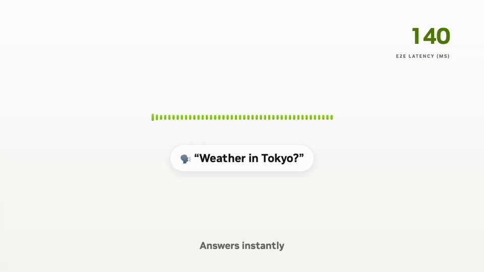
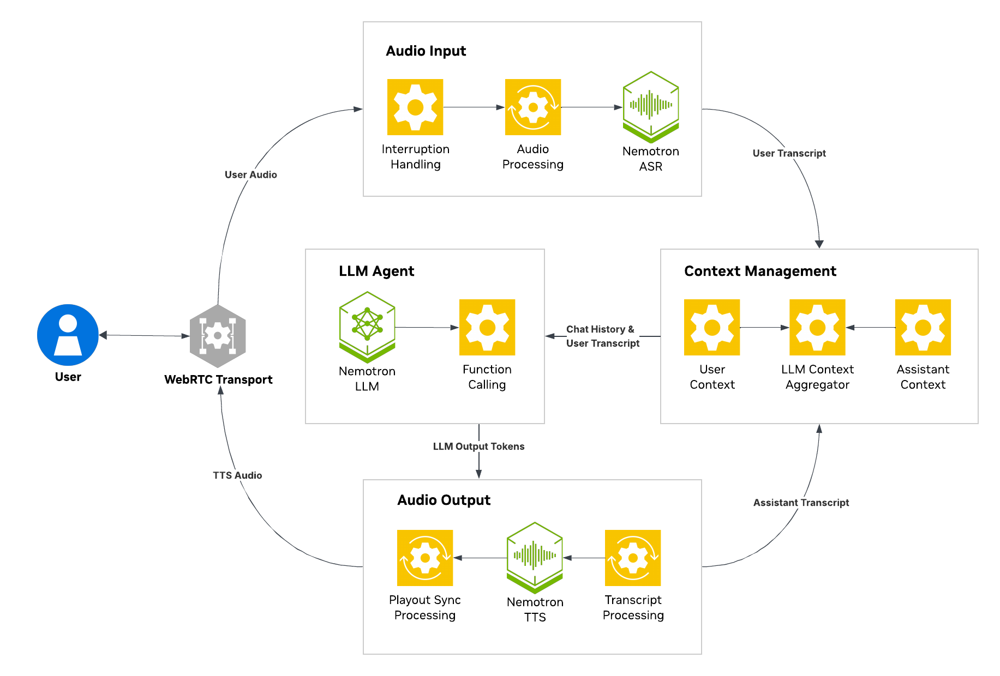

# Nemotron Voice Agent

[](LICENSE) [](https://build.nvidia.com/) [](https://github.com/pipecat-ai/pipecat) [](https://brev.nvidia.com/launchable/deploy?launchableID=env-3GGgfIXCnso410yatOZD24ufRJ2)

**[Why](#-why-this-blueprint)** • **[Quick Start](#-quick-start)** • **[Examples](#-examples)** • **[Documentation](#-documentation)** • **[News](#-news)** • **[Roadmap](#-roadmap)**



Nemotron Voice Agent Blueprint provides a comprehensive, end-to-end voice agent built with open NVIDIA Nemotron models and NVIDIA NIM for acceleration and scaling. It is designed to guide developers through the creation of a cascaded pipeline, integrating Nemotron ASR, LLM, and TTS, while solving for the complexities of streaming, interruptible conversations. Clone it, swap in your own logic, and deploy a working voice AI prototype in hours.

Built on the open-source [Pipecat](https://github.com/pipecat-ai/pipecat) and [LiveKit Agents](https://github.com/livekit/agents) frameworks and leveraging NVIDIA NIM microservices, this example helps teams accelerate the deployment of high-performance voice AI solutions.

## ✨ Why This Blueprint

The blueprint provides reference pipelines for building and evaluating voice agents.

- **Measured latency at scale**: the [historical four-B200 benchmark table](docs/04-evaluation-and-performance.md#reference-results) reports server-side end-to-end latency below one second at each tested concurrency, up to 64 streams. This is not a measurement of browser playback latency.
- **Fully open models**: Nemotron Streaming and Parakeet ASR, Magpie TTS and Nemotron LLM models. Swap any component, self-host, no lock-in.
- **Interruption Handling**: Voice Activity Detection (VAD) and End-of-Utterance (EOU) logic to guide the agent on exactly when to start and stop speaking, ensuring a natural conversational flow.
- **Multilingual Capabilities**: native support for multiple languages provided by NVIDIA Magpie TTS and Multilingual ASR.
- **Multimodal Understanding**: reason over speech and vision together, analyzing live camera input and uploaded media (images, documents) within a single conversation, powered by Nemotron Omni.
- **Multi-Agent and Tool Calling**: orchestrate cooperating agents that invoke external tools and functions for task-oriented workflows, while decoupling reasoning from response generation for lower perceived latency.
- **Voice Agent Builder Skill**: quickly scaffold and refine cascaded or Omni voice agents from scratch with NVIDIA models using Pipecat or LiveKit.
- **Edge Support**: deploy anywhere, from cloud and workstation to DGX Spark and edge devices like Jetson Thor, using self-contained deployment recipes.
- **OpenAI Realtime–compatible gateway**: `WS /v1/realtime` alongside RTVI `/api/ws`. See [Use the Realtime Gateway](docs/how-to/use-realtime-gateway.md).

---

## 📣 News

Highlights from the [2.4.0 changelog](CHANGELOG.md#240---tbd) include the following:

- **v2.4.0**
  - Generic Assistant on LiveKit Agents with Cloud, Server, Single GPU, and optional SIP phone call profiles.
  - Frontend/Backend Live example and `/v1/live` gateway for responsive voice interaction with delegated backend work.
  - Nemotron 3.5 Transcribe ASR on Server and Single GPU recipes, and NVIDIA Dynamo recipes.
  - Nemotron 3.5 Super VL on NVIDIA Cloud.

<details>
<summary>Previous releases</summary>

- **[October 2026] v2.3.1**
  - Nemotron 3.5 Bolt E4B on NVIDIA Cloud, server, and single-GPU hosts, with Conversational Mode.
  - Nemotron 3.5 Bolt 74B A9B on single-GPU hosts.

- **[October 2026] v2.3.0**
  - Nemotron 3.5 Super VL on server and single-GPU hosts.
  - Speaker labels for the Generic Assistant, with single-speaker and multi-speaker modes.
  - Streaming-input LLM prefill for lower TTFT with single-GPU Lightning and Super VL.
  - Live service status in the Services tab, and Pipecat 1.12.0.

- **[September 2026] v2.2.0**
  - Expanded open model support with Nemotron 3.5 Lightning and Nemotron 3 Nano NIM.
  - Unified local deployment across workstations, DGX Spark, and Jetson Thor.
  - OpenAI Realtime API compatibility for external voice clients.
  - Agent Skills for building voice agents with Nemotron.
- **[July 2026] v2.0.0**
  - Omni-based example showcasing a single multimodal model replacing the ASR + LLM stages.
  - Omni subagents example demonstrating multi-agent coordination for audio and video understanding.
  - Frontend/backend agent example showing how to integrate an existing text-based agentic backend with a voice frontend.
  - New models: Nemotron 3 Super 120B A12B, Nemotron 3 Nano Omni, Nemotron ASR Streaming (English + Multilingual).
- **[March 2026] v1.0.0**
  - Generic cascaded pipeline (Parakeet ASR + LLM + Magpie TTS) with English and multilingual support.

</details>

See the [CHANGELOG](CHANGELOG.md) for the full release history.

---

## 🏗️ Architecture



---

## 🧩 Models and Services

| Component | Model | Swap with |
|-----------|-------|-----------|
| **ASR** | [Nemotron ASR Streaming](https://build.nvidia.com/nvidia/nemotron-asr-streaming/modelcard) | Any NIM ASR |
| | [Nemotron 3.5 Transcribe 30B A4B](https://huggingface.co/nvidia/NVIDIA-Nemotron-3.5-Transcribe-30B-A4B) | |
| | [Parakeet CTC 1.1B ASR](https://build.nvidia.com/nvidia/parakeet-ctc-1_1b-asr/modelcard) | |
| | [Parakeet 1.1B RNNT Multilingual ASR](https://build.nvidia.com/nvidia/parakeet-1_1b-rnnt-multilingual-asr/modelcard) | |
| **TTS** | [Magpie TTS Multilingual](https://build.nvidia.com/nvidia/magpie-tts-multilingual/modelcard) | Any NIM TTS |
| | [Magpie TTS Zeroshot](https://build.nvidia.com/nvidia/magpie-tts-zeroshot/modelcard) | |
| | [Chatterbox TTS Multilingual](https://build.nvidia.com/resembleai/chatterbox-multilingual-tts/modelcard) | |
| **LLM** | [Nemotron 3.5 Lightning 30B A3B](https://build.nvidia.com/nvidia/nemotron-3.5-lightning-30b-a3b/modelcard) | Any OpenAI-compatible |
| | [Nemotron 3.5 Super VL 120B A12B](https://build.nvidia.com/nvidia/nemotron-3.5-super-vl-120b-a12b/modelcard) | |
| | [Nemotron 3.5 Bolt 74B A9B](https://huggingface.co/nvidia/NVIDIA-Nemotron-3.5-Bolt-74B-A9B-24GB) | |
| | [Nemotron 3.5 Bolt E4B](https://build.nvidia.com/nvidia/nemotron-3.5-bolt-e4b) | |
| | [Nemotron 3 Nano Omni 30B A3B](https://build.nvidia.com/nvidia/nemotron-3-nano-omni-30b-a3b-reasoning) | |
| **Orchestration** | [Pipecat](https://github.com/pipecat-ai/pipecat) | [LiveKit Agents with NVIDIA plugin](https://github.com/livekit/agents/tree/main/livekit-plugins/livekit-plugins-nvidia) |

---

## 🧪 Examples

Each example showcases a **pattern** for building a voice pipeline. Start from the one closest to your use case and adapt it. Follow each example's own README (linked below) for its architecture, supported recipes, configuration, and tunables.

| Example | Description | When to use | Supported Deployment Profiles |
|---------|-------------|-------------|--------------------|
| [Generic Assistant](src/nemotron_voice_agent/pipecat/examples/generic/README.md) | Baseline **English-only** cascaded pipeline with Nemotron streaming ASR by default, optional whole-turn Transcribe ASR, Nemotron LLM, and Magpie TTS. Optional speaker labels isolate the first speaker or label a multi-speaker conversation. | Best for getting started and prototyping, before tailoring to a specific domain. | Cloud, Server (workstation), Single GPU (workstation, DGX Spark, Jetson Thor), Dynamo (workstation) |
| [Multilingual Assistant](src/nemotron_voice_agent/pipecat/examples/multilingual/README.md) | Cascaded pipeline using **Multilingual ASR and TTS**, with a fixed language per session for better reliability. Optional Transcribe ASR. | Use for non-English and multi-language voice agents. | Cloud, Server (workstation), Single GPU (workstation, DGX Spark, Jetson Thor), Dynamo (workstation) |
| [Nemotron Omni Assistant](src/nemotron_voice_agent/pipecat/examples/omni_assistant/README.md) | Cascaded pipeline using **Nemotron Omni**, where a single model replaces the ASR + LLM stages and Magpie TTS speaks the reply. | Comparing a cascaded ASR + LLM + TTS pipeline against an Omni-based one. | Cloud, Server (workstation), Single GPU (workstation, DGX Spark, Jetson Thor) |
| [Nemotron Omni Assistant Subagents](src/nemotron_voice_agent/pipecat/examples/omni_assistant_subagents/README.md) | Multi-agent **Nemotron Omni** pipeline where specialized agents add audio/video and live-webcam understanding while the voice loop stays responsive. | Recommended for multimodal inputs, giving a richer experience across image, audio, video, and webcam. | Cloud, Server (workstation), Single GPU (workstation, DGX Spark) |
| [Frontend/Backend Live](src/nemotron_voice_agent/pipecat/examples/frontend_backend_live/README.md) | Bluebird Cafe assistant with a routing talker and a choice of backend LLM, LLM agent, or external agent such as Hermes. Apps connect through `/v1/live`. | Keep voice interaction responsive while delegated work runs separately. | Cloud, Server (workstation), Single GPU (workstation, DGX Spark, Jetson Thor) |
| [Generic Assistant on LiveKit](src/nemotron_voice_agent/livekit/examples/generic_assistant/README.md) | Cascaded pipeline on **LiveKit Agents** with the NVIDIA plugin, Nemotron ASR, Nemotron LLM, and Magpie TTS. It has its own web UI with sample use cases, and optional phone calls through SIP. | Use when you build on LiveKit, or when callers reach the agent by phone. | Cloud, Server (workstation), Single GPU (workstation, DGX Spark and Jetson Thor not validated) |

> **Note:** The listed deployment profiles are what ship in the default configs, not a hard limit. Each linked example README lists its default models by profile. The examples can be extended with other hardware configurations or models. Those configurations are not included by default.

---

## 📋 Requirements

These are the minimum requirements, and support varies by example and deployment profile. See the [Examples](#-examples) table for what runs where, and each example's README plus the [LLM](docs/how-to/configure-llm.md) / [ASR](docs/how-to/configure-asr.md) / [TTS](docs/how-to/configure-tts.md) Services docs for exact models and corresponding VRAM usage.

### Hardware Requirements

| Deployment Profile | Hardware | Notes |
|------|----------|-------|
| Cloud | CPU only (no GPU) | Model endpoints from NVIDIA cloud APIs (NVCF). |
| Server | NVIDIA GPU workstation. GPU count and memory depend on the selected models and scale. | Scaling-oriented NIM deployment. DGX Spark and Jetson Thor are not supported for this profile. Default all-on-one-GPU layout is about 80 GB. The `frontend-backend-live/server` recipe also runs the Nemotron 3.5 Super VL NIM on GPUs `1` and `2`, so it needs three GPUs. When that NIM is not running, the recipe's backend runs on the Lightning NIM. The optional Nemotron 3.5 Bolt E4B NIM runs in place of the Lightning NIM. Size it using the [NIM support matrix and LLM sizing guide](docs/how-to/configure-llm.md#vram--hardware-support). The optional Nemotron 3.5 Transcribe NIM runs on GPU `1` by default, so it needs a second GPU. |
| Performance Server | Four-GPU Blackwell workstation | `generic-assistant/server-perf` load benchmark only, not a browser UI session. |
| Single GPU | 1 workstation GPU, DGX Spark, or Jetson Thor | Uses the universal `*/single-gpu` recipes. Nemotron 3.5 Lightning workstations need at least 28 GiB usable VRAM. Nemotron 3.5 Super VL is optional and needs a Blackwell GPU, DGX Spark, or Jetson Thor with at least 78 GiB usable memory. Nemotron 3.5 Bolt 74B is optional and needs a Blackwell workstation GPU (SM120) or DGX Spark with at least 32 GiB usable memory. Nemotron 3.5 Bolt E4B is optional and needs at least 24 GiB usable memory on a supported workstation GPU, DGX Spark, or Jetson Thor. Jetson Thor requires JetPack 7.0. Orin is not supported. Follow the [LLM sizing guide](docs/how-to/configure-llm.md#vram--hardware-support) and, when applicable, the [Jetson Thor guide](docs/03-jetson-thor.md). |

### Software Requirements

Credentials depend on the deployment profile. Do not mix them, except for Dynamo, which needs both.

- **Cloud, Server, and Performance Server**: an **NVIDIA API Key** (`NVIDIA_API_KEY`) from [build.nvidia.com](https://build.nvidia.com/). Server (`*/server`) and Performance Server (`generic-assistant/server-perf`) also need valid **NVIDIA NGC** credentials to pull NIM container images (refer to the [NGC Getting Started Guide](https://docs.nvidia.com/ngc/ngc-overview/index.html#registering-activating-ngc-account)) and a `docker login nvcr.io`.
- **Single GPU**: a **Hugging Face token** (`HF_TOKEN`) for model downloads and NVIDIA driver 580.x or newer for NeMo-Speech.cpp. It does not require `NVIDIA_API_KEY` or authentication with `docker login nvcr.io`.
- **Dynamo**: the `*/dynamo` recipes need both the Server credentials (`NVIDIA_API_KEY` and `docker login nvcr.io`) for the speech NIMs and `HF_TOKEN` for the LLM weights.
- **Docker**: Docker Compose 2.24.4 or newer. Cloud needs Docker only. Server, Performance Server, Single GPU, and Dynamo also need Docker with NVIDIA GPU support ([NVIDIA Container Toolkit](https://docs.nvidia.com/datacenter/cloud-native/container-toolkit/latest/install-guide.html)).

---

## 🚀 Quick Start

Run the Pipecat Generic Assistant using NVIDIA Cloud endpoints, with no local GPU required. For local Server, Single-GPU, and Dynamo recipes, refer to [Getting Started](docs/01-getting-started.md). For LiveKit, follow the [Generic Assistant on LiveKit guide](src/nemotron_voice_agent/livekit/examples/generic_assistant/README.md).

### With the Agent Skills

Install the skills, then ask your coding agent to deploy or configure your chosen example:

```bash
npx skills add .
```

### Manual Steps

You need Docker Compose 2.24.4 or newer and an NVIDIA API key from [build.nvidia.com](https://build.nvidia.com/). This cloud recipe does not require an NGC registry login.

1. Clone the release branch over HTTPS.

    ```bash
    git clone --branch release_v2.4.0 https://github.com/NVIDIA-AI-Blueprints/nemotron-voice-agent.git
    ```

2. Change to the repository root.

    ```bash
    cd nemotron-voice-agent
    ```

3. Create `.env` only if it does not exist.

    ```bash
    test -f .env || cp .env.example .env
    ```

4. Set `NVIDIA_API_KEY` in `.env`.
5. Start the cloud recipe.

    ```bash
    docker compose --profile generic-assistant up -d
    ```

6. Open `https://localhost:7860/` on the Docker host. For a remote browser, use `https://<machine-ip>:7860/`. Keep TLS enabled for browser microphone access. For certificate warnings or connection failures, refer to [Browser Access](docs/06-troubleshooting.md#browser-access).
7. Select **Connect**.
8. Allow microphone access if the browser prompts you.
9. Ask a question after the greeting finishes. The assistant should answer aloud.
10. Select **Disconnect** to end the session.
11. Stop the deployment when you finish.

    ```bash
    docker compose --profile generic-assistant down
    ```

---

## 🤖 Agent Skills

This repository includes AI agent skills for deployment assistance. Install them for your coding agent with:

```bash
npx skills add .
```

- [`nemotron-voice-agent-builder`](skills/nemotron-voice-agent-builder/SKILL.md): scaffold, refine, or fix cascaded or Omni voice agents with NVIDIA models using Pipecat or LiveKit.
- [`nemotron-voice-agent-deploy`](.agents/skills/nemotron-voice-agent-deploy/SKILL.md): recipe-family auth (`NVIDIA_API_KEY` + NGC login for `*/server`, `HF_TOKEN` only for `*/single-gpu`), profile selection, compose bring-up, and `.env`, prompt, service, and setting changes to a running deployment.

---

## 📖 Documentation

| Type | Guide | Description |
|------|-------|-------------|
| Tutorial | [Getting Started](docs/01-getting-started.md) | Full deployment: quick start, local GPU, DGX Spark, and the recipe matrix |
| Launchable | [Brev Launchable](notebooks/brev_launchable.ipynb) | Deploy a Pipecat `*/server` or `*/single-gpu` profile on a Brev instance. Server profiles require `NVIDIA_API_KEY` and an NGC Docker login. Single-GPU profiles use local vLLM and NeMo-Speech.cpp. Switching profiles restarts application containers while preserving the Brev VM, Jupyter, and caches by default. `RESET_VOLUMES=True` removes Compose-managed named volumes but preserves the host Hugging Face cache. |
| How-to | [Configuration Guide](docs/02-configuration-guide.md) | Index of all configuration and customization guides |
| Reference | [LLM](docs/how-to/configure-llm.md) · [ASR](docs/how-to/configure-asr.md) · [TTS](docs/how-to/configure-tts.md) Models | NVIDIA model catalogs, VRAM usage and model configs |
| How-to | [Jetson Thor](docs/03-jetson-thor.md) | Edge deployment guide for the `*/single-gpu` recipes |
| Reference | [Evaluation & Performance](docs/04-evaluation-and-performance.md) | Accuracy and latency/scaling benchmarks |
| Explanation | [Best Practices](docs/05-best-practices.md) | Production latency, UX, and scaling guidance |
| How-to | [Troubleshooting](docs/06-troubleshooting.md) | Startup & deployment known issues |
| How-to | [Realtime Gateway](docs/how-to/use-realtime-gateway.md) | OpenAI Realtime–compatible `WS /v1/realtime`: how it works and how to connect |
| How-to | [Live Gateway](docs/how-to/use-live-gateway.md) | The Frontend/Backend Live example's `/v1/live` session API: routes, delegation modes, and settings |
| Tutorial | [Generic Assistant on LiveKit](src/nemotron_voice_agent/livekit/examples/generic_assistant/README.md) | Deploy and configure the LiveKit example |
| How-to | [Phone Calls (SIP)](src/nemotron_voice_agent/livekit/examples/generic_assistant/SIP.md) | Connect a phone number to the LiveKit example over SIP |

Step-by-step **how-to guides** are indexed in the [Configuration Guide](docs/02-configuration-guide.md). They cover configuring .env, models, and prompts, enabling opentelemetry tracing, a TURN Server, and the audio recorder for debugging, plus the Realtime integrator gateway, the Live gateway, and connecting an agent harness.

---

## 🗺️ Roadmap

Planned for future releases:

- Voice agent integrations for NemoClaw-supported harnesses.

Recent releases are in [News](#-news). See the [CHANGELOG](CHANGELOG.md) for the full release history.

---

## ⚖️ License

This NVIDIA AI BLUEPRINT is dual-licensed: documentation, skills, and assets under CC-BY-4.0, and source code under Apache-2.0. See [LICENSE](LICENSE) for details. This project may download and install additional third-party open source software and containers. Review the license terms of these projects in [THIRD_PARTY_NOTICES.txt](THIRD_PARTY_NOTICES.txt) before use.
