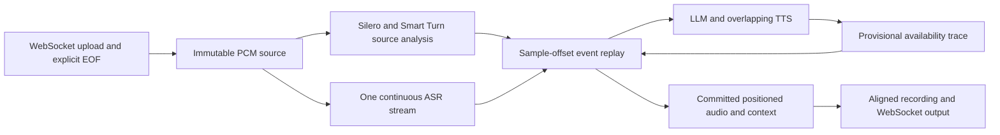

# Offline Generic-Assistant Evaluation

Status: experimental implementation. Historical recordings from October 15 use
the prototype based on commit `dc60ebb` with Pipecat 1.3.0. That base commit does
not contain the offline feature. This pull request ports the
implementation to the current `develop` branch, which pins Pipecat 1.12.0. The
saved recordings do not validate this new revision or its changed defaults.
All human-readable latency values below are milliseconds. Wire positions remain
integer samples; raw execution timers remain nanoseconds.

## Problem and Scope

The experimental `/api/ws/offline` endpoint accepts a finite 16 kHz mono PCM16
session, including silence, without input or output presentation pacing. It
seals the upload, runs one continuous streaming ASR request, detects turns on
source sample offsets, and schedules generated responses against the source.
The normal `/api/ws` and WebRTC paths keep their existing behavior.

The goal is to upload an entire user recording as fast as the connection allows
and produce a bot recording on the same audio timeline. Speech, input silence,
turn detection, provider readiness, interruption, and the final response tail
must retain explicit positions even when execution finishes much sooner than the
recording's duration. This supports finite-session accuracy and alignment
experiments. Real-time presentation sleeps and receive inactivity cannot define
those positions.

The provider stages are automatic speech recognition (ASR), a large language
model (LLM), and text-to-speech (TTS). Voice activity detection (VAD) identifies
speech intervals before the endpoint policy decides that a turn is complete.

This is a separate finite-session execution engine. It reuses the generic
assistant's configuration, prompt, tools, summary policy, Silero, and Smart Turn,
but calls ASR/LLM/TTS through offline adapters instead of running the live
Pipecat frame-processing pipeline. It does not make the existing live pipeline
operate under a virtual clock, or establish identical live accuracy or latency.

### Supported Configuration

The current adapter supports the generic cascaded assistant with a continuous
Riva ASR stream, an HTTP chat-completions LLM endpoint, and stitched Magpie TTS.
It preserves catalog/session selections for the ASR model, language, and
punctuation, LLM temperature, token limit, tool choice, and TTS voice/language.
The per-session configuration fingerprint records the resolved choices.

Source detection honors the shared turn-policy settings. Smart Turn mode uses
a 200 ms Silero stop threshold and the shared 1,000 ms fallback by default.
`SMART_TURN_STOP_SECS` overrides the fallback. Set
`USE_SILERO_VAD_TURN_DETECTION=true` for Silero-only detection;
`SILERO_VAD_STOP_SECS` then controls its stop threshold, which defaults to 500 ms.
The `*_SECS` environment variables accept values in seconds.

Streaming-input LLM URLs using `ws://` or `wss://`, per-sentence synthesis,
zero-shot TTS models, and zero-shot audio prompts are rejected explicitly.
This endpoint does not expose the OpenAI Realtime gateway protocol. The existing
`/v1/realtime`, `/api/ws`, and WebRTC paths retain their own behavior.

## Architecture and Wall-Clock Audit

Changing the output sleep alone is insufficient. Advancing a shared clock to the
last uploaded sample also breaks causality: a bulk upload can reach EOF while a
response to the first turn is still computing. This endpoint seals an immutable
source and replays a chronological event queue. Detection and recognition may
analyze ahead; only events reached on the presentation timeline may affect the
conversation. Generation produces a provisional trace, and replay decides which
audio and context changes actually survive an interruption.



| Existing generic/Pipecat behavior | Offline replacement |
| --- | --- |
| Silero speech/silence thresholds already count model windows | Preserve thresholds with fixed 512-sample windows, independent of transport packets |
| Silero recurrent-state reset uses five wall-clock seconds | Reset at source-sample boundaries |
| VAD `audio_idle_timeout` forces a stop when frames stop arriving | Source silence or explicit EOF; upload watchdog only fails a stalled session |
| Speech-timeout policy and Smart Turn's STT timeout can stop a turn after elapsed time | Audio endpoint plus final-ASR availability; no interim-transcript inactivity guess |
| Smart Turn buffer retention and speech start use monotonic time | Source offsets for buffer selection and speech boundaries |
| Streaming STT keepalive can insert audio after wall-clock inactivity | Finite source iterator, unchanged source silence, explicit request EOF |
| WebSocket output pacing and output-queue idle behavior | Positioned spans; zero-filled gaps during rendering |
| Bot-speaking notifications and TTS idle stop-frame timer | Scheduled playback start/end plus synthesis EOF |
| Assistant context follows asynchronous output notifications | Commit only completed playback or the aligned played prefix |
| Audio-buffer recorder aligns frames using arrival timestamps | Canonical ingress WAV and committed bot spans at absolute sample offsets |
| Wall-clock user/bot latency observer | Source events and measured provider availability stored separately |
| Pipeline/session inactivity timers | Explicit finite-session completion and failure-only watchdogs |

The module boundaries keep scheduling policy independent of transport, model
execution, and files:

| Boundary | Responsibility and contract |
| --- | --- |
| `models.py` | Immutable source/trace/span records and the narrow `Detector`, `Recognizer`, and `Responder` protocols |
| `detection.py` | Source-only speech/endpoint decisions, source-indexed model state and buffers, measured endpoint computation |
| `providers.py` | One finite continuous ASR call, streaming LLM/TTS capture, observed execution measurements and optional word alignment |
| `engine.py` | Chronological replay, turn readiness, private response snapshots, interruption, and conversation/audio commitment |
| `recorder.py` | Validate and render committed nonoverlapping spans into zero-filled PCM and save the audit files |
| `protocol.py`, `websocket.py` | Validate bounded uploads and explicit EOF, own cancellation/watchdogs, publish output and metrics |
| `factory.py` | Compose generic services and session-owned resources from the existing catalogs/configuration |

These boundaries apply SOLID principles concretely: each module has one reason
to change; new backends implement small provider protocols; the scheduler depends
on those protocols rather than Riva/OpenAI/WebSocket classes; adapters must obey
the same trace invariants; and alternate recording or transport code consumes
the same committed result. A new backend still needs adapter contract tests,
especially for source coverage and word timestamps. No global Pipecat clock is
patched.

## Execution and Timing

There are two time domains. Upload progress is transport bookkeeping and does not
advance either conversation or playback.

| Domain | Representation | Used for |
| --- | --- | --- |
| Source/presentation time | Absolute integer samples at 16 kHz; offset 0 is the first input sample | Speech and endpoint positions, causal replay, response placement, clipping, silence, recording extent |
| Observed execution time | Monotonic elapsed nanoseconds, reported as milliseconds | Provider/endpoint compute observations, upload/runtime/publication measurements, failure watchdogs |

Measured execution durations are deliberately retained and projected onto the
sample timeline. Removing those durations would put bot replies too early. A
failure watchdog can abort a stalled request but cannot end a user's turn or
manufacture audio.

Silero runs in fixed 512-sample windows; its reset schedule and Smart Turn's
buffer selection use source offsets. No missing-packet timeout manufactures a
speech stop. Source EOF explicitly closes a pending user turn.

ASR and detection are source-only preprocessing. Future transcripts cannot enter
conversation history until their source turn and recognition availability are
reached. Late recognition during newer speech defers/coalesces pending input.
Responses run against private history snapshots. Tool/summary context updates
are provisional until their scheduled availability; cancelled future events
are dropped.

LLM text is sent to a persistent Magpie synthesis stream while generation is
still in progress. Each PCM chunk retains measured availability relative to the
response request. Its playback begins at the later of availability and preceding
playback end. Gaps are silence. User speech interrupts at the VAD confirmation
offset; a chunk is clipped exactly and unplayed response samples are discarded.
Synthesis EOF and playback end are distinct.

Define `S(ns) = ceil(ns * 16000 / 1_000_000_000)`. This rounds forward so an
observation can never make audio available before its measured readiness.

For user turn `t`, readiness is:

```text
turn_ready[t] = max(endpoint_sample[t] + S(endpoint_compute_ns[t]),
                    latest_available_sample_of_ASR_segments_owned_by_t)
```

A response is requested only after every seen pending turn is ready, no user
speech is active, and no response remains active. Recognition that arrives while
newer speech is active can therefore defer/coalesce several detected turns into
one request. Source decisions at the same sample are processed before a request;
confirmed speech start also wins ties against output/context completion.

For response request sample `r`, measured chunk availability `c_i_ns`, and chunk
length `n_i`:

```text
start_i = max(r + S(c_i_ns), end_(i-1))
end_i   = start_i + n_i
```

The response remains active through the later of playback end and provider
completion. Interruption at sample `s` retains only PCM before `s`, including a
partial final chunk. Recording and wire output use these same committed spans.

The runtime first completes source detection and continuous ASR concurrently,
then captures each requested response and replays its measured availability.
It does not sleep through source silence. Whole-session wall execution and
source-timeline turn gaps consequently measure different things.

The original generic prompt, service catalogs, tool schemas, text filter, and
pinned history-summary policy are reused. Automatic introduction is disabled
for this finite-session mode. Summary work happens before the next LLM request,
inside response capture, and its observed execution is included in that trace.

Provider word timestamps are requested when the installed Riva protocol supports
them. Valid ordered timings retain only the played word prefix after interruption.
This assumes cumulative offsets across the response's synthesis submissions;
confirm that contract with the selected live TTS backend. The adapter preserves
word metadata on the final metadata-only chunk. Bounds and first-seen order are
validated; invalid offsets are never
sorted into a seemingly valid alignment.
When timestamps are absent or invalid, interrupted assistant text is omitted
from history and the manifest explicitly reports that policy; unplayed full text
is never inserted as if it had been spoken.

### Measurement Limits

The implementation measures **server-observed provider elapsed time**, including
RPC transport and queueing. It does not claim pure GPU execution time. Playback
uses the overlapping LLM/TTS trace rather than summing independent durations.

Continuous ASR associates finals with word offsets and `audio_processed`. Its
current availability policy is recorded as
`source_dependency_plus_observed_bulk_residual`. For each final:

```text
dependency_sample = max(reported_audio_processed_sample, latest_word_end_sample)
residual_ns       = max(0, final_arrival_ns - dependency_chunk_supplied_ns)
available_sample  = max(previous_available_sample,
                        dependency_sample + S(residual_ns))
```

The supply observation is when the ASR request iterator yields the dependency's
512-sample chunk, not when the backend receives or finishes it. This residual
includes rapid-input backlog, RPC/transport, and backend queueing/processing.
Reported coverage may also include silence after a word. Adding that residual to
its source dependency is an explicit projection policy, not a measurement of
how a paced live stream would behave. The live runs confirmed that the adapter
works with the selected backend; paired live runs are still required to validate
latency/accuracy fidelity. Pure GPU inference time is unavailable here.

The source detector deterministically includes its current endpoint window.
Live Pipecat frame-queue ordering and its initial wall-clock Silero reset may
differ slightly. Compare paired cases before claiming identical task outcomes.
Current `develop` also uses `NvidiaForceEouSTTService` in the live generic path.
It sends an 80 ms silence chunk tagged with `force_eou` at VAD stop. Offline
recognition preserves the finite source and does not insert keepalive silence
or force-EOU requests; the manifest records `asr_force_eou: false`. A shared
source-indexed ASR endpoint policy is additional fidelity work, not a property
of the current continuous adapter.
The trace runtime can compute audio that is subsequently discarded by a simulated
interruption; its compute totals include that work. It does not reproduce the
compute savings of real-time cancellation. External read-only tools can return
different dates, random values, or online data across independent evaluations.

Execution watchdogs remain real-time failure checks for upload, RPC, processing,
and publication. They never advance conversation time or fabricate silence.

### Causality and Recording Invariants

The runtime enforces the following invariants:

* Input is immutable after a length, packet-count, and hash-validated EOF. Silence
  is ordinary source PCM; disconnect is cancellation rather than implicit EOF.
* Source-only models can inspect ahead, but future source speech/transcripts
  cannot enter a response's history before replay reaches their dependency and
  readiness positions.
* ASR remains one continuous request for the entire recording. Recognition
  ownership uses the turn-start-to-endpoint half-open interval, with an explicit
  source-EOF point rule. This retains quiet trailing words after VAD speech end;
  missing or ambiguous ownership fails instead of silently dropping text.
* Provider outputs and tool/summary context changes are provisional. Replay
  commits only events reached before interruption; generation never mutates
  shared history directly.
* Interruption occurs at VAD-confirmed speech start. It is not backdated to the
  raw speech onset. Unplayed audio and future context events are discarded.
* Committed bot spans are ordered and nonoverlapping. Unfilled positions are
  exactly zero; there is no wall-clock idle-silence generator.
* Output covers `max(input_sample_count, last_committed_bot_sample)`. Explicit
  EOF can finish a pending user turn, and the final reply can extend past input.

### Recorded Latency Metrics

New sessions record observed ASR first response, first nonempty transcript, first
final transcript, input supply/EOF and per-final source dependency/residual
timing. Each LLM request round records dispatch, first response/text and stream
completion. TTS records first text queued/consumed, first audio, last audio and
stream EOF; its input-to-first-audio timer excludes earlier sentence aggregation.
These timers include transport and provider queueing, rather than isolating GPU
execution.

`metrics.server` records upload, runtime construction/execution, recording,
publication and source-sealed-to-first-output-send timings. Its batch E2E scope
ends at precompletion, before the final metrics-manifest rewrite and completion
frame send. These are execution measurements. Rendered turn gaps use sample
positions and can include endpoint silence, ASR projection and deferred playback.
Offline wire publication follows whole-session processing, so wire TTFB and
source-timeline first response describe different events.

Extract per-session, per-response, ASR-final and LLM-round tables from saved runs:

```bash
uv run python benchmarking_tools/offline-eval/extract_metrics.py \
  --input-dir saved_run --output-dir extracted_metrics --run-label trial_01
```

Missing observations in older recordings remain null. New probe values require
new recordings; never attach a repeat run's timings to earlier audio. Bulk ASR
residual includes queueing from rapid input supply and must not be interpreted as
the latency of a paced live ASR stream. The extracted JSON includes definitions
and the hashes of the input trace files.

## Run

Configure and start the normal generic server using the existing service catalog
and credentials. The selected deployment must allow the generic assistant.

```bash
EXAMPLE_SELECTION=generic-assistant PIPELINE_TLS=false uv run python src/server.py
```

The sample client lives in `benchmarking_tools/offline-eval/client.py` and uses
the root benchmark dependencies:

```bash
uv sync --group benchmark
uv run python benchmarking_tools/offline-eval/client.py \
  --url ws://127.0.0.1:7860/api/ws/offline \
  --input query_1.wav query_2.wav query_3.wav \
  --gap-seconds 8 --duration-seconds 300 --output-dir offline_run_01
```

Input recordings are preserved and separated by the requested silence. The
client pads to the requested session length and refuses to shorten recordings.
For an already assembled recording use `--input session.wav --gap-seconds 0`.
`--upload-speed 0` sends in bulk; `--upload-speed 1` paces the upload for comparison.
Upload pacing does not determine server presentation timestamps.

For a small selection of individual Full-Duplex-Bench (FDB) inputs, use the batch
runner:

```bash
uv run python benchmarking_tools/offline-eval/run_fdb_samples.py \
  --manifest cases.json --url ws://127.0.0.1:7860/api/ws/offline \
  --config config.json --output-dir fdb_offline_run
```

The manifest is `{"cases":[{"id":"case-1","input":"canonical.wav","provenance":{}}]}`.
Relative inputs resolve beside the manifest. Supply already normalized 16 kHz
mono PCM16 and record any conversion in provenance. Each case keeps a separate
conversation. Upload has no pacing and defaults to the server's maximum
65,536-sample packets, capped to the negotiated limit. The runner additionally
writes `input.wav` and a stereo `comparison.wav` with user input left and bot
output right. Channels retain exact samples; the user side is padded for the
bot's final tail. A connection/provider failure produces failure status without
fabricated output audio.

Optional `--config config.json` supplies the existing generic prompt/service
selection keys. Alternatively create a normal `/api/session-config` session and
add `?session_id=...` to the offline endpoint. Process-local session IDs remain
unsupported in multi-worker deployments; direct handshake configuration works.

## Recording

Set `OFFLINE_AUDIO_DUMP_PATH` to a server-owned output directory. Its default is
`audio_dumps/offline`. Each sealed session gets a generated UUID directory:

* `source.wav`: canonical ingress recording, before any service/turn filtering.
* `full_output.wav`: committed bot PCM at explicit offsets, with zero-filled gaps.
* `events.jsonl`: source, availability, interruption, playback, and context events.
* `manifest.json`: source/output extents, compute trace, messages, and configuration fingerprint.
* `failure.json`: failure status when execution does not finish successfully.

The output extent is `max(source_end, final_committed_response_end)`. A 300-second
source has at least 300 seconds of output; a final response may extend it. The
client additionally writes a source-horizon `output.wav` view for the existing
NVA FDB adapter. Benchmark-specific cropping belongs in that adapter, not the
server. Do not concatenate independent FDB cases for official scoring.

## Wire Contract

The version is `nva.offline.v1`. The client first sends `offline.session.start`
with rate, channels, encoding, input sample count, and optional generic `config`.
The server acknowledges capabilities and bounds before receiving PCM.

Binary packets begin with a network-order `!4sQQI` header: magic, sequence,
absolute start sample, sample count. `NVAI` means input and `NVAO` means committed
output. PCM is little-endian signed 16-bit mono. Input packets must be contiguous
and ordered. Output may omit silence but must be nonoverlapping and ordered.
Sample offset zero and partial final packets are valid.

`offline.input.complete` contains input sample count, packet count, and SHA-256.
It seals the source; disconnect is cancellation, not EOF. The server streams
committed output/events and ends with `offline.session.complete`, including
rendered sample count, output packet count, status, and configuration fingerprint.
Input after EOF is rejected throughout processing and publication. Failures use
`offline.session.error`; no success recording is inferred from receive inactivity.

## Validation

Run unit and in-process WebSocket tests without model or judge endpoints:

```bash
uv run pytest tests/unit/test_offline*.py
```

Tests cover source-window thresholds, reset offsets, partial EOF, one continuous
ASR stream, stream draining, late/multiple recognition segments, future-context
suppression, summary/tool ordering, overlapping text/audio production, exact
interruption clipping, silence, final extension, malformed uploads, disconnect,
watchdog failure, and recording extent. Recorded traces make packetization and
arrival-pause comparisons deterministic.

`tests/unit/test_offline_client_integration.py` runs the actual sample client and timeline
engine together with deterministic provider traces. A 300-second session is
uploaded using 511-, 512-, and 32768-sample packets and at 200 times audio speed.
It verifies identical events and identical 301-second server/client WAVs, a
confirmed-speech interruption, synthesis availability gaps, and final extension.
These are alignment checks, not speech accuracy or provider speed measurements.

### Current Revision Validation

The Pipecat 1.12.0 port passed the full unit suite: **684 tests passed, three
skipped, and 166 parameterized subtests passed**. The offline tests exercise
deterministic provider traces without making model-service requests.

The bundled Silero and Smart Turn v3.2 source detector also processed all four
archived sample inputs. The two silence-fallback endpoints occurred 1,184 ms
after VAD speech end under the current shared 1,000 ms setting, compared with
3,168 ms in the archived prototype. This is a source-detector observation, not
a new ASR/LLM/TTS response latency. Model and policy changes can also alter other
detector events.

A separate smoke check constructed the current generic runtime, ran its bundled
detector on empty source input, and closed its provider resources successfully.
It verified the continuous-ASR, `asr_force_eou: false`, stitched-TTS configuration.
Neither check sent ASR, LLM, or TTS inference requests. No response WAVs were
regenerated on the port; the following latency tables describe the historical
prototype recordings only.

### Historical Real-Provider Sample Validation

The Pipecat 1.3.0 prototype's original run and a separately labeled instrumented
repeat used four FDB inputs: v1 smooth-turn 117, v1 synthetic-pause 88,
v1.5 user-interruption 135, and
v1.5 clean-baseline 135. A separate 300,000 ms composite concatenated those inputs
with source silence and padding as an alignment stress test. It is not an
official FDB case, and its empty padding is not used in the valid-turn averages.

The deployed services were Nemotron ASR NIM 1.3.1, an OpenAI-compatible
`nvidia/nemotron-3.5-lightning-30b-a3b` LLM endpoint, and Magpie TTS 1.10.0 using
`Magpie-Multilingual.EN-US.Aria`. The trial selected
`generic_assistant_without_tools`, temperature 0, and `max_tokens` 256; no
automatic introduction was generated. The remote application was a separate
CPU container and reused the existing model deployments.

At the historical recording revision, the suite passed locally and in the remote
runtime: **141 tests plus 61 parameterized subtests**. Ruff and whitespace checks
passed. Current revision validation is reported separately above. Saved-run
verification checked source hashes,
server/client PCM equality, event equality,
zero PCM outside committed spans, exact interruption clipping, stereo comparison
channels, full continuous-ASR source consumption, provider-timer identities, and
matching server/client final metrics. Original and repeat input/configuration
hashes matched and source detector decisions were identical. Generated audio and
provider measurements belong to their own run and are kept separately.

The selected live TTS backend also returned ordered cumulative word timestamps
across two synthesis text submissions, including metadata on its final
metadata-only response. That verifies this backend's current contract; the
fallback policy still applies to others.

### Historical Measured Valid-Turn Latencies

These are the Pipecat 1.3.0 instrumented repeat's five responses with committed
PCM, excluding the composite and the smooth case's response cancelled before any playback.
Every value is milliseconds, rounded to two decimals. The synthetic-pause reply
coalesced three detector turns and used EOF, not a natural endpoint.

| Valid response | Endpoint wait | Post-endpoint readiness/scheduling wait | Response request to first PCM | Rendered turn gap |
| --- | ---: | ---: | ---: | ---: |
| Smooth 117, response 2 | 192.00 | 635.69 | 123.81 | 951.50 |
| Pause 88, response 1 (EOF) | 0.00 | 349.50 | 88.63 | 438.13 |
| Interruption 135, response 1 | 3,168.00 | 0.31 | 106.75 | 3,275.06 |
| Interruption 135, response 2 | 192.00 | 1,202.19 | 92.56 | 1,486.75 |
| Clean 135, response 1 | 3,168.00 | 0.25 | 108.13 | 3,276.38 |

The gap is first committed bot PCM minus the last owned turn's VAD speech end.
Endpoint wait is source time; readiness/scheduling wait includes projected ASR
availability, measured endpoint computation, and any deferral. It is not a pure
ASR timer. Sample-projected first PCM rounds forward to a 0.0625 ms sample grid.

| Same valid response | LLM TTFT | LLM full RPC stream | TTS first audio | TTS full stream | Full response generation |
| --- | ---: | ---: | ---: | ---: | ---: |
| Smooth 117, response 2 | 24.58 | 139.23 | 39.64 | 530.03 | 614.32 |
| Pause 88, response 1 | 28.17 | 131.63 | 38.38 | 474.99 | 525.32 |
| Interruption 135, response 1 | 27.62 | 107.59 | 42.74 | 466.45 | 530.56 |
| Interruption 135, response 2 | 28.22 | 99.74 | 39.23 | 385.41 | 438.89 |
| Clean 135, response 1 | 27.06 | 104.27 | 44.45 | 477.27 | 541.04 |

LLM TTFT/full stream start at RPC dispatch. TTS first audio/full stream start
when the synthesis adapter consumes its first text, excluding earlier LLM text
aggregation; full stream also includes waiting for later text and EOF. Full
response generation starts at response capture and ends when LLM/TTS capture
finishes, including audio later discarded after an interruption. These stages
overlap and must not be summed.

Continuous ASR has recording-level first-response timers, rather than a new
request and TTFB for every turn:

| Individual recording | ASR first response | ASR first nonempty text | ASR first final text | ASR complete stream | Server batch E2E |
| --- | ---: | ---: | ---: | ---: | ---: |
| Smooth 117 | 28.67 | 118.94 | 193.60 | 623.51 | 2,233.03 |
| Pause 88 | 25.20 | 82.30 | 139.30 | 382.76 | 1,130.37 |
| Interruption 135 | 25.73 | 43.79 | 162.18 | 1,123.26 | 2,189.55 |
| Clean 135 | 24.48 | 127.85 | 160.17 | 1,117.86 | 1,757.04 |

An ASR first response may contain no transcript. Server batch E2E is sealed input
to precompletion after recording/publication, not a per-turn reply timer. For
the separate 300,000 ms stress test, server batch E2E was 24,690.98 ms and ASR
stream completion was 19,988.43 ms. Those are offline processing observations.

The historical prototype used Smart Turn's then-default 3,000 ms silence
fallback. Current `develop` uses the shared 1,000 ms fallback by default; the prototype
numbers do not predict its turn gaps. The observed 3,168 ms endpoint wait
dominates two historical individual turn gaps. The other long waits include the
bulk ASR availability projection. Neither fast
provider TTFB nor a complete aligned WAV establishes live timing fidelity. The
interruption sample's cutoff was 480.00 ms after its supplied annotation, at VAD
confirmation; replay added zero additional samples after confirmation. The
smooth sample's annotation-to-first-PCM gap was 857.50 ms. These annotation
comparisons are inspection metrics, not official scores.

The downloadable evidence bundle contains input, full bot output, source-horizon
output, user-left/bot-right comparison WAVs, server/client manifests and events,
configuration/runtime provenance, verification reports, and CSV/JSON timing
tables. Raw ASR-final and LLM-round rows preserve per-call observations. Missing
timers from the original run remain null; repeat measurements are never applied
to its earlier WAVs.

### Remaining Fidelity Work

No official FDB judge/scorer, paired real-time run, or official FDB/τ score was
run. Verification of file/sample integrity does not certify semantic response
quality or detector correctness. Accuracy agreement and ASR availability
projection must be checked on paired live/offline cases before claiming
equivalent evaluation outcomes. Offline throughput is not real-time concurrency
capacity or real-world response latency.

FDB smooth-turn scoring derives reply latency from output word timestamps and
the annotated source turn boundary. Its pause-handling decisions also depend on
whether output exists inside the evaluated interval. Consequently, deleting
compute delay or allowing the extended tail into an originally bounded case can
change scores. Keep each official case's source horizon and alignment in the FDB
adapter. The full server recording remains available for inspection. Use the
existing real-time scaling-perf runner for concurrency and service-latency claims;
use this client for finite-session accuracy experiments and offline throughput.
