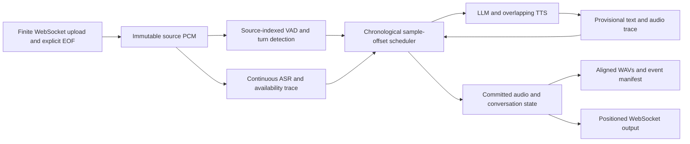

# Offline Processing for Nemotron Voice Agent

## Aim and Background

This proposal enables Nemotron Voice Agent to process recorded conversations
faster than real time. You can run accuracy and task-completion benchmarks
without waiting for every recording to play. The input includes speech and silence. The output is
bot audio positioned on the same timeline, with transcripts and server-side
measurements that explain each response.

A real-time voice agent receives and plays audio at its recorded rate. A long
pause therefore takes time even when the models have no work to do. Bulk input
removes that wait, but network arrival time no longer identifies the speaker's
position in the conversation. Pacing output faster alone also loses the original
timing of silence, turn completion, and interruption.

This design separates the **recording timeline** from **execution time**. Audio
sample offsets determine where conversation events occur. Measured model-service
delays still affect when bot audio becomes available. The server renders gaps
as silence instead of sleeping through them.

The target outcome is a faster evaluation workflow with inspectable evidence:

* Upload a complete recording without real-time pacing.
* Preserve source speech, silence, and turn boundaries.
* Generate responses using the configured ASR, LLM, TTS, prompt, and tools.
* Interrupt bot playback when the user is confirmed to have started speaking.
* Save aligned user and bot WAVs, transcripts, events, and server metrics.
* Compare the same files through offline and normal online processing before
  relying on offline task or accuracy scores.

Automatic speech recognition (ASR), a large language model (LLM), text-to-speech
(TTS), and voice activity detection (VAD) form the first supported integration.
The capability is an execution architecture for Nemotron Voice Agent; the
Generic Assistant is the first example that composes its providers and policy.

The implementation adds `/api/ws/offline`, a custom finite-session WebSocket
endpoint. It uses a separate execution engine and does not change the normal
`/api/ws`, `/v1/realtime`, or WebRTC paths. This is not an OpenAI Realtime or RTVI
protocol extension. Other examples can reuse the scheduling contracts through
additional integration factories.

The design baseline uses the standard continuous NVIDIA STT service with
`stop_history=320` (the 320 ms baseline).
It does not inject force-EOU requests or synthetic control silence. Both modes
must use this baseline and record the effective STT configuration during
validation. This setting is separate from Silero's silence threshold; the
scheduler does not add another 320 ms delay.

## Design Approach and Architecture

### Source Offsets Define Conversation Time

At 16 kHz, each sample has an unambiguous position in the recording. A 512-sample
analysis window represents 32 ms, whether it arrives immediately or after a
network pause. Transport packet sizes do not change the analysis window.

The server first validates and seals the complete source, including silence.
Detection and continuous ASR analyze that immutable source. The scheduler then
replays speech, endpoint, transcript-readiness, and generated-audio events in
sample order. It advances directly between events without waiting for source
silence to elapse.

Analyzing the source ahead does not permit using future conversation state.
Only transcripts whose source dependency and availability have been reached can
enter a response. Generation uses a private history snapshot. Replay decides
which generated audio and context updates survive a later interruption.

The following diagram shows the boundaries between source analysis, scheduling,
provider execution, and recording.



### Keep Two Explicit Time Domains

The two time domains have distinct responsibilities.

| Domain | Representation | Responsibility |
| --- | --- | --- |
| Recording timeline | Absolute integer samples; zero is the first source sample | Speech, turn endpoints, response placement, interruption, silence, and recording extent |
| Observed execution time | Monotonic durations, displayed in milliseconds | Provider delays, upload, processing, publication, and failure watchdogs |

Upload progress does not advance conversation time. Provider execution remains
measured because a response cannot be placed before its input and generated
audio are available. Watchdogs retain execution-time deadlines, but they only
fail stalled work. They cannot end a user turn or insert source silence.

The design replaces the following timing dependencies.

| Existing Behavior | Offline Rule |
| --- | --- |
| Silero speech and silence thresholds | Preserve fixed-window audio counting |
| Periodic Silero state reset | Reset after the corresponding source samples |
| Receive-idle and user-speech timeouts | Use source silence, detector decisions, and explicit source EOF |
| Smart Turn retained audio buffers | Select buffers using source offsets |
| ASR inactivity keepalive | Send only source PCM and explicitly drain the finite request |
| Output pacing and queue-empty silence | Schedule PCM spans and zero-fill uncovered positions |
| Bot-speaking and TTS idle notifications | Use scheduled playback start/end and synthesis completion |
| Conversation commitment after output | Commit completed speech or the aligned prefix actually played |
| Recorder arrival timestamps | Record ingress PCM and positioned committed bot spans |
| Session inactivity | Require explicit input completion and explicit processing completion |

### Provider Availability and Playback

The scheduler keeps model-service availability separate from endpoint detection.
For a turn, response readiness is the later of endpoint availability and the
availability of its owned final transcripts. Recognition that becomes ready
while newer user speech is active can defer or combine pending turns.

LLM text streams into TTS while generation continues. Each returned audio chunk
retains its observed availability relative to the response request. Its start
is the later of that availability and the preceding chunk's playback end. This
preserves overlap between LLM and TTS instead of adding their full durations.

Convert a measured duration to samples by rounding forward:

```text
S(duration_ns) = ceil(duration_ns * 16000 / 1_000_000_000)
turn_ready = max(endpoint_sample + S(endpoint_compute_ns),
                 latest_owned_transcript_available_sample)
chunk_start = max(response_request_sample + S(chunk_ready_ns),
                  previous_chunk_end)
chunk_end = chunk_start + chunk_sample_count
```

Confirmed user speech takes priority over bot playback at the same sample.
Interruption clips a chunk exactly at that position and discards later audio.
It is not backdated to the raw speech onset. Valid TTS word alignment retains
only the played assistant text prefix; without valid alignment, interrupted
assistant text is omitted from later history.

Continuous ASR records each final's source dependency and observed arrival.
The current adapter projects its availability using the following policy:

```text
dependency = max(reported_audio_processed_sample, latest_word_end_sample)
residual_ns = max(0, final_arrival_ns - dependency_chunk_supplied_ns)
available_sample = max(previous_available_sample,
                       dependency + S(residual_ns))
```

The residual includes transport, queueing, and backlog caused by rapid input.
It is an explicit offline projection, not a measurement of paced online ASR
latency. The manifest names the policy
`source_dependency_plus_observed_bulk_residual` so evaluation can distinguish it
from other availability models.

### Recording and Conversation Invariants

The scheduler and recorder enforce the following rules.

* Input becomes immutable after sample-count, packet-count, and SHA-256 checks.
  Source silence remains ordinary PCM; a disconnect cancels the session.
* Future source speech or transcripts cannot enter a response history early.
* One continuous ASR request consumes the whole recording and drains at EOF.
* Transcript ownership extends from turn start to endpoint, retaining quiet
  trailing words after detected speech end. Missing or ambiguous ownership fails.
* Generation does not mutate shared history. Playback and context updates remain
  provisional until replay commits them.
* Bot spans are ordered and nonoverlapping. Every uncovered sample is zero.
* Output spans at least the input duration and extends for a final bot reply.

A recording with 300,000 ms of source audio therefore produces at least
300,000 ms of bot output, including silence. Evaluation adapters can additionally
crop a source-horizon view when a benchmark requires a fixed interval.

## Implementation Overview

Small contracts separate scheduling policy from transport, providers, and files.
The first integration currently lives in `src/examples/generic/offline/`.

| Module | Responsibility |
| --- | --- |
| `models.py` | Immutable source, recognition, response, and committed-span records; `Detector`, `Recognizer`, and `Responder` protocols |
| `detection.py` | Source-indexed Silero and Smart Turn decisions, model resets, buffers, and endpoint computation observations |
| `providers.py` | Continuous Riva ASR, streaming HTTP LLM, overlapping stitched Magpie TTS, provider timers, and optional word alignment |
| `engine.py` | Causal replay, turn readiness, private history snapshots, interruption, and audio/context commitment |
| `recorder.py` | Span validation, zero-filled rendering, WAVs, and audit records |
| `protocol.py` and `websocket.py` | Bounded upload, offset validation, explicit EOF, cancellation, publication, and failure watchdogs |
| `factory.py` | Generic Assistant prompt, tools, service selections, summary policy, and session-owned resources |
| `src/examples/shared/evaluation_trace.py` | Optional passive timing observations for the normal live pipeline, separate from offline scheduling |

These boundaries apply the SOLID principles directly. Each module owns one
responsibility. Provider protocols are narrow and keep the scheduler independent
of Riva, OpenAI, and WebSocket classes. New implementations must preserve the
same source, availability, completion, and commitment invariants. An additional
transport or recorder consumes the same committed result. No global Pipecat
clock is patched.

To integrate another example, supply a composition factory and adapters that
satisfy those contracts. Keep example-specific configuration and provider
lifecycles outside `engine.py`. An OpenAI Realtime gateway integration additionally
needs codec conversion, response completion, cancellation, and conversation
truncation tied to scheduled playback.

### Configuration and Lifecycle

The first integration supports continuous Riva ASR, an HTTP chat-completions LLM,
and stitched Magpie TTS. It resolves the Generic Assistant's prompt, tools,
summary policy, model selections, language, punctuation, voice, temperature, and
token settings. A configuration fingerprint records the resolved choices.
Automatic introduction is disabled for finite-session processing.

Offline synthesis requests the same native 22,050 Hz TTS output as the live
pipeline, using `PIPELINE_AUDIO_OUT_SAMPLE_RATE`. A continuous SoXR VHQ stream
converts it to canonical 16 kHz PCM and flushes its tail at synthesis EOF. The
manifest records `tts_sample_rate`, `output_sample_rate`, and `tts_resampling`.
The paired live gateway requests 16 kHz client PCM from its existing output
conversion path. Matching the native synthesis rate avoids changing the TTS
request merely to simplify comparison. Offline first-audio timing ends at the
first canonical PCM, so it includes the continuous resampler's initial buffering.
Live service TTFB ends before output resampling. These are distinct scopes.

Source detection uses the shared turn settings. Smart Turn uses a 200 ms Silero
stop threshold and a 1,000 ms fallback by default. `SMART_TURN_STOP_SECS` overrides
the fallback. `USE_SILERO_VAD_TURN_DETECTION=true` selects Silero-only detection;
`SILERO_VAD_STOP_SECS` then defaults to 500 ms. These environment values accept
seconds even though reported measurements use milliseconds.

Streaming-input LLM URLs, per-sentence synthesis, zero-shot TTS models, and
zero-shot audio prompts are rejected explicitly. They need dedicated adapters
rather than silent changes in behavior.

### WebSocket and Recording Contract

The custom protocol is `nva.offline.v1`. The client starts with
`offline.session.start`, declaring 16 kHz mono PCM16, the input sample count,
and optional session configuration. The server acknowledges bounds before audio.

Binary packets contain a network-order `!4sQQI` header: magic, sequence,
absolute start sample, and sample count. `NVAI` identifies input and `NVAO`
identifies output. PCM is little-endian signed 16-bit mono. Input is contiguous
and ordered. Output can omit silence but must be ordered and nonoverlapping.

`offline.input.complete` supplies the sample count, packet count, and SHA-256.
The server validates and seals the source, processes it, publishes committed
audio and events, and sends `offline.session.complete`. Disconnect is not EOF.
Input after EOF is rejected. Failures send `offline.session.error`.

`OFFLINE_AUDIO_DUMP_PATH` selects the server-owned recording directory; its
default is `audio_dumps/offline`. A UUID session directory contains these files.

| File | Contents |
| --- | --- |
| `source.wav` | Canonical ingress PCM, including silence |
| `full_output.wav` | Positioned bot PCM with zero-filled gaps and any final tail |
| `events.jsonl` | Source, recognition availability, interruption, playback, and context events |
| `manifest.json` | Extents, configuration fingerprint, messages, compute traces, and metrics |
| `failure.json` | Explicit failure status when processing does not succeed |

The sample client also writes source-horizon `output.wav` and a stereo
`comparison.wav`, with user input on the left and bot output on the right.

## Paired Online and Offline Evaluation

### Method

Use the same canonical files on the same application revision and model services.
The online baseline must use the normal live pipeline with input paced at its
recorded rate. Pacing upload to `/api/ws/offline` does not exercise the live
pipeline and is not an online baseline.

The paired evaluation follows these steps.

1. Select individual recordings with natural turns, a pause, an interruption, and
   a clean baseline. Preserve source silence and record each canonical file's hash.
2. Prepare a shared source with explicit trailing silence when a natural final
   endpoint is required. Both modes receive those exact samples.
3. Resolve identical model, prompt, voice, generation, and detector settings.
   Disable automatic introduction for both modes and start a fresh conversation
   for each case. Record any unavoidable processing-policy differences.
4. Run each recording through the live pipeline at one times audio speed and
   through `/api/ws/offline` without pacing.
5. Save each mode's bot WAV, aligned user/bot comparison WAV, transcripts,
   source events, server metrics, revision, dependencies, and configuration.
6. Verify PCM extent, offsets, silence, interruption cuts, source hashes, and
   metric definitions before comparing response content and task outcomes.
7. Run the benchmark's scorer separately when reporting accuracy or task
   completion. Keep the benchmark's required source horizon and scoring rules.

Independent generations can differ even with temperature zero. Matching WAV
bytes is not the success criterion. Compare recognized input, response intent,
turn ownership, silence, interruption behavior, and benchmark results. Report
observed differences instead of assuming timing or accuracy equivalence.

### Validation Status and Prepared Recordings

Full-Duplex-Bench (FDB) score-validation work is in progress. Paired online and
offline model runs and benchmark scoring are scheduled after this design
proposal is shared. The next validation report will compare response content,
turn placement, interruption behavior, accuracy, and task-completion outcomes.
This proposal does not report measured benchmark scores or claim equivalence.

The four paired source files are prepared. Each preserves the original sample
prefix exactly and appends 4,000 ms of explicit zero-valued silence to allow a
natural final endpoint in both modes. The manifest records original and prepared
hashes, sample counts, and padding. These prepared inputs are comparison cases,
not the unmodified official benchmark inputs.

| Source | Prepared Duration, ms |
| --- | ---: |
| FDB v1 smooth turn 117 | 13,099.94 |
| FDB v1 synthetic pause 88 | 9,322.69 |
| FDB v1.5 user interruption 135 | 20,594.69 |
| FDB v1.5 clean baseline 135 | 20,595.00 |

The follow-up report will link the native input, online bot, offline bot, and
comparison WAVs for listening and download. It will include per-case and
valid-turn server metrics in milliseconds, measured evaluation turnaround, and
scorer results with their input and configuration provenance.

The results require measured values for the following comparisons.

| Comparison | Evidence |
| --- | --- |
| Evaluation turnaround | Source duration, upload duration, processing completion, and total elapsed time for each mode |
| Recognized input and response content | Final ASR text, generated assistant text, and the committed played prefix |
| Turn placement | VAD speech end, endpoint, first committed bot sample, and rendered turn gap |
| Interruption | Confirmed user start, final bot sample, and any discarded response tail |
| Server processing | ASR first nonempty transcript, LLM first text and stream completion, TTS first audio and completion |
| File integrity | Source SHA-256, PCM format, channel alignment, output extent, and server/client equality |

### Server Tracing and Metric Definitions

Set `NVA_EVAL_TRACE_DIR` on the server to retain passive live-pipeline traces.
Without that setting, the normal provider classes and frame flow are unchanged.
The observer never creates audio, changes pacing, or makes provider requests.
It counts PCM, buffers bounded events, and writes a session JSON file after the
worker stops. Trace-file failures do not fail the voice session.

The live trace records ASR request yields and existing response callbacks,
LLM frames, TTS text submission and generated PCM, stitched-worker completion,
VAD and semantic turn events, and output frames after their transport write.
Context IDs and request indices preserve observed ownership; absent events
remain null. Every trace includes `timing_scopes` for the boundaries it observes.
Observer callbacks can run after frame pushes. The report therefore calculates
LLM frame intervals from their original pipeline timestamps. Provider hooks use
a separate clock origin, so the report does not subtract a TTS-hook timestamp
from an LLM-frame timestamp without clock calibration.

All human-readable durations are milliseconds. Raw manifests retain sample
positions and nanosecond timers. Stages overlap and their durations must not be
summed into an end-to-end total. The following scopes distinguish measurements
that have similar names but different start or end events.

| Metric | Offline Scope | Normal Live Scope |
| --- | --- | --- |
| Server E2E | Sealed source to precompletion for the entire file, after processing, recording, and publication | Pipecat inferred user speech end to `BotStartedSpeakingFrame`, per reported turn |
| ASR first text | Request start to first nonempty transcript; continuous-stream firsts cover the recording | Existing nonempty-results callback or final-text frame; Pipecat ASR TTFB starts at inferred user speech end and ends at transcript finalization |
| LLM first text | RPC dispatch to first nonempty text | Service start frame to first nonempty text frame; Pipecat TTFT can instead end at a choices-bearing role-only delta |
| LLM completion | RPC dispatch to stream completion | Start to end at the service frame boundary, including local request work |
| TTS first audio | First text consumed by the gRPC request iterator to first canonical 16 kHz PCM, including resampler buffering | Filtered text entering `run_tts` to native PCM entering the TTS context queue, before output resampling and paced output |
| TTS completion | First consumed text to synthesis EOF, including later text waits | Stitched-worker completion, including later text waits; cancelled or returned workers do not by themselves establish successful RPC EOF |
| Output observation | Committed PCM at scheduled sample offsets | Output frame after transport write; client receipt and playback are separate observations |
| Rendered turn gap | Last owned turn's detected speech end to first committed bot PCM | Reported separately from server latency; client playback uses packet receipt and queued PCM |

Offline batch E2E and live turn E2E cover different scopes. Likewise, ASR,
LLM, and TTS observations must retain their boundary labels instead of being
presented as interchangeable timers. Provider measurements include transport and
backend queueing; none isolates GPU execution.

Offline turn-gap breakdown separates endpoint wait, post-endpoint readiness and
scheduling wait, and response-request-to-first-PCM delay. Only responses with
committed PCM count in valid-turn summaries. Cancelled responses still contribute
to processing totals. EOF-flushed responses are identified separately from
natural endpoints.

The online comparison client retains the server's reported metrics in
milliseconds and writes its own receipt/playback measurements with separate
names. It models zero-prebuffer playback by placing each packet no earlier than
receipt or the preceding queued packet's end. Its WAV is a client playback
recording, not a server sample clock. It applies no network-delay correction or
manual time shift. A semantic turn waiting for a response or an active response
prevents idle completion. Collection waits until that work settles or the
absolute post-input deadline fails the run. It does not send extra audio, manual
commits, or `response.create`.

### Limits of the Comparison

Both modes use continuous ASR with the same STT baseline (`stop_history=320`,
320 ms) and no force-EOU injection. Source audio, including silence, determines
recognition progress. Offline EOF explicitly completes the finite source; the
online stream remains open during normal conversation.

The bulk ASR availability projection can still change transcript readiness,
response timing, or turn grouping compared with paced input. The paired
evaluation must measure these differences; aligned output alone does not
establish live fidelity. It must also verify the effective 320 ms configuration
in both modes rather than infer it from the proposal baseline.

Replay can generate audio that an interruption later discards. Its compute
totals include that work and do not reproduce the savings from live cancellation.
Read-only tools can also return different time-sensitive values across runs.

This workflow targets benchmark turnaround for accuracy and task completion.
Offline throughput is not real-time concurrency capacity. A benchmark that scores
real-world response delay, such as latency-sensitive Full-Duplex-Bench criteria,
still needs its live evaluation. WAV integrity checks do not constitute an
official accuracy, Full-Duplex-Bench, or task-completion score.

## Running and Reproducing

Configure the normal Generic Assistant and start the application with its
catalogs and credentials.

```bash
EXAMPLE_SELECTION=generic-assistant PIPELINE_TLS=false uv run python src/server.py
```

The following client sends an existing canonical recording without pacing.

```bash
uv sync --group benchmark
uv run python benchmarking_tools/offline-eval/client.py \
  --url ws://127.0.0.1:7860/api/ws/offline \
  --input session.wav --gap-seconds 0 --upload-speed 0 \
  --output-dir offline_run
```

Multiple `--input` files can be separated by `--gap-seconds` and padded with
`--duration-seconds`. The client refuses to shorten source recordings.
`--upload-speed 1` tests paced input to this same offline endpoint; it does not
change the server's execution engine.

The batch runner starts an independent session for each sample.

```bash
uv run python benchmarking_tools/offline-eval/run_fdb_samples.py \
  --manifest cases.json --url ws://127.0.0.1:7860/api/ws/offline \
  --config config.json --output-dir fdb_offline_run
uv run python benchmarking_tools/offline-eval/extract_metrics.py \
  --input-dir fdb_offline_run --output-dir extracted_metrics --run-label offline
```

The manifest format is
`{"cases":[{"id":"case-1","input":"canonical.wav","provenance":{}}]}`.
Relative inputs resolve beside it. Supply 16 kHz mono PCM16 and record any
conversion in provenance. The optional configuration uses the existing Generic
Assistant session keys. A session created through `/api/session-config` can
instead be passed as `?session_id=...`; those process-local IDs are not supported
across workers. Direct handshake configuration avoids that lookup.

### Reproduce the Paired Comparison

Start the same current application with optional passive server tracing enabled.
The live gateway and offline endpoint use that application and its configured
model services. Configure the server catalogs so the flat configuration selects
the same models, prompt, voice, and generation settings in both modes.

```bash
NVA_EVAL_TRACE_DIR=audio_dumps/evaluation \
  EXAMPLE_SELECTION=generic-assistant PIPELINE_TLS=false \
  uv run python src/server.py
```

Prepare shared input files, run offline inference, and then replay the same
prepared files through the normal OpenAI Realtime gateway at their recorded rate.
The preparation command makes no model requests. Use new or empty output
directories for each invocation.

```bash
uv run python benchmarking_tools/offline-eval/compare_live.py \
  --manifest cases.json --prepare-only --trailing-silence-ms 4000 \
  --output-dir paired/prepared
uv run python benchmarking_tools/offline-eval/run_fdb_samples.py \
  --manifest paired/prepared/cases.json \
  --url ws://127.0.0.1:7860/api/ws/offline --config config.json \
  --output-dir paired/offline
uv run python benchmarking_tools/offline-eval/compare_live.py \
  --manifest paired/prepared/cases.json \
  --live-url ws://127.0.0.1:7860/v1/realtime --config config.json \
  --offline-results-dir paired/offline --output-dir paired/online
```

The live client verifies paired source PCM equality before replay. It requests
16 kHz PCM for both client directions. It writes input/bot comparison WAVs,
`offline_left_online_right.wav`, transcripts, send/receive traces, accepted
session settings, and server-reported latency tables. The optional
`REALTIME_API_KEY` environment variable supplies a live gateway bearer token;
credentials are not saved in session configuration.

After the live session closes, use the passive server trace files to build the
paired report. If the client runs on another host, first copy the completed
trace files to the path passed as `--server-traces-dir`.

```bash
uv run python benchmarking_tools/offline-eval/report_comparison.py \
  --offline-results-dir paired/offline --online-results-dir paired/online \
  --server-traces-dir audio_dumps/evaluation --output-dir paired/report
```

The reporter makes no provider requests. It requires successful runs with the
same case IDs, compares the actual input PCM bytes and format, and matches each
accepted live session ID to exactly one server trace. Missing runs, unequal
sources, and ambiguous trace matches fail explicitly. Its outputs include these
files, with all time values in milliseconds.

| Report File | Contents |
| --- | --- |
| `comparison.json` | Complete report, metric definitions, source hashes, file inventory, and warnings |
| `cases_ms.csv` | Per-case completion times, offline batch processing, response counts, scoped server summaries, and input-pacing lateness |
| `offline_valid_responses_ms.csv` | Offline committed-response timings and turn-gap breakdown |
| `online_valid_responses_ms.csv` | Live committed responses, server-reported metrics, and client receipt/playback observations |
| `asr_workers_ms.csv` | Live ASR worker lifetime and callback timings from worker start or first supplied audio |
| `llm_requests_ms.csv` | Live service-frame first-text and completion timings, with explicit ownership information |
| `tts_contexts_ms.csv` | Live text submission, first generated PCM, worker lifetime, and cancellation/outcome scope |
| `server_messages_ms.csv` | Server latency observations in their original event scope |
| `wav_inventory_ms.csv` | Native WAV paths, durations, formats, and file/PCM hashes |
| `transcripts.json` | Offline committed conversation and live transcription events |

Only responses with committed PCM populate valid-response tables. Empty source
regions do not become turns. Request indices, synthesis context IDs, and wire
response IDs remain separate unless the trace proves their association. Equal
ordinal counts are insufficient. Missing observations remain null or blank.

The per-case online/offline client completion ratio includes setup, publication,
and the online idle drain. The report shows these components separately. This
ratio describes evaluation turnaround, not inference acceleration or equivalent
response latency. It does not infer task accuracy or acoustic scores.

For official live benchmark procedures, refer to the
[Full-Duplex-Bench client](../benchmarking_tools/Full-Duplex-Bench-Eval/README.md)
and [scaling benchmark](../benchmarking_tools/scaling-perf/README.md).

## Verification and Tests

The offline tests use deterministic provider traces to verify the architecture
without model or judge endpoints.

```bash
uv run pytest tests/unit/test_offline*.py
```

Coverage includes packetization-independent detection, source resets, partial
EOF, continuous ASR draining, quiet trailing words, future-context suppression,
summary/tool ordering, overlapping generation, interruption clipping, silence,
final-tail extension, malformed uploads, disconnect, and watchdog failure.
The real sample client also exercises the engine with different packet sizes
and accelerated input; identical traces must produce identical aligned PCM.

The follow-up real-provider paired runs will additionally verify configuration
and source hashes, server/client PCM equality, silence outside committed spans,
exact clipping, stereo channel alignment, source consumption, provider-timer identities, and
matching final metrics. These checks validate recording and measurement
integrity. Benchmark scorers separately evaluate semantic accuracy and task
completion.
