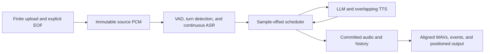

# Offline Processing for Nemotron Voice Agent

> **Current status:** The opening proposal is preserved design history. Its
> full-file replay and transcript-ownership rules are superseded by the
> incremental native-aggregation runtime. Use the
> [implementation reference](offline-processing-reference.md) for current
> configuration and behavior, and the
> [native policy acceptance contract](#october-30-2026-native-policy-acceptance-contract)
> for fidelity requirements. The [progress log](offline-processing-progress.md)
> records implementation changes, measured results, and remaining limitations.

## Aim and Background

Enable Nemotron Voice Agent to process recorded conversations faster than real
time, so accuracy and task-completion benchmarks do not wait for every recording
to play. Input contains speech and silence. Output contains bot responses placed
on the same audio timeline, with transcripts and server metrics for inspection.

Bulk upload removes real-time input pacing, but arrival time no longer indicates
where speech occurs. Removing output sleeps alone also loses turn placement,
silence, and interruption behavior. The proposal addresses this by scheduling
conversation events on audio sample offsets and measuring model-service delays
separately.

For example, a 300,000 ms input produces at least 300,000 ms of bot output.
Gaps contain silence, responses begin when their inputs and generated audio are
available, and a final response can extend beyond the input.

The first integration uses automatic speech recognition (ASR), a large language
model (LLM), text-to-speech (TTS), and voice activity detection (VAD) in the
Generic Assistant. The scheduling architecture supports other examples through
provider adapters and composition factories.

The scope is a custom finite-session WebSocket endpoint, `/api/ws/offline`.
The existing live WebSocket, OpenAI Realtime gateway, and WebRTC paths retain
their execution behavior. This proposal does not add WebRTC offline support.

The design baseline uses standard continuous NVIDIA speech-to-text (STT) with
`stop_history=320` (320 ms), without force-EOU injection or synthetic control
silence. Both evaluation modes must use that baseline. This STT setting is
separate from Silero's silence threshold and adds no separate scheduler delay.

## Architecture

The server validates and seals the complete source before processing. VAD,
turn detection, and one continuous ASR request analyze that immutable recording.
A scheduler replays their events in source order, requests responses, and commits
the audio and conversation history that survive interruptions.

The following diagram shows the processing boundaries.



Source analysis can run ahead, but response generation receives only transcripts
whose source dependency and availability have been reached. Each response uses
a private history snapshot. The scheduler decides which generated audio and
history updates become committed. Future user speech cannot enter an earlier
response.

Two time domains keep conversation placement independent of processing speed.

| Domain | Controls |
| --- | --- |
| Audio timeline: integer sample offsets | Speech, silence, endpoints, playback, interruption, and recording extent |
| Execution time: monotonic durations | Provider availability, processing measurements, and failure watchdogs |

At 16 kHz, 512 analysis samples always represent 32 ms. Upload speed and network
pauses do not change that duration. Watchdogs can fail stalled work; they cannot
end user turns or advance the audio timeline.

### Timing Rules

Offline execution replaces the following pacing and idle dependencies.

| Pipeline Behavior | Offline Rule |
| --- | --- |
| VAD thresholds, state resets, and Smart Turn buffers | Count and select source samples |
| Receive-idle and user-speech timeouts | Use source silence, detector decisions, and explicit EOF |
| ASR keepalive and stream completion | Consume source PCM through one continuous request and drain at EOF |
| Output pacing, empty-queue silence, and bot-speaking state | Schedule audio spans, zero-fill gaps, and derive playback start/end |
| TTS completion and conversation history | Observe synthesis completion; commit only completed or justified played text |
| Recording timestamps and session completion | Use source offsets and explicit completion events |

Measured compute and service delays remain part of response placement. A turn
becomes ready after both endpoint computation and its owned final transcripts
are available. Transcript availability is tracked independently of source
position and upload progress.

LLM output streams into TTS while generation continues. Each audio chunk retains
its observed readiness relative to the response request. The scheduler places it
after both that readiness and the preceding chunk's playback end.

The core placement rules are:

```text
S(duration_ns) = ceil(duration_ns * 16000 / 1_000_000_000)
turn_ready = max(endpoint_sample + S(endpoint_compute_ns),
                 latest_owned_transcript_available_sample)
chunk_start = max(response_request_sample + S(chunk_ready_ns),
                  previous_chunk_end)
chunk_end = chunk_start + chunk_sample_count
```

Continuous ASR associates each final transcript with its source dependency.
The adapter projects availability from that dependency plus the observed delay
after the relevant audio was supplied. Bulk-input backlog contributes to this
projection; it does not establish paced-live ASR latency.
The [scheduling reference](offline-processing-reference.md#provider-availability-and-playback)
defines the calculation and recorded policy.

### Interruption and Recording Rules

The scheduler and recorder enforce these invariants.

- **Immutable source:** validate sample count, packet count, and SHA-256 at explicit
  EOF. A disconnect cancels the session.
- **Causal history:** assign transcripts from turn start through endpoint,
  including quiet trailing words. Missing or ambiguous ownership fails explicitly.
- **Confirmed interruption:** user speech takes priority at its confirmed sample.
  Clip current bot audio there and discard later spans; do not backdate the cut.
- **Played context:** commit completed assistant text or a played prefix supported
  by valid TTS word alignment. Omit interrupted assistant text when alignment is invalid.
- **Aligned output:** spans are ordered and nonoverlapping, uncovered samples are
  zero, and output covers the input plus any final response tail.

These rules let reviewers inspect turn placement without relying on packet
arrival times or manually shifting recordings.

## Implementation Overview

The first integration lives in `src/examples/generic/offline/`. Narrow
`Detector`, `Recognizer`, and `Responder` contracts keep scheduling independent
of model-service SDKs and transport classes.

The implementation divides responsibility as follows.

| Component | Responsibility |
| --- | --- |
| Source detection and recognition | Source-indexed VAD/Smart Turn decisions and continuous ASR availability |
| Response providers | Streaming HTTP LLM, overlapping stitched Magpie TTS, timers, and word alignment |
| Replay engine | Turn readiness, private history, interruption, and audio/history commitment |
| WebSocket protocol and recorder | Bounded upload, offset/hash validation, explicit EOF, positioned output, and WAVs |
| Integration factory | Example-specific prompts, tools, service settings, and resource lifecycles |

This separation gives each component one responsibility and allows providers,
transports, and recorders to be replaced through their contracts. Another example
supplies a factory and compatible adapters. A gateway integration additionally
needs codec conversion, completion, cancellation, and conversation truncation
tied to scheduled playback. No global Pipecat clock is patched.

The first adapters support continuous Riva ASR, HTTP chat completions, and
stitched Magpie TTS. They preserve selected prompts, tools, voice, generation
settings, and a configuration fingerprint. Automatic introductions are disabled.
Both modes request the same native TTS rate before converting to canonical
16 kHz PCM. Unsupported provider modes fail explicitly.

The server saves `source.wav`, `full_output.wav`, `events.jsonl`, and
`manifest.json`. The client also saves a source-horizon `output.wav` and
`comparison.wav`, with user input on the left and bot output on the right.
Failures produce explicit status instead of successful-looking recordings.

For packet layouts, configuration restrictions, module mappings, and executable
commands, refer to the
[implementation and evaluation reference](offline-processing-reference.md).

## Validation and Results

An unscored composite recording has completed through both execution paths on
Pipecat 1.12.0 with standard continuous STT, `stop_history=320`, and no force-EOU
injection. Recording checks verify identical source PCM, output extents,
committed spans, and stereo alignment. The exported evidence bundle retains
WAVs, server metrics, and runtime provenance; refer to the
[validation artifact reference](offline-processing-reference.md#completed-composite-inspection).

Behavioral and scoring consistency against real-time streaming is being
validated. Full-Duplex-Bench (FDB) score validation is in progress; official
scoring will follow sharing this design proposal.

The comparison uses identical canonical PCM, application revision, model
services, prompts, voice, generation settings, and detector settings. Each case
starts a fresh conversation. Effective STT settings and source hashes are recorded.

The two execution paths are:

- **Default online:** send input at its recorded rate through the normal live
  pipeline at `/v1/realtime`.
- **Offline POC:** bulk-upload the same samples through `/api/ws/offline`.

Pacing uploads to the offline endpoint does not exercise the default live
pipeline. Independent generation can vary even at temperature zero, so matching
WAV bytes is not the acceptance criterion.

### Prepared Recordings and Acceptance Checks

Four sources cover a natural turn, a pause, an interruption, and a clean
baseline. Each preserves its canonical prefix and adds the same 4,000 ms of
explicit silence in both modes for a natural final endpoint.

| Source | Prepared Duration, ms |
| --- | ---: |
| FDB v1 smooth turn 117 | 13,099.94 |
| FDB v1 synthetic pause 88 | 9,322.69 |
| FDB v1.5 user interruption 135 | 20,594.69 |
| FDB v1.5 clean baseline 135 | 20,595.00 |

These padded files test comparison behavior. Official scoring must follow the
benchmark's required inputs, source horizon, and scorer rules.

Validation compares recognized text, response intent, turn ownership, first bot
audio, silence, interruption cuts, played context, and final-tail preservation.
File checks verify hashes, formats, server/client PCM, and stereo alignment.
The benchmark scorer separately measures accuracy and task outcomes; WAV
integrity alone does not establish either.

### Server Measurements and Test Coverage

All displayed durations use milliseconds. Reports retain explicit timing scopes:

- **Evaluation turnaround:** upload, processing, publication, and total completion.
- **Turn placement:** speech end, endpoint, first committed bot sample, and turn gap.
- **Providers:** ASR first text/finalization, LLM first text/completion, and TTS
  first audio/completion.
- **Live observations:** server-reported turn metrics and separate client
  receipt/playback measurements.

Offline batch E2E and live turn E2E cover different boundaries. LLM/TTS stages
overlap, so their durations must not be summed. Provider timers include transport
and queueing. Offline first audio includes canonical resampling; live service
time to first byte (TTFB) ends before output resampling. Only responses with
committed audio count in valid-turn summaries; silent regions do not become turns.

An optional passive server trace (`NVA_EVAL_TRACE_DIR`) supports the comparison
without changing pacing or provider requests. The reporter verifies actual
source equality and session identity. Missing measurements remain null;
incomplete traces cannot establish response associations.
The [metric reference](offline-processing-reference.md#server-tracing-and-metric-definitions)
defines exact boundaries and report files.

Deterministic tests cover packetization independence, source resets, ASR draining,
transcript ownership, future-context suppression, overlapping generation,
interruption, history commitment, silence, final tails, malformed upload,
disconnect, and watchdog failures. Client and trace tests cover delayed replies,
cancellation ownership, source/session pairing, and partial observations.
The completed composite inspection validates recording and measurement
integrity. Paired benchmark cases and official scoring provide the next
validation layer.

## Limits and Extensions

Bulk-ASR availability measurements include backlog from rapid input and must
retain their recorded timing scope. Replay can generate work that later
interruptions discard, so compute totals do not reproduce live cancellation
savings.
Time-sensitive tool results and independent generation can differ between runs.

The proposed mode targets faster accuracy and task-completion evaluation.
Real-world latency and concurrency benchmarks still require live execution.
Further provider modes, examples, and transport gateways need adapters that
preserve the same causality, completion, interruption, and recording contracts.

## October 23, 2026: Current Implementation and Scored Validation

The preceding proposal preserves the design history. The factory now selects
the incremental architecture described below and in the
[implementation reference](offline-processing-reference.md). It supersedes the
earlier transcript-ownership, private-history, and completed-response replay
rules above.

### Implemented Architecture

After finite upload validation, source-indexed VAD checkpoints and continuous
ASR callbacks feed active actors. The scheduler advances an integer sample clock
when their published readiness bounds permit it. ASR processed prefixes identify
supplied audio chunks; word timestamps remain disabled. Bounds represent the
observed processing schedule, not backend completeness acknowledgements or
reconstructed arrival times from a separate realtime run.

The scheduler feeds actual Pipecat user and assistant aggregators. Their frame
order and sample-clock waits decide user turns and context commitment.
Persistent native NVIDIA LLM/TTS processors generate responses incrementally.
There is no whole-file ASR barrier, whole-response capture barrier, or
future-speech response budget. ASR and response generation can overlap.

Native interruption cancels work, waits for acknowledgement, and fences stale
callbacks before the next generation. Output retains native FIFO buffering and
control-frame order. Separate clocks represent WebSocket write completion and
client PCM presentation. The recorder converts cumulative sample counts,
clips interrupted playback, fills gaps with silence, and preserves the final
response tail.

Current scope is fixed input, continuous Riva ASR, Silero detection, HTTP chat
completion, stitched Magpie TTS, and a prompt without tools. History
summarization requires an additional adapter. Both evaluated modes disable it
with `CHAT_HISTORY_RECENT_TURNS=0`. Standard STT retains 320 ms stop history
without force-EOU injection. The normal gateway and offline endpoint share the
same deployed model services.

### Eight-Question Comparison

Eight deterministically selected AA-BigBench questions cover four categories.
Each mode runs twice at concurrency 1: 32 captures, with eight unique questions.
All captures pass source and recording-integrity checks. All 16 pairs match
observed final-ASR sequences and user-message grouping. Both modes make 43
native LLM requests per repeat. Every offline capture emits native TTS PCM
before its continuous-ASR EOF.

The primary score judges independent ASR of each complete spoken output WAV,
including interrupted speech, against the official answer.

| Result | Online | Offline |
| --- | ---: | ---: |
| Repeat 1 correct | 4/8 | 4/8 |
| Repeat 2 correct | 3/8 | 4/8 |
| Total correct | 7/16 (43.75%) | 8/16 (50%) |
| Verdict agreement across repeats | 7/8 | 8/8 |
| Total client completion (ms) | 524,303.096 | 41,566.944 |

Paired verdicts agree in 13/16 comparisons. Offline completes 440,069 ms of source
in 41,566.944 ms, a 10.587-times source-duration/elapsed ratio. Client totals include
setup, upload, execution, and collection. Online additionally includes input
pacing and a 5,000 ms idle window per case. Post-inference ASR and judging are
excluded. These measurements do not estimate realtime response latency.

The judge is Sonnet 4.6, differing from historical Sonnet 3.5 evaluation. All 32
verdicts use one frozen user rubric and strict output-format policy. One
conditional online answer has possible judge-interpretation ambiguity; its
original verdict remains in the score.

Assistant-context timing differences in cases `62` and `187` occur in repeat 1
and disappear in repeat 2. Wording also varies within each mode. This evidence
supports faster evaluation and matching observed user grouping on this subset;
it does not establish benchmark-wide accuracy or complete behavioral equivalence.
Refer to the [scored progress checkpoint](offline-processing-progress.md#october-23-2026-eight-question-scored-comparison)
for provenance and remaining limits.

### Next Validation

Broader behavioral and scoring consistency remains in progress. The next planned
adaptation runs VoiceBench through its GitLab CI evaluation flow in offline mode
at concurrency 1, using Lightning with thinking disabled. That execution and its
scores are not validated by this AA-BigBench result. Latency-sensitive benchmarks
continue to require realtime execution.

## October 30, 2026: Validation and Architecture Checkpoint

The WebSocket implementation supports continuous ASR, independently scheduled native
LLM/TTS work, and sample-aligned recording. Full-audio sessions wait for provider EOF
and native audio-context drain. Text-scored evaluation returns at the first eligible raw
LLM completion without waiting for the whole TTS response.

Three offline concurrency-1 VoiceBench Lite runs each complete all 778 cases with zero
errors or retries. Their internal nine-dataset means range from 72.27 to 73.41, compared
with 65.78 for the historical online concurrency-6 run. Different source revisions and
concurrency prevent a mode-only accuracy or throughput conclusion.

A matched-source, concurrency-1 probe completes five online/offline pairs. Four pairs
send identical complete HTTP request bodies; all five have the same recognized user-word
sequence. All five raw answers differ without establishing different correctness. The
remaining pair has different message grouping because its final ASR callback arrives
after the online turn commit and before the offline logical turn commit. This probe
shows no queue loss.

The next design target is shared late-final continuation semantics and stable turn
identity in both modes. Audio offsets preserve media coordinates but cannot force fresh
provider callback order. Behavioral and scoring consistency remains under validation.
Refer to the [dated progress
checkpoint](offline-processing-progress.md#october-30-2026-voicebench-repeatability-and-context-timing)
for results, timing boundaries, and planned tests.

## October 30, 2026: Native Policy Acceptance Contract

Fresh rebased-source validation at NVA `273522f` completes five online/offline pairs at
concurrency 1. Four pairs send identical complete serialized requests; all five use the
same recognized user-word sequence, model, and options. Raw answers differ in every
pair; the diagnostic makes no judge calls or new accuracy claims. Four conditional
policy replays using captured transcript flags and STT metadata reproduce the recorded
context grouping in native queued and shared execution.

The acceptance contract preserves native online policy: the same delivered
source/provider/control event tape, recorded metadata, and policy deadlines must produce
equivalent context commits, cancellation decisions, and output-control order. Fresh
streamed and bulk provider readiness can change that tape, so exact fresh-run grouping
or answer equality is not guaranteed.

Automatic merging, backdating, and offline-only normalization are not chosen fixes. Turn
IDs help correlation but cannot prove ASR ownership across missed VAD speech or
restarts. Any shared late-final revision policy remains contingent on an explicit
ownership and closure contract. The [progress
record](offline-processing-progress.md#rebased-source-validation-and-native-policy-contract)
retains current results, historical failures, and timing limits.
