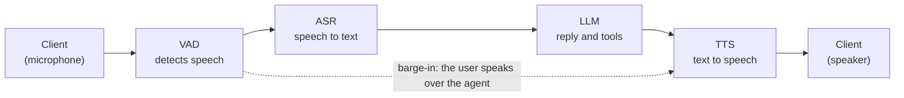

# Generic Assistant on LiveKit

This example is a cascaded voice assistant built on [LiveKit Agents](https://docs.livekit.io/agents/). It uses Nemotron automatic speech recognition (ASR) and Magpie text-to-speech (TTS) through the LiveKit NVIDIA plugin, and a Nemotron large language model (LLM) through the OpenAI-compatible API. A small web UI joins a LiveKit room, shows live transcripts and tool calls, and lets you pick a voice.

The example is self-contained. It has its own Python environment, image, and Compose file, and nothing outside this folder refers to it. It reuses the model recipes in [`docker/`](../../../docker) and the catalog in [`services.yaml`](../../../services.yaml). It does not use the Pipecat server, the React client, or [`examples_registry.yaml`](../../../examples_registry.yaml). To move the example to another repository, replace the `extends` entries in `docker-compose.yaml` with copies of those service definitions.

## How It Works

The assistant is a cascade: each stage hands its output to the next. The solid arrows in the following diagram are the normal flow. The dotted arrow is barge-in: when you speak over the agent, the VAD tells the TTS to stop.



1. **Client.** The browser sends your microphone to a LiveKit room over WebRTC, plays the agent's audio, and shows transcripts and tool calls.
2. **VAD.** The Silero voice activity detection (VAD) model detects when you start and stop speaking. It does not recognize words.
3. **ASR.** Nemotron streaming ASR turns your speech into text while you talk.
4. **LLM.** The Nemotron LLM writes the reply and calls tools, such as the weather tool, when needed.
5. **TTS.** Magpie TTS speaks the reply as it streams in.
6. **Barge-in.** The VAD keeps listening while the agent speaks. If you talk over the agent, it stops, and your new speech becomes the next turn.

The following diagram shows the deployed components. The ASR, LLM, and TTS services run on NVIDIA Cloud or in local sidecars, depending on the profile.


## Default Models

The agent uses the first entry of each slot that the `generic-assistant` example offers in `services.yaml`. To pick another catalog entry, set `LLM_SERVICE`, `ASR_SERVICE`, or `TTS_SERVICE` in `.env`.

| Profile | ASR | LLM | TTS |
| --- | --- | --- | --- |
| Cloud | Nemotron ASR Streaming English | Nemotron 3.5 Lightning 30B A3B | Magpie TTS Multilingual |
| Server | Nemotron ASR Streaming English (NIM) | Nemotron 3.5 Lightning 30B A3B (NIM) | Magpie TTS Multilingual (NIM) |
| Single GPU | Nemotron Speech Streaming (NeMo-Speech.cpp) | Nemotron 3.5 Lightning 30B A3B (vLLM) | Magpie TTS (NeMo-Speech.cpp) |

## Recommended Hardware

Pick the profile for your hardware. The support follows the `generic-assistant` example in the [Getting Started guide](../../../docs/01-getting-started.md), with the DGX Spark exception noted in the table.

| Hardware | Profile | Notes |
| --- | --- | --- |
| No local GPU | Cloud: `generic-assistant-livekit` | Models run on NVIDIA Cloud. You need `NVIDIA_API_KEY` and internet access. |
| Workstation or server GPU | Server: `generic-assistant-livekit/server` | NVIDIA NIM containers. The Getting Started guide lists this profile for workstations only. It also ran on a DGX Spark in our testing, with a first start of 40 minutes or more, but that combination is not officially supported. |
| Workstation, DGX Spark, or Jetson Thor | Single GPU: `generic-assistant-livekit/single-gpu` | vLLM for the LLM and NeMo-Speech.cpp for ASR and TTS. This is the profile for DGX Spark and Jetson Thor. |

For the Server and Single GPU profiles, use a machine that is not running other model servers:

- **Memory:** on DGX Spark and Jetson Thor, the GPU shares memory with the system. Stop other model containers first.
- **Ports:** these host ports must be free: 7880 to 7882 (LiveKit), 3000 (UI), 9000, 9001, 50151, 50152, and 18000 (Server), or 50051 and 18000 (Single GPU). A conflict shows as `port is already allocated`.
- **Pipecat:** do not run a Pipecat recipe on the same machine at the same time.

## Running the Example

Run all commands from the repository root, on the machine that hosts the deployment (refer to [Recommended Hardware](#recommended-hardware)). Docker builds and runs the containers there, and the model weights download there. Open the UI in a browser on the same machine, or use an SSH tunnel (refer to [Remote Browser Access](#remote-browser-access)).

1. Clone the repository. Skip this step if you already have a clone:

   ```bash
   git clone https://github.com/NVIDIA-AI-Blueprints/nemotron-voice-agent.git
   cd nemotron-voice-agent
   ```

2. Keep your existing `.env`. If you do not have one, copy the template. If you have one for another example, add the entries from [`.env.example`](.env.example):

   ```bash
   test -f .env || cp src/examples/generic_assistant_livekit/.env.example .env
   ```

3. In `.env`, set `NVIDIA_API_KEY` for the Cloud and Server profiles, or `HF_TOKEN` for the Single GPU profile. You do not need LiveKit credentials: the `livekit-init` service generates them on the first run and keeps them in the `livekit_state` volume. To use your own, set `LIVEKIT_API_KEY` and `LIVEKIT_API_SECRET`.

4. For the Server profile only, log in to the NVIDIA NGC container registry:

   ```bash
   set -a; . ./.env; set +a
   printf '%s' "$NVIDIA_API_KEY" | docker login nvcr.io -u '$oauthtoken' --password-stdin
   ```

5. Deploy one profile. **Run only one of the following options.** The helper script [`run.sh`](run.sh) checks your `.env`, stops a different running profile, warns about busy ports and low memory, prints each `docker compose` command, and waits until the sidecars are healthy.

   **Option A: Cloud.** Use this option when you have no local GPU.

   ```bash
   src/examples/generic_assistant_livekit/run.sh up cloud
   ```

   **Option B: Server with NIM.** Use this option on a workstation or server GPU. It also worked on a DGX Spark in our testing, but only Single GPU is documented for DGX Spark and Jetson Thor.

   ```bash
   src/examples/generic_assistant_livekit/run.sh up server
   ```

   **Option C: Single GPU.** Use this option on a workstation, DGX Spark, or Jetson Thor. It requires `HF_TOKEN` in `.env`, because vLLM downloads the LLM from Hugging Face. Create a [token](https://huggingface.co/settings/tokens) with read access. Download the speech weights once, and then start the profile:

   ```bash
   bash scripts/download-nemo-speech-models.sh
   src/examples/generic_assistant_livekit/run.sh up single-gpu
   ```

   The first start of the Server and Single GPU profiles downloads and loads models, which can take a long time. The script prints progress every 15 seconds. `not ready yet` is normal while a large model loads. Worry only if a container restarts or its last log line stops changing. Press Ctrl+C to stop waiting. The containers keep running. Connect after the script prints `Ready to connect`.

   ```bash
   src/examples/generic_assistant_livekit/run.sh wait single-gpu          # resume waiting (or: server)
   src/examples/generic_assistant_livekit/run.sh up single-gpu --no-wait  # start and return immediately
   ```

   The script runs this plain command. The `--env-file .env` option makes Compose read the root `.env`:

   ```bash
   docker compose --env-file .env -f src/examples/generic_assistant_livekit/docker-compose.yaml \
     --profile generic-assistant-livekit/single-gpu up -d     # or: generic-assistant-livekit, generic-assistant-livekit/server
   ```

   Each profile starts these services:

   | Profile | App services | Sidecars |
   | --- | --- | --- |
   | `generic-assistant-livekit` | `livekit-server`, `livekit-agent`, `livekit-ui` | none (NVIDIA Cloud) |
   | `generic-assistant-livekit/server` | `livekit-server`, `livekit-agent-server`, `livekit-ui` | `livekit-nvidia-llm`, `livekit-nemotron-asr`, `livekit-magpie-tts` |
   | `generic-assistant-livekit/single-gpu` | `livekit-server`, `livekit-agent-single-gpu`, `livekit-ui` | `livekit-nvidia-llm-vllm`, `livekit-nemo-speech` |

   The sidecars extend the service definitions in [`docker/`](../../../docker) and have network aliases that match the hostnames in `services.yaml`. The agent shares the LiveKit server's network namespace, because LiveKit advertises `LIVEKIT_NODE_IP` for media. If you recreate `livekit-server`, run the same `up` command again so that the agent is recreated too.

6. Open `http://localhost:3000/`, select **Connect**, and speak. Try "What is the weather in Paris?". The transcript panel shows each tool call and result.

7. When you are done, stop the profile. Omit the profile to stop all of them:

   ```bash
   src/examples/generic_assistant_livekit/run.sh down single-gpu     # or: cloud, server
   ```

## Cleanup

```bash
src/examples/generic_assistant_livekit/run.sh ps                 # show containers
src/examples/generic_assistant_livekit/run.sh down single-gpu    # stop a profile
src/examples/generic_assistant_livekit/run.sh clean single-gpu   # stop and delete volumes, after a confirmation
src/examples/generic_assistant_livekit/run.sh clean --image -y   # all profiles, also remove the image, no prompt
```

| Script command | Plain command | Removes | Keeps |
| --- | --- | --- | --- |
| `run.sh down <profile>` | `docker compose ... --profile <profile> down` | Containers and the network | Volumes, the image, downloaded weights |
| `run.sh clean <profile>` | `docker compose ... --profile <profile> down -v` | The above, and the volumes `livekit_state`, `llm_cache`, `asr_cache`, and `tts_cache` | The image, downloaded weights, pulled sidecar images |
| `run.sh clean --image` | `down -v`, then `docker image rm generic-assistant-livekit:latest` | The above, and the example image | Downloaded weights, pulled sidecar images |

- **After a `clean`:** the next start generates new LiveKit credentials, and the Server profile downloads the NIM models again. After `--image`, the next start also rebuilds the image.
- **Weights are kept:** Hugging Face downloads are in `~/.cache/huggingface`, and the NeMo-Speech.cpp weights are in `models/nemo-speech`. Other applications can share them, so remove them only if nothing else needs them.
- **Switching profiles:** `run.sh up` stops a different running profile for you. With plain Compose, run `down` for the old profile first, or its containers keep their ports.

## Voice Selection

After you connect, the **Voice** list shows the voices that the TTS server offers. Select one to switch. The agent uses it from the next reply and says a short sample, which does not enter the conversation history.

- **Discovery:** the agent asks the TTS server for its voices when a session starts. This works for NVIDIA Cloud, the Magpie NIM, and NeMo-Speech.cpp. If the server cannot be asked, the list has only the default voice.
- **Language and default:** the list shows voices for the catalog entry's language, `en-US` by default. The default voice is `voice_id` in `services.yaml` (refer to [Configure TTS](../../../docs/how-to/configure-tts.md#voices--emotions)).
- **Validation:** the agent ignores any voice that the server did not list.
- **Scope:** the choice applies to the current session only.

## Remote Browser Access

This example does not include a Traversal Using Relays around NAT (TURN) server. The UI is published on `127.0.0.1` and LiveKit advertises `LIVEKIT_NODE_IP` (default `127.0.0.1`), so the browser must run on the same machine as Docker. Browsers also allow the microphone only on `localhost` or HTTPS.

To use a browser on your laptop, forward the UI, signaling, and LiveKit TCP media ports. Run this command on your laptop and keep it open. Then open `http://localhost:3000/`:

```bash
ssh -N -L 3000:127.0.0.1:3000 -L 7880:127.0.0.1:7880 -L 7881:127.0.0.1:7881 <user>@<host>
```

SSH cannot forward UDP, so media falls back to TCP port 7881. For a LAN or internet setup, set `LIVEKIT_NODE_IP` to the host address, serve the UI over HTTPS, and add a TURN server. The repository provides one in [`docker/docker-compose.coturn.yaml`](../../../docker/docker-compose.coturn.yaml) (refer to [Enable the TURN Server](../../../docs/how-to/enable-turn-server.md)). The UI does not pass TURN credentials to LiveKit, so extend `ui/app.js` to use relay candidates.

## Customization

| Path | Role |
| --- | --- |
| `agent.py` | Agent worker: builds the ASR, LLM, and TTS clients, registers tools, and publishes UI events |
| `config.py` | Resolves endpoints from `services.yaml` for the `cloud`, `server`, and `single-gpu` recipes |
| `prompts.yaml` | Prompt and greeting |
| `tools.py`, `tool_wrapper.py` | Weather and date tool logic, and the wrapper that reports tool calls to the UI |
| `voices.py` | Lists the voices a speech server offers, and validates voice-change requests |
| `credentials.py` | Generates the LiveKit key and secret and the server config |
| `ui_server.py`, `ui/` | Web UI and the join-token endpoint |
| `run.sh` | Helper script to start, wait for, stop, and clean up a profile |
| `docker-compose.yaml`, `Dockerfile`, `.env.example` | Services, image, and environment template |
| `pyproject.toml`, `uv.lock` | Example-only dependencies |

To add a tool, write a function with type hints and a docstring `Args:` section in `agent.py`, add it to `TOOLS`, and mention it in `prompts.yaml`. To change models, refer to [Configure Services](../../../docs/how-to/configure-services.md). The agent applies the catalog entry's `extra_params` and turns reasoning off, as the `settings.yaml` default does. It does not read other editable settings.

## Dependencies

The example keeps its dependencies separate from the Pipecat environment, because the root `pyproject.toml` forces `nvidia-riva-client>=2.27.0,<3`. Do not merge the two environments.

> **Temporary pin:** the NVIDIA speech changes from [livekit/agents#6706](https://github.com/livekit/agents/pull/6706) merged on November 12, but no `livekit-plugins-nvidia` release contains them yet (1.8.11 predates the merge). `pyproject.toml` pins `livekit-plugins-nvidia` to the merge commit `b7c9e2d0` of `livekit/agents`. `livekit-agents` and `livekit-plugins-silero` come from PyPI through `override-dependencies`, because the silero model is a Git LFS file that a git install does not include. When the next release ships, use `livekit-plugins-nvidia>=1.8.12`, and remove the git source and both overrides.

To run the unit tests and install the example environment without Docker:

```bash
uv run pytest tests/unit/test_livekit_example_*.py -v
uv sync --project src/examples/generic_assistant_livekit
```

## Credits

The web UI layout and styling are adapted from [aws-samples/sample-voice-agent-on-aws](https://github.com/aws-samples/sample-voice-agent-on-aws/tree/main/samples/cascading/livekit-transcribe-polly) (MIT-0). The license text is in [THIRD_PARTY_NOTICES.txt](../../../THIRD_PARTY_NOTICES.txt). The browser loads [livekit-client](https://github.com/livekit/client-sdk-js) 2.15.3 (Apache-2.0) from the jsDelivr CDN.
