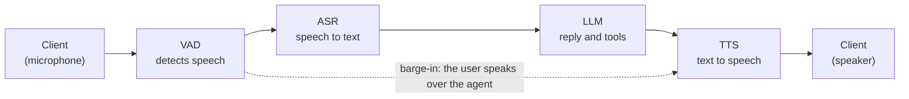

# Generic Assistant on LiveKit

This example is a cascaded voice assistant built on [LiveKit Agents](https://docs.livekit.io/agents/), with automatic speech recognition (ASR), large language model (LLM), and text-to-speech (TTS) models. A small web UI shows live transcripts and tool calls, and lets you choose a [use case](#use-cases) and a [voice](#voice-selection).

The example is self-contained. It has its own Python environment, image, and Compose file, and nothing outside this folder refers to it. It reuses the model recipes in [`docker/`](../../../docker) and the catalog in [`services.yaml`](../../../services.yaml), and it does not use the Pipecat server, the React client, or [`examples_registry.yaml`](../../../examples_registry.yaml). To move it to another repository, replace the `extends` entries in `docker-compose.yaml` with copies of those service definitions.

## How It Works

The assistant is a cascade: each stage hands its output to the next. The dotted arrow is barge-in: when you speak over the agent, the VAD tells the TTS to stop.



1. **Client.** The browser sends your microphone to a LiveKit room over WebRTC, and plays the agent's audio.
2. **VAD.** The Silero voice activity detection (VAD) model detects when you start and stop speaking.
3. **ASR.** The ASR model turns your speech into text while you talk.
4. **LLM.** The LLM writes the reply and calls the tools of the selected use case.
5. **TTS.** The TTS model speaks the reply as it streams in.
6. **Barge-in.** The VAD keeps listening while the agent speaks. If you talk over it, the agent stops, and your new speech becomes the next turn.

The ASR, LLM, and TTS services run on NVIDIA Cloud or in local sidecars, depending on the profile:


## Deployment Profiles

The profiles match the three modes of the repository's Pipecat examples. Choose one for your hardware. The support follows the [Getting Started guide](../../../docs/01-getting-started.md).

| Profile | Hardware and credentials | ASR and TTS | LLM | Model files |
| --- | --- | --- | --- | --- |
| Cloud: `generic-assistant-livekit` | No GPU. `NVIDIA_API_KEY` | NVIDIA Cloud | NVIDIA Cloud | None |
| Single GPU: `generic-assistant-livekit/single-gpu` | Workstation, DGX Spark, or Jetson Thor. `HF_TOKEN` | NeMo-Speech.cpp, one sidecar that loads small GGUF files | vLLM | Hugging Face. A script downloads the speech files (under 1 GB each). vLLM downloads the LLM (about 21.6 GB) at first start. |
| Server: `generic-assistant-livekit/server` | Workstation or server GPU. `NVIDIA_API_KEY` and an NGC login | Official NVIDIA NIM containers | An NVIDIA NIM container | NGC. Each NIM downloads its models at first start. The first run can take 30 to 60 minutes. |

The Server profile is documented for workstations only. It also ran on a DGX Spark in our testing, which is not an officially supported combination.

The default models are the first entries that the `generic-assistant` example offers in `services.yaml`: Nemotron ASR Streaming, Nemotron 3.5 Lightning 30B A3B, and Magpie TTS. To use others, refer to [Configure Models](#configure-models). For the Server and Single GPU profiles, use a machine that is not running other model servers:

- **Memory:** on DGX Spark and Jetson Thor, the GPU shares memory with the system. Stop other model containers first.
- **Ports:** these host ports must be free: 7880 to 7882 (LiveKit), 3000 (UI), 9000, 9001, 50151, 50152, and 18000 (Server), or 50051 and 18000 (Single GPU).
- **Pipecat:** do not run a Pipecat recipe on the same machine at the same time.

## Running the Example

This example needs Docker Compose 2.24 or newer. Run all commands from the repository root, on the machine that hosts the deployment. Docker builds and runs the containers there, and the model weights download there.

1. Clone the repository. Skip this step if you already have a clone:

   ```bash
   git clone https://github.com/NVIDIA-AI-Blueprints/nemotron-voice-agent.git
   cd nemotron-voice-agent
   ```

2. Keep your existing `.env`. If you do not have one, copy the template. If you have one for another example, add the entries from [`.env.example`](.env.example):

   ```bash
   test -f .env || cp src/examples/generic_assistant_livekit/.env.example .env
   ```

3. In `.env`, set `NVIDIA_API_KEY` (Cloud and Server) or `HF_TOKEN` (Single GPU). You do not need LiveKit credentials: the `livekit-init` service generates them on the first run. To use your own, set `LIVEKIT_API_KEY` and `LIVEKIT_API_SECRET`.

4. For the Server profile only, log in to the NVIDIA NGC container registry:

   ```bash
   set -a; . ./.env; set +a
   printf '%s' "$NVIDIA_API_KEY" | docker login nvcr.io -u '$oauthtoken' --password-stdin
   ```

5. Deploy one profile. **Run only one of the following options.** The helper script [`run.sh`](run.sh) checks your `.env`, stops a different running profile, warns about busy ports and low memory, and waits until the sidecars are healthy and the agent has registered with LiveKit.

   **Option A: Cloud.**

   ```bash
   src/examples/generic_assistant_livekit/run.sh up cloud
   ```

   **Option B: Single GPU.** Download the speech weights once, and then start the profile:

   ```bash
   bash scripts/download-nemo-speech-models.sh
   src/examples/generic_assistant_livekit/run.sh up single-gpu
   ```

   **Option C: Server with NIM.**

   ```bash
   src/examples/generic_assistant_livekit/run.sh up server
   ```

   The first start of the Single GPU and Server profiles downloads and loads models, which can take a long time. The script prints progress every 15 seconds. `not ready yet` is normal while a large model loads. Worry only if a container restarts or its last log line stops changing. Connect after the script prints `Ready to connect`. To stop waiting without stopping the containers, press Ctrl+C. To resume, or to skip the wait:

   ```bash
   src/examples/generic_assistant_livekit/run.sh wait single-gpu          # or: server
   src/examples/generic_assistant_livekit/run.sh up single-gpu --no-wait
   ```

   The script runs this plain command, where `--env-file .env` makes Compose read the root `.env`:

   ```bash
   docker compose --env-file .env -f src/examples/generic_assistant_livekit/docker-compose.yaml \
     --profile generic-assistant-livekit/single-gpu up -d     # or: generic-assistant-livekit, generic-assistant-livekit/server
   ```

   Each profile starts `livekit-server`, `livekit-ui`, and one agent (`livekit-agent`, `livekit-agent-single-gpu`, or `livekit-agent-server`). Single GPU adds `livekit-nvidia-llm-vllm` and `livekit-nemo-speech`. Server adds `livekit-nvidia-llm`, `livekit-nemotron-asr`, and `livekit-magpie-tts`. The sidecars extend the definitions in `docker/`. The agent shares the LiveKit server's network namespace, so if you recreate `livekit-server`, run the same `up` command again.

6. Open the UI. On the machine that runs Docker, open `http://localhost:3000/`. For a browser on another computer, start an SSH tunnel on that computer first, and keep it open (refer to [Remote Browser Access](#remote-browser-access)):

   ```bash
   src/examples/generic_assistant_livekit/run.sh tunnel <user>@<host>
   ```

   The header shows the deployment mode and the models in use. Choose a use case and a voice, select **Connect**, and speak.

7. When you are done, stop the profile. Omit the profile to stop all of them:

   ```bash
   src/examples/generic_assistant_livekit/run.sh down single-gpu     # or: cloud, server
   ```

## Use Cases

The **Use case** list selects the agent's prompt and tools. Choose one before you connect. It stays fixed for the session, and the generic assistant is the default.

| Use case | What it does | Try saying |
| --- | --- | --- |
| Generic assistant | Date, time, and live weather | "What is the weather in Paris?" |
| Insurance claims | Summit Auto Insurance: look up a policy, file a claim, check a claim | "I was in a fender bender yesterday, my policy is AUT-1001." |
| Clinic booking | Riverside Family Clinic: find open slots, book and cancel appointments | "I would like to see a dermatologist this week." |
| Bank assistant | Harbor Bank: verify a PIN (demo PIN 1234), then balances, transfers, and a lost card | "What is my checking balance?" |

The insurance, clinic, and bank data is fictional and held in memory for one session. Only the weather lookup calls an outside service (Open-Meteo, no key needed). Each tool call shows in the transcript panel. To add a use case, add an entry to `prompts.yaml`, write its tool functions in `scenarios.py`, and register it in `USE_CASES`. LiveKit builds each tool schema from the type hints and the docstring `Args:` section.

## Voice Selection

The **Voice** list shows the voices that the TTS server offers. Choose a voice before you connect, or change it during the session: the agent uses the new voice from its next reply and says a short sample.

- **Discovery:** the agent worker asks the TTS server for its voices when it starts and retries until the server answers. The UI shows `Loading voices…` until then.
- **Language and default:** the list shows voices for the catalog entry's language (`en-US` by default). The default voice is `voice_id` in `services.yaml` (refer to [Configure TTS](../../../docs/how-to/configure-tts.md#voices--emotions)).
- **Validation:** the UI server and the agent ignore any voice that the server did not list.

## Configure Models

The agent reads the repository's [`services.yaml`](../../../services.yaml) catalog, which the Pipecat examples also use. To use a different model, set one or more of these variables in `.env`, and then recreate the agent (`livekit-agent`, `livekit-agent-server`, or `livekit-agent-single-gpu`):

```bash
LLM_SERVICE=nemotron-bolt-4b
ASR_SERVICE=nemotron-asr-streaming-english
TTS_SERVICE=magpie-multilingual-tts
```

```bash
docker compose --env-file .env -f src/examples/generic_assistant_livekit/docker-compose.yaml \
  --profile generic-assistant-livekit/single-gpu up -d --force-recreate livekit-agent-single-gpu
```

To list the keys that each profile accepts, with the defaults marked, run this command from the repository root:

```bash
PYTHONPATH=src uv run python -m examples.generic_assistant_livekit.config single-gpu   # or: cloud, server. Omit to list all
```

- **Cloud:** any listed entry works without other setup.
- **Server and Single GPU:** the entry's sidecar must be running, and `docker-compose.yaml` starts only the defaults. To run another model locally, add its sidecar from `docker/` with `extends`, with a network alias that matches the hostname in `services.yaml`.
- **New models:** add an entry to `services.yaml`, and then select it.
- **Not supported:** ASR entries that use the Transcribe HTTP API, such as `nemotron-transcribe`. The LiveKit NVIDIA plugin speaks Riva gRPC.

Unlike the Pipecat examples, this example has no **Services** tab, no per-example service list, and no `settings.yaml` controls. You choose models at deploy time, one profile serves all three slots, and only the entry's `extra_params` apply, with reasoning off.

## Remote Browser Access

This example does not include a Traversal Using Relays around NAT (TURN) server. The UI and the LiveKit ports listen on `127.0.0.1`, and LiveKit advertises `LIVEKIT_NODE_IP` (default `127.0.0.1`), so the browser must run on the Docker machine or reach it through a tunnel. Browsers also allow the microphone only on `localhost` or HTTPS.

Run `run.sh tunnel` on the laptop and keep it open. It forwards the UI, signaling, and LiveKit TCP media ports, and it stops with an error if a local port is busy. Then open `http://localhost:3000/`. Without this folder on the laptop, run the plain command:

```bash
src/examples/generic_assistant_livekit/run.sh tunnel <user>@<host>
# or: ssh -N -L 3000:127.0.0.1:3000 -L 7880:127.0.0.1:7880 -L 7881:127.0.0.1:7881 <user>@<host>
```

To start the tunnel with a plain `ssh -N <host>`, add the forwards to your SSH config on the laptop:

```text
Host spark
  HostName <host>
  User <user>
  LocalForward 3000 127.0.0.1:3000
  LocalForward 7880 127.0.0.1:7880
  LocalForward 7881 127.0.0.1:7881
```

SSH cannot forward UDP, so media falls back to TCP port 7881. For a LAN or internet setup, set `LIVEKIT_NODE_IP` and `LIVEKIT_BIND` to the host address, serve the UI over HTTPS, and add a TURN server ([`docker/docker-compose.coturn.yaml`](../../../docker/docker-compose.coturn.yaml), refer to [Enable the TURN Server](../../../docs/how-to/enable-turn-server.md)). The UI does not pass TURN credentials to LiveKit, so extend `ui/app.js` to use relay candidates.

The defaults keep the example private to the machine that runs it:

- **The UI server mints join tokens without authentication,** and each session starts an agent that uses your model quota. Keep the UI on `127.0.0.1` (`LIVEKIT_UI_BIND`) unless the network is trusted.
- **LiveKit ports 7880 to 7882 also bind to `127.0.0.1`.** `LIVEKIT_BIND=0.0.0.0` opens them. Join tokens still require the LiveKit secret.
- **Credentials reach only the containers that use them.** Only the cloud agent receives `NVIDIA_API_KEY`, and no application container receives `HF_TOKEN`.

## Cleanup

```bash
src/examples/generic_assistant_livekit/run.sh ps                 # show containers
src/examples/generic_assistant_livekit/run.sh down single-gpu    # stop a profile
src/examples/generic_assistant_livekit/run.sh clean single-gpu   # stop and delete volumes, after a confirmation
src/examples/generic_assistant_livekit/run.sh clean --image -y   # all profiles, also remove the image, no prompt
```

`down` removes the containers and the network. `clean` also removes the volumes (`livekit_state`, `llm_cache`, `asr_cache`, `tts_cache`), so the next start generates new LiveKit credentials, and the Server profile downloads its NIM models again. `--image` also removes the example image, which the next start rebuilds. The plain commands are `docker compose ... --profile <profile> down [-v]` and `docker image rm generic-assistant-livekit:latest`.

Cleanup never removes the downloaded weights (`~/.cache/huggingface` and `models/nemo-speech`) or the pulled sidecar images, because other applications can share them. `run.sh up` stops a different running profile for you. With plain Compose, run `down` for the old profile first, or its containers keep their ports.

## Troubleshooting

Check the agent log first: `src/examples/generic_assistant_livekit/run.sh logs <profile> agent`.

- **Transcripts appear but the agent does not answer (Cloud):** the hosted LLM is probably rate limited (`429 Too Many Requests` in the log, and a warning in the UI). Wait a minute, or choose another model, for example `LLM_SERVICE=nemotron-bolt-4b`.
- **`LLM was busy. Retrying.` in the transcript panel:** a call failed for a moment, such as with HTTP 429, and the library retried it. The conversation continues.
- **The Voice list is empty or shows `Default voice (list unavailable)`:** the TTS server has not answered yet. A hosted endpoint can take up to 30 seconds when cold, and a local sidecar answers after it loads its models.
- **`port is already allocated`:** another container holds a host port. Refer to [Deployment Profiles](#deployment-profiles) and [Cleanup](#cleanup).

## Customization

| Path | Role |
| --- | --- |
| `agent.py`, `config.py` | The agent worker, and endpoint resolution from `services.yaml` for each profile |
| `prompts.yaml`, `scenarios.py` | The use cases: prompts and UI text, and tools with fictional demo data |
| `tools.py`, `tool_wrapper.py` | Weather and date logic, and the wrapper that reports tool calls to the UI |
| `voices.py`, `session.py`, `errors.py`, `state.py` | Voice discovery and validation, token attributes, error summaries, and the files the worker shares with the UI server |
| `credentials.py` | Generates the LiveKit key, secret, and server config |
| `ui_server.py`, `ui/` | The web UI and its endpoints for the join token, use cases, voices, and deployment |
| `run.sh` | Helper script to start, wait for, stop, and clean up a profile, and to open the tunnel |
| `docker-compose.yaml`, `Dockerfile`, `.env.example` | Services, image, and environment template |
| `pyproject.toml`, `uv.lock` | Example-only dependencies |

## Dependencies

The example keeps its dependencies separate from the Pipecat environment, because the root `pyproject.toml` forces `nvidia-riva-client>=2.27.0,<3`. Do not merge the two environments.

> **Temporary pin:** the NVIDIA speech changes from [livekit/agents#6706](https://github.com/livekit/agents/pull/6706) merged on November 12, but no `livekit-plugins-nvidia` release contains them yet (1.8.11 predates the merge). `pyproject.toml` pins that plugin to the merge commit `b7c9e2d0`. `livekit-agents` and `livekit-plugins-silero` come from PyPI through `override-dependencies`, because the silero model is a Git LFS file that a git install does not include. When the next release ships, use `livekit-plugins-nvidia>=1.8.12` and remove the git source and both overrides.

To run the unit tests and install the example environment without Docker:

```bash
uv run pytest tests/unit/test_livekit_example_*.py -v
uv sync --project src/examples/generic_assistant_livekit
```
