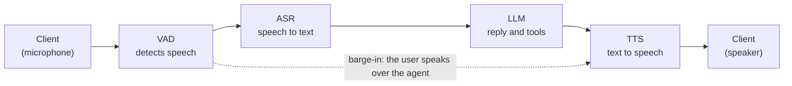

# Generic Assistant on LiveKit

This example is a cascaded voice assistant built on [LiveKit Agents](https://docs.livekit.io/agents/). It uses Nemotron automatic speech recognition (ASR) and Magpie text-to-speech (TTS) through the LiveKit NVIDIA plugin, and a Nemotron large language model (LLM) through the OpenAI-compatible API. A small web UI joins a LiveKit room, shows live transcripts and tool calls, and lets you pick a use case and a voice.

The example is self-contained. It has its own Python environment, image, and Compose file, and nothing outside this folder refers to it. It reuses the model recipes in [`docker/`](../../../docker) and the catalog in [`services.yaml`](../../../services.yaml). It does not use the Pipecat server, the React client, or [`examples_registry.yaml`](../../../examples_registry.yaml). To move the example to another repository, replace the `extends` entries in `docker-compose.yaml` with copies of those service definitions.

## How It Works

The assistant is a cascade: each stage hands its output to the next. The solid arrows in the following diagram are the normal flow. The dotted arrow is barge-in: when you speak over the agent, the VAD tells the TTS to stop.



1. **Client.** The browser sends your microphone to a LiveKit room over WebRTC, plays the agent's audio, and shows transcripts and tool calls.
2. **VAD.** The Silero voice activity detection (VAD) model detects when you start and stop speaking. It does not recognize words.
3. **ASR.** Nemotron streaming ASR turns your speech into text while you talk.
4. **LLM.** The Nemotron LLM writes the reply and calls tools, such as the weather tool, when needed.
5. **TTS.** Magpie TTS speaks the reply as it streams in.
6. **Barge-in.** The VAD keeps listening while the agent speaks. If you talk over the agent, it stops, and your new speech becomes the next turn.

The following diagram shows the deployed components. The ASR, LLM, and TTS services run on NVIDIA Cloud or in local sidecars, depending on the profile.


## Default Models

The agent uses the first entry of each slot that the `generic-assistant` example offers in `services.yaml`. To use other models, refer to [Configure Models](#configure-models).

| Profile | ASR | LLM | TTS |
| --- | --- | --- | --- |
| Cloud | Nemotron ASR Streaming English | Nemotron 3.5 Lightning 30B A3B | Magpie TTS Multilingual |
| Single GPU | Nemotron Speech Streaming (NeMo-Speech.cpp) | Nemotron 3.5 Lightning 30B A3B (vLLM) | Magpie TTS (NeMo-Speech.cpp) |
| Server | Nemotron ASR Streaming English (NIM) | Nemotron 3.5 Lightning 30B A3B (NIM) | Magpie TTS Multilingual (NIM) |

## Configure Models

The agent reads the repository's [`services.yaml`](../../../services.yaml) catalog, the same file that the Pipecat examples use. Catalog entries, their `nvcf` cloud overrides, and the `SERVICE_RECIPE` selection work the same way. To use a different model, set one or more of these variables in `.env`:

```bash
LLM_SERVICE=nemotron-bolt-4b
ASR_SERVICE=nemotron-asr-streaming-english
TTS_SERVICE=magpie-multilingual-tts
```

Then recreate the agent so that it reads the change. Use `livekit-agent`, `livekit-agent-server`, or `livekit-agent-single-gpu`, depending on the profile:

```bash
docker compose --env-file .env -f src/examples/generic_assistant_livekit/docker-compose.yaml \
  --profile generic-assistant-livekit/single-gpu up -d --force-recreate livekit-agent-single-gpu
```

To list the keys that each profile accepts, with the defaults marked, run this command from the repository root:

```bash
PYTHONPATH=src uv run python -m examples.generic_assistant_livekit.config single-gpu   # or: cloud, server. Omit to list all
```

- **Cloud:** any listed entry works without other setup, because NVIDIA hosts it.
- **Server and Single GPU:** the entry's sidecar must be running. `docker-compose.yaml` starts only the default sidecars. To run another model locally, add its sidecar from [`docker/`](../../../docker) with `extends`, as the existing sidecars do, and give it a network alias that matches the hostname in `services.yaml`.
- **New models:** add an entry to `services.yaml`, and then select it with the variables above.
- **Not supported:** ASR entries that use the Transcribe HTTP API, such as `nemotron-transcribe`, because the LiveKit NVIDIA plugin speaks Riva gRPC.

The example inherits the shared catalog, but not the Pipecat UI around it:

| | Pipecat examples | This example |
| --- | --- | --- |
| Model catalog (`services.yaml`) | Yes | Yes, the same file |
| List of services per example (`examples_registry.yaml`) | Each example lists what it offers | Not used. Any catalog entry that the profile can serve |
| Switching models | **Services** tab in the UI | At deploy time, through `.env` and an agent restart |
| Editable settings (`settings.yaml`) | UI controls, such as the reasoning budget | Only the entry's `extra_params`, with reasoning off |
| Cloud and local models together | Cloud entries appear in local profiles | One profile for all three slots |

## Deployment Profiles

The profiles match the three modes of the repository's Pipecat examples. They differ in where the models run and which runtime serves them.

| Profile | ASR and TTS | LLM | Model files |
| --- | --- | --- | --- |
| Cloud | NVIDIA Cloud endpoints | NVIDIA Cloud endpoint | None. Nothing runs locally. |
| Single GPU | NeMo-Speech.cpp: one sidecar serves ASR and TTS | vLLM serves the NVFP4 checkpoint | Hugging Face. The speech GGUF files are under 1 GB each, downloaded by `download-nemo-speech-models.sh`. The LLM is about 21.6 GB, downloaded by vLLM at first start. |
| Server | Official NVIDIA NIM containers, one each for ASR and TTS | An official NVIDIA NIM container | NGC. Each NIM downloads its own models at first start. |

- **Single GPU:** open runtimes that fit one GPU. NeMo-Speech.cpp is a C++ runtime that loads small GGUF files, which are compact (quantized) single-file weights. In our testing, this speech sidecar started faster than the NIM speech containers. The LLM download dominates the first start.
- **Server:** NVIDIA NIM microservices are prebuilt, supported containers that include an optimized runtime and fetch their models from NGC. They suit scaling and production on workstation or server GPUs. The Getting Started guide notes that the first run can take 30 to 60 minutes.
- **Cloud:** the same models served by NVIDIA, so you need no GPU. It is the quickest way to try the example.

For the hardware and credentials that each profile needs, refer to the [Getting Started guide](../../../docs/01-getting-started.md).

## Recommended Hardware

Pick the profile for your hardware. The support follows the `generic-assistant` example in the [Getting Started guide](../../../docs/01-getting-started.md), with the DGX Spark exception noted in the table.

| Hardware | Profile | Notes |
| --- | --- | --- |
| No local GPU | Cloud: `generic-assistant-livekit` | Models run on NVIDIA Cloud. You need `NVIDIA_API_KEY` and internet access. |
| Workstation, DGX Spark, or Jetson Thor | Single GPU: `generic-assistant-livekit/single-gpu` | vLLM for the LLM and NeMo-Speech.cpp for ASR and TTS. This is the profile for DGX Spark and Jetson Thor. |
| Workstation or server GPU | Server: `generic-assistant-livekit/server` | NVIDIA NIM containers. The Getting Started guide lists this profile for workstations only. It also ran on a DGX Spark in our testing, with a first start of 40 minutes or more, but that combination is not officially supported. |

For the Server and Single GPU profiles, use a machine that is not running other model servers:

- **Memory:** on DGX Spark and Jetson Thor, the GPU shares memory with the system. Stop other model containers first.
- **Ports:** these host ports must be free: 7880 to 7882 (LiveKit), 3000 (UI), 9000, 9001, 50151, 50152, and 18000 (Server), or 50051 and 18000 (Single GPU). A conflict shows as `port is already allocated`.
- **Pipecat:** do not run a Pipecat recipe on the same machine at the same time.

## Running the Example

Run all commands from the repository root, on the machine that hosts the deployment (refer to [Recommended Hardware](#recommended-hardware)). Docker builds and runs the containers there, and the model weights download there. Open the UI in a browser on the same machine, or use an SSH tunnel (refer to [Remote Browser Access](#remote-browser-access)).

1. Clone the repository. Skip this step if you already have a clone:

   ```bash
   git clone https://github.com/NVIDIA-AI-Blueprints/nemotron-voice-agent.git
   cd nemotron-voice-agent
   ```

2. Keep your existing `.env`. If you do not have one, copy the template. If you have one for another example, add the entries from [`.env.example`](.env.example):

   ```bash
   test -f .env || cp src/examples/generic_assistant_livekit/.env.example .env
   ```

3. In `.env`, set `NVIDIA_API_KEY` for the Cloud and Server profiles, or `HF_TOKEN` for the Single GPU profile. You do not need LiveKit credentials: the `livekit-init` service generates them on the first run and keeps them in the `livekit_state` volume. To use your own, set `LIVEKIT_API_KEY` and `LIVEKIT_API_SECRET`.

4. For the Server profile only, log in to the NVIDIA NGC container registry:

   ```bash
   set -a; . ./.env; set +a
   printf '%s' "$NVIDIA_API_KEY" | docker login nvcr.io -u '$oauthtoken' --password-stdin
   ```

5. Deploy one profile. **Run only one of the following options.** The helper script [`run.sh`](run.sh) checks your `.env`, stops a different running profile, warns about busy ports and low memory, prints each `docker compose` command, and waits until the sidecars are healthy.

   **Option A: Cloud.** Use this option when you have no local GPU.

   ```bash
   src/examples/generic_assistant_livekit/run.sh up cloud
   ```

   **Option B: Single GPU.** Use this option on a workstation, DGX Spark, or Jetson Thor. It requires `HF_TOKEN` in `.env`, because vLLM downloads the LLM from Hugging Face. Create a [token](https://huggingface.co/settings/tokens) with read access. Download the speech weights once, and then start the profile:

   ```bash
   bash scripts/download-nemo-speech-models.sh
   src/examples/generic_assistant_livekit/run.sh up single-gpu
   ```

   **Option C: Server with NIM.** Use this option on a workstation or server GPU. It also worked on a DGX Spark in our testing, but only Single GPU is documented for DGX Spark and Jetson Thor.

   ```bash
   src/examples/generic_assistant_livekit/run.sh up server
   ```

   The first start of the Single GPU and Server profiles downloads and loads models, which can take a long time. The script prints progress every 15 seconds. `not ready yet` is normal while a large model loads. Worry only if a container restarts or its last log line stops changing. Press Ctrl+C to stop waiting. The containers keep running. Connect after the script prints `Ready to connect`.

   ```bash
   src/examples/generic_assistant_livekit/run.sh wait single-gpu          # resume waiting (or: server)
   src/examples/generic_assistant_livekit/run.sh up single-gpu --no-wait  # start and return immediately
   ```

   The script runs this plain command. The `--env-file .env` option makes Compose read the root `.env`:

   ```bash
   docker compose --env-file .env -f src/examples/generic_assistant_livekit/docker-compose.yaml \
     --profile generic-assistant-livekit/single-gpu up -d     # or: generic-assistant-livekit, generic-assistant-livekit/server
   ```

   Each profile starts these services:

   | Profile | App services | Sidecars |
   | --- | --- | --- |
   | `generic-assistant-livekit` | `livekit-server`, `livekit-agent`, `livekit-ui` | none (NVIDIA Cloud) |
   | `generic-assistant-livekit/single-gpu` | `livekit-server`, `livekit-agent-single-gpu`, `livekit-ui` | `livekit-nvidia-llm-vllm`, `livekit-nemo-speech` |
   | `generic-assistant-livekit/server` | `livekit-server`, `livekit-agent-server`, `livekit-ui` | `livekit-nvidia-llm`, `livekit-nemotron-asr`, `livekit-magpie-tts` |

   The sidecars extend the service definitions in [`docker/`](../../../docker) and have network aliases that match the hostnames in `services.yaml`. The agent shares the LiveKit server's network namespace, because LiveKit advertises `LIVEKIT_NODE_IP` for media. If you recreate `livekit-server`, run the same `up` command again so that the agent is recreated too.

6. Open the UI.

   - **Browser on the same machine as Docker:** open `http://localhost:3000/`.
   - **Browser on another computer, such as your laptop:** the UI listens only on the host's loopback, so start an SSH tunnel first. The script does not start it, because it must run on the computer that has the browser. Run this command in a terminal on that computer, keep it open, and then open `http://localhost:3000/`:

     ```bash
     src/examples/generic_assistant_livekit/run.sh tunnel <user>@<host>
     ```

   The header shows the deployment mode and the models in use, with the runtime that serves each one. Select **Connect**, and speak. Try "What is the weather in Paris?". The transcript panel shows each tool call and result.

7. When you are done, stop the profile. Omit the profile to stop all of them:

   ```bash
   src/examples/generic_assistant_livekit/run.sh down single-gpu     # or: cloud, server
   ```

## Cleanup

```bash
src/examples/generic_assistant_livekit/run.sh ps                 # show containers
src/examples/generic_assistant_livekit/run.sh down single-gpu    # stop a profile
src/examples/generic_assistant_livekit/run.sh clean single-gpu   # stop and delete volumes, after a confirmation
src/examples/generic_assistant_livekit/run.sh clean --image -y   # all profiles, also remove the image, no prompt
```

| Script command | Plain command | Removes | Keeps |
| --- | --- | --- | --- |
| `run.sh down <profile>` | `docker compose ... --profile <profile> down` | Containers and the network | Volumes, the image, downloaded weights |
| `run.sh clean <profile>` | `docker compose ... --profile <profile> down -v` | The above, and the volumes `livekit_state`, `llm_cache`, `asr_cache`, and `tts_cache` | The image, downloaded weights, pulled sidecar images |
| `run.sh clean --image` | `down -v`, then `docker image rm generic-assistant-livekit:latest` | The above, and the example image | Downloaded weights, pulled sidecar images |

- **After a `clean`:** the next start generates new LiveKit credentials, and the Server profile downloads the NIM models again. After `--image`, the next start also rebuilds the image.
- **Weights are kept:** Hugging Face downloads are in `~/.cache/huggingface`, and the NeMo-Speech.cpp weights are in `models/nemo-speech`. Other applications can share them, so remove them only if nothing else needs them.
- **Switching profiles:** `run.sh up` stops a different running profile for you. With plain Compose, run `down` for the old profile first, or its containers keep their ports.

## Use Cases

The **Use case** list in the UI selects the agent's prompt and tools. Choose one before you connect. It stays fixed for the session. The generic assistant is the default.

| Use case | What it does | Tools | Try saying |
| --- | --- | --- | --- |
| Generic assistant | Date, time, and live weather | `get_weather`, `get_current_datetime` | "What is the weather in Paris?" |
| Insurance claims | Summit Auto Insurance: look up a policy, file a claim, check a claim | `lookup_policy`, `file_claim`, `check_claim_status`, `get_current_datetime` | "I was in a fender bender yesterday, my policy is AUT-1001." |
| Clinic booking | Riverside Family Clinic: find open slots, book and cancel appointments | `list_available_slots`, `book_appointment`, `cancel_appointment`, `get_current_datetime` | "I would like to see a dermatologist this week." |
| Bank assistant | Harbor Bank phone banking: verify a PIN, then balances, transactions, transfers, and a lost card | `verify_identity`, `get_balance`, `recent_transactions`, `transfer_funds`, `report_lost_card` | "What is my checking balance?" (the demo PIN is 1234) |

All data in the insurance, clinic, and bank use cases is fictional and held in memory for one session, so every session starts fresh. Only the weather lookup calls an outside service (Open-Meteo, no key needed). Each tool call shows in the transcript panel.

To add a use case, add an entry to `prompts.yaml` (name, description, examples, greeting, and the prompt), write its tool functions in `scenarios.py`, and register it in `USE_CASES`. Tools are plain functions. LiveKit builds the tool schema from the type hints and the docstring `Args:` section.

## Voice Selection

The **Voice** list shows the voices that the TTS server offers. Choose a voice before you connect, and the session starts with it. You can also change it during the session: the agent uses the new voice from its next reply and says a short sample, which does not enter the conversation history.

- **Discovery:** when the agent worker starts, it asks the TTS server for its voices and publishes the list to the `livekit_state` volume. It retries until the server answers, so the list appears after the speech server finishes loading. The UI shows `Loading voices…` until then. This works for NVIDIA Cloud, the Magpie NIM, and NeMo-Speech.cpp.
- **Language and default:** the list shows voices for the catalog entry's language, `en-US` by default. The default voice is `voice_id` in `services.yaml` (refer to [Configure TTS](../../../docs/how-to/configure-tts.md#voices--emotions)).
- **Validation:** the UI server and the agent ignore any voice that the server did not list.
- **Scope:** the choice applies to the current session only.

## Remote Browser Access

This example does not include a Traversal Using Relays around NAT (TURN) server. The UI is published on `127.0.0.1` and LiveKit advertises `LIVEKIT_NODE_IP` (default `127.0.0.1`), so the browser must run on the same machine as Docker. Browsers also allow the microphone only on `localhost` or HTTPS.

To use a browser on your laptop, run `run.sh tunnel` on the laptop and keep it open. It forwards the UI, signaling, and LiveKit TCP media ports, and it stops with an error if a local port is busy instead of leaving a half-working tunnel. If you do not have this folder on the laptop, run the plain command. Then open `http://localhost:3000/`:

```bash
src/examples/generic_assistant_livekit/run.sh tunnel <user>@<host>
# or: ssh -N -L 3000:127.0.0.1:3000 -L 7880:127.0.0.1:7880 -L 7881:127.0.0.1:7881 <user>@<host>
```

To start the tunnel with a plain `ssh -N <host>`, add the forwards to your SSH config on the laptop:

```text
Host spark
  HostName <host>
  User <user>
  LocalForward 3000 127.0.0.1:3000
  LocalForward 7880 127.0.0.1:7880
  LocalForward 7881 127.0.0.1:7881
```

SSH cannot forward UDP, so media falls back to TCP port 7881. For a LAN or internet setup, set `LIVEKIT_NODE_IP` to the host address, serve the UI over HTTPS, and add a TURN server. The repository provides one in [`docker/docker-compose.coturn.yaml`](../../../docker/docker-compose.coturn.yaml) (refer to [Enable the TURN Server](../../../docs/how-to/enable-turn-server.md)). The UI does not pass TURN credentials to LiveKit, so extend `ui/app.js` to use relay candidates.

## Troubleshooting

Check the agent log first: `src/examples/generic_assistant_livekit/run.sh logs <profile> agent`.

- **Transcripts appear but the agent does not answer (Cloud):** the hosted LLM is probably rate limited. The log shows `429 Too Many Requests`, and the UI shows a warning. Wait a minute, or choose another model, for example `LLM_SERVICE=nemotron-bolt-4b` (refer to [Configure Models](#configure-models)).
- **A `busy, retrying` note in the transcript panel:** the library retried a call that failed for a moment, for example with HTTP 429, and the conversation continues. It is not an error.
- **The Voice list is empty or shows `Default voice (list unavailable)`:** the TTS server has not answered yet. The agent keeps retrying. A hosted endpoint can take up to 30 seconds when it is cold, and a local sidecar answers after it loads its models. The log shows `could not list TTS voices` while it fails.
- **`port is already allocated` or a stuck start:** another container holds a host port. Refer to [Recommended Hardware](#recommended-hardware) and [Cleanup](#cleanup).

## Customization

| Path | Role |
| --- | --- |
| `agent.py` | Agent worker: builds the ASR, LLM, and TTS clients, registers tools, and publishes UI events |
| `config.py` | Resolves endpoints from `services.yaml` for the `cloud`, `server`, and `single-gpu` recipes, and lists the models that a profile accepts |
| `prompts.yaml` | Prompt, greeting, and UI text for each use case |
| `scenarios.py` | The use cases, their tools, and their fictional demo data. No LiveKit imports |
| `tools.py`, `tool_wrapper.py` | Weather and date logic, and the wrapper that reports tool calls to the UI |
| `voices.py` | Lists the voices a speech server offers, and validates voice-change requests |
| `credentials.py` | Generates the LiveKit key and secret and the server config |
| `ui_server.py`, `ui/` | Web UI and its endpoints for the join token, use cases, voices, and deployment |
| `run.sh` | Helper script to start, wait for, stop, and clean up a profile, and to open the SSH tunnel from a laptop |
| `docker-compose.yaml`, `Dockerfile`, `.env.example` | Services, image, and environment template |
| `pyproject.toml`, `uv.lock` | Example-only dependencies |

## Dependencies

The example keeps its dependencies separate from the Pipecat environment, because the root `pyproject.toml` forces `nvidia-riva-client>=2.27.0,<3`. Do not merge the two environments.

> **Temporary pin:** the NVIDIA speech changes from [livekit/agents#6706](https://github.com/livekit/agents/pull/6706) merged on November 12, but no `livekit-plugins-nvidia` release contains them yet (1.8.11 predates the merge). `pyproject.toml` pins `livekit-plugins-nvidia` to the merge commit `b7c9e2d0` of `livekit/agents`. `livekit-agents` and `livekit-plugins-silero` come from PyPI through `override-dependencies`, because the silero model is a Git LFS file that a git install does not include. When the next release ships, use `livekit-plugins-nvidia>=1.8.12`, and remove the git source and both overrides.

To run the unit tests and install the example environment without Docker:

```bash
uv run pytest tests/unit/test_livekit_example_*.py -v
uv sync --project src/examples/generic_assistant_livekit
```

## Credits

The web UI layout and styling are adapted from [aws-samples/sample-voice-agent-on-aws](https://github.com/aws-samples/sample-voice-agent-on-aws/tree/main/samples/cascading/livekit-transcribe-polly) (MIT-0). The license text is in [THIRD_PARTY_NOTICES.txt](../../../THIRD_PARTY_NOTICES.txt). The browser loads [livekit-client](https://github.com/livekit/client-sdk-js) 2.15.3 (Apache-2.0) from the jsDelivr CDN.
