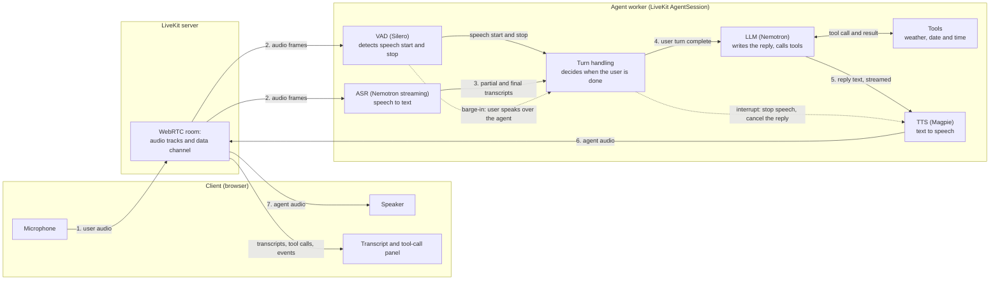
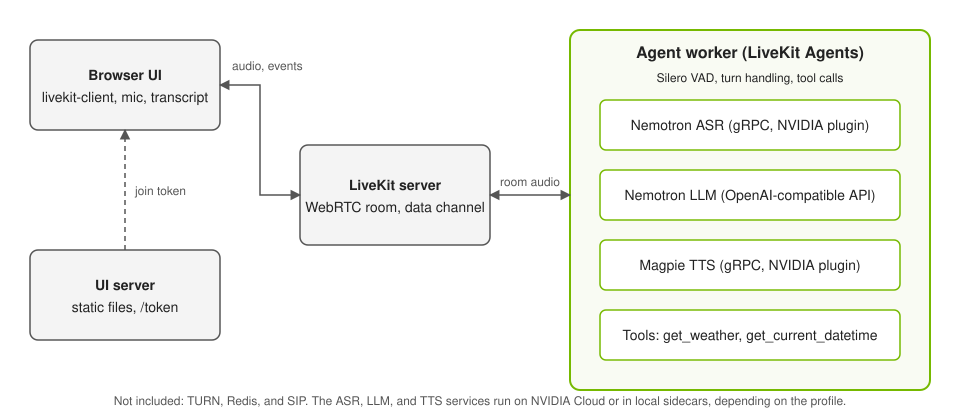

# Generic Assistant on LiveKit

This example is a cascaded voice assistant built on [LiveKit Agents](https://docs.livekit.io/agents/). The agent worker keeps automatic speech recognition (ASR), large language model (LLM), tools, and text-to-speech (TTS) as separate services. It uses Nemotron ASR through the LiveKit NVIDIA plugin, a Nemotron LLM through the OpenAI-compatible API, and Magpie TTS through the same plugin. A small web UI joins a LiveKit room, shows live transcripts, and shows each tool call.

The example is self-contained. It has its own Python environment, image, and Compose services. It does not use the Pipecat server, the React client, or [`examples_registry.yaml`](../../../examples_registry.yaml). It reuses the model recipes in [`docker/`](../../../docker) and the catalog in [`services.yaml`](../../../services.yaml), and nothing outside this folder refers to it. To move the example to another repository, replace the `extends` entries in `docker-compose.yaml` with copies of those service definitions.

## How It Works

The assistant is a cascade: each stage hands its output to the next. The following diagram shows one conversation turn, from your microphone to the agent's voice and back. Solid arrows are the normal flow. Dotted arrows are the barge-in path.



The following list describes each stage:

1. **Client.** The browser publishes your microphone to a LiveKit room over WebRTC, and plays the agent's audio. It also shows live transcripts and each tool call, which arrive over the room's data channel.
2. **VAD.** Voice activity detection runs the small Silero model on the incoming audio. It tells the agent when speech starts and stops. It does not recognize words.
3. **ASR.** Nemotron streaming ASR turns speech into text while you talk, so partial transcripts appear before you finish. Hosted ASR applies low-latency endpointing in the plugin. Self-hosted speech servers do endpointing themselves.
4. **Turn handling.** The agent combines the VAD and ASR signals to decide that your turn is complete, and then sends the final transcript to the LLM.
5. **LLM and tools.** The Nemotron LLM streams a reply. When your request matches a tool, such as the weather, it calls the tool, reads the result, and continues the reply.
6. **TTS.** Magpie TTS converts the streamed text into speech as it arrives, so the agent starts talking before the full reply exists. The audio returns through LiveKit to your speaker.
7. **Barge-in.** While the agent speaks, the VAD keeps listening. If you start talking, the agent stops speaking and cancels the rest of the reply, and your new speech becomes the next turn. If the sound turns out not to be real speech, the agent can resume. The UI shows both cases as events.

The following diagram shows the deployed components. The ASR, LLM, and TTS services run on NVIDIA Cloud or in local sidecars, depending on the profile.



## Default Models

The agent reads the first entry of each slot that the `generic-assistant` example offers in `services.yaml`. Select a different catalog entry with `LLM_SERVICE`, `ASR_SERVICE`, or `TTS_SERVICE` in `.env`. The following table lists the default entries for each profile:

| Profile | ASR | LLM | TTS |
| --- | --- | --- | --- |
| Cloud | Nemotron ASR Streaming English | Nemotron 3.5 Lightning 30B A3B | Magpie TTS Multilingual |
| Server | Nemotron ASR Streaming English (NIM) | Nemotron 3.5 Lightning 30B A3B (NIM) | Magpie TTS Multilingual (NIM) |
| Single GPU | Nemotron Speech Streaming (NeMo-Speech.cpp) | Nemotron 3.5 Lightning 30B A3B (vLLM) | Magpie TTS (NeMo-Speech.cpp) |

## Recommended Hardware

Pick the profile for your hardware. The hardware support matches the `generic-assistant` example in the [Getting Started guide](../../../docs/01-getting-started.md).

| Hardware | Profile | Notes |
| --- | --- | --- |
| No local GPU (laptop or any Docker host) | Cloud: `generic-assistant-livekit` | The speech and language models run on NVIDIA Cloud. You need `NVIDIA_API_KEY` and internet access. |
| Workstation or server GPU | Server: `generic-assistant-livekit/server` | NVIDIA NIM containers for ASR, the LLM, and TTS. Do not use this profile on DGX Spark or Jetson Thor. |
| One GPU: workstation, DGX Spark, or Jetson Thor | Single GPU: `generic-assistant-livekit/single-gpu` | vLLM for the LLM and NeMo-Speech.cpp for ASR and TTS. This is the profile for DGX Spark and Jetson Thor. |

For the Server and Single GPU profiles, use a machine that is not already running other model servers:

- **Memory:** the models start together and share the GPU. On DGX Spark and Jetson Thor, the GPU shares memory with the system, so other model containers reduce what is available.
- **Ports:** the sidecars publish host ports that must be free. The Server profile uses 9000, 9001, 50151, 50152, and 18000. The Single GPU profile uses 50051 and 18000. LiveKit uses 7880 to 7882, and the UI uses 3000. Compose reports `port is already allocated` for a conflict. Stop the other container or choose another machine.
- **Other recipes:** do not run a Pipecat recipe on the same machine at the same time.

## Running the Example

This example runs with the Cloud, Server (NVIDIA NIM), and Single GPU profiles. The Single GPU profile covers workstations, DGX Spark, and Jetson Thor. Refer to the [Getting Started guide](../../../docs/01-getting-started.md) for prerequisites and hardware detail. Run all commands from the repository root (`nemotron-voice-agent/`).

> **Run everything on one machine.** Run every step in a shell on the machine that hosts the deployment: the workstation, DGX Spark, or Jetson Thor that matches your profile (refer to [Recommended Hardware](#recommended-hardware)). Docker builds the image and starts the containers on the machine where you run the commands, and the model weights download there. Open the UI in a browser on that same machine. To use a browser on another machine, refer to [Remote Browser Access](#remote-browser-access), which includes an SSH tunnel for a laptop.

1. Clone the repository and change to its root. Skip this step if you already have a clone:

   ```bash
   git clone https://github.com/NVIDIA-AI-Blueprints/nemotron-voice-agent.git
   cd nemotron-voice-agent
   ```

2. Keep your existing `.env` file. If you do not have one, copy the example template. If you already have one for another example, add the entries from [`.env.example`](.env.example) to it:

   ```bash
   test -f .env || cp src/examples/generic_assistant_livekit/.env.example .env
   ```

3. In `.env`, set `NVIDIA_API_KEY` for the Cloud and Server profiles. For the Single GPU profile, also set `HF_TOKEN` and leave `NVIDIA_API_KEY` empty. You do not need LiveKit credentials. The `livekit-init` service generates a random API key and secret on the first run and stores them in the `livekit_state` Docker volume. They persist across `down` and restart, and `down -v` creates a new pair. To use your own, set `LIVEKIT_API_KEY` and `LIVEKIT_API_SECRET` in `.env`.

4. For the Server profile only, log in to the NVIDIA NGC container registry:

   ```bash
   set -a; . ./.env; set +a
   printf '%s' "$NVIDIA_API_KEY" | docker login nvcr.io -u '$oauthtoken' --password-stdin
   ```

5. Deploy exactly one profile that matches your hardware. **Run only one of the three options that follow.** The helper script [`run.sh`](run.sh) checks your `.env`, stops a different running profile first, and warns about busy ports and low memory. It prints each `docker compose` command that it runs.

   **Option A: Cloud.** Use this option when you have no local GPU.

   ```bash
   src/examples/generic_assistant_livekit/run.sh up cloud
   ```

   **Option B: Server with NIM.** Use this option on a workstation or server GPU. Do not use it on DGX Spark or Jetson Thor.

   ```bash
   src/examples/generic_assistant_livekit/run.sh up server
   ```

   **Option C: Single GPU.** Use this option on a workstation, DGX Spark, or Jetson Thor. Download the speech weights once, as your user, and then start the profile:

   ```bash
   bash scripts/download-nemo-speech-models.sh
   src/examples/generic_assistant_livekit/run.sh up single-gpu
   ```

   The script prints the container status after it starts them, and then waits until the sidecars are healthy. The first start of the Server and Single GPU profiles downloads and loads models, so containers show `health: starting` for a long time. The wait prints progress every 15 seconds, with the last log line of each container that is still starting. A container that shows `not ready yet` has passed its health check window, but it can still be loading: the first start of a large model can take longer than the check allows. Worry only when a container is restarting or its last log line stops changing. Press Ctrl+C to stop waiting. The containers keep running, and you can resume with the `wait` command. Connect only after the script prints `Ready to connect`. Use `--no-wait` to return right after the start:

   ```bash
   src/examples/generic_assistant_livekit/run.sh wait single-gpu          # resume waiting (or: server)
   src/examples/generic_assistant_livekit/run.sh up single-gpu --no-wait  # start and return immediately
   ```

   The script runs the following plain command, with the profile that you choose. The `--env-file .env` option makes Compose read the root `.env` for variable interpolation. Without it, Compose looks for a `.env` file next to the Compose file. Use this command directly if you prefer not to use the script:

   ```bash
   docker compose --env-file .env -f src/examples/generic_assistant_livekit/docker-compose.yaml \
     --profile generic-assistant-livekit/single-gpu up -d     # or: generic-assistant-livekit, generic-assistant-livekit/server
   ```

   The following table lists the services that each recipe profile starts:

   | Recipe profile | App services | Sidecars |
   | --- | --- | --- |
   | `generic-assistant-livekit` | `livekit-server`, `livekit-agent`, `livekit-ui` | none (cloud NVCF) |
   | `generic-assistant-livekit/server` | `livekit-server`, `livekit-agent-server`, `livekit-ui` | `livekit-nvidia-llm`, `livekit-nemotron-asr`, `livekit-magpie-tts` |
   | `generic-assistant-livekit/single-gpu` | `livekit-server`, `livekit-agent-single-gpu`, `livekit-ui` | `livekit-nvidia-llm-vllm`, `livekit-nemo-speech` |

   The sidecars extend the shared service definitions in [`docker/`](../../../docker), so they use the same images and settings as the `generic-assistant` recipes. Each sidecar has a network alias that matches the hostname in `services.yaml`.
   The agent shares the LiveKit server's network namespace, because LiveKit advertises `LIVEKIT_NODE_IP` for media. If you recreate `livekit-server`, run the same `up` command again so that Compose also recreates the agent.

6. On the same machine, open the UI at `http://localhost:3000/`, select **Connect**, and speak. Try "What is the weather in Paris?". The transcript panel shows each tool call and result.

7. Tear down when you are done:

   ```bash
   src/examples/generic_assistant_livekit/run.sh down single-gpu     # or: cloud, server. Omit the profile to stop all
   ```

Do not run this example and a Pipecat recipe at the same time. Their sidecars publish the same host ports.

## Cleanup

Use `run.sh` to stop the deployment or to delete its data:

```bash
src/examples/generic_assistant_livekit/run.sh ps                      # show containers
src/examples/generic_assistant_livekit/run.sh down single-gpu         # stop one profile (omit the profile to stop all)
src/examples/generic_assistant_livekit/run.sh clean single-gpu        # stop and delete volumes, after a confirmation
src/examples/generic_assistant_livekit/run.sh clean --image -y        # all profiles, also remove the image, no prompt
```

The `livekit-server`, `livekit-ui`, and `livekit-init` services belong to all three profiles, so a `down` for one profile also removes them. `run.sh up` stops a different running profile for you. With plain Compose, run `down` for the old profile before you start another one. Otherwise its containers keep their ports and the Compose network, and the new profile fails with `port is already allocated`.

The following table lists what each cleanup step removes and what it keeps:

| Script command | Plain command | Removes | Keeps |
| --- | --- | --- | --- |
| `run.sh down <profile>` | `docker compose ... --profile <profile> down` | Containers and the network | Volumes (generated LiveKit credentials and NIM model caches), the image, downloaded weights |
| `run.sh clean <profile>` | `docker compose ... --profile <profile> down -v` | The above, and this example's named volumes: `livekit_state`, `llm_cache`, `asr_cache`, and `tts_cache` | The example image, downloaded weights, and the pulled sidecar images |
| `run.sh clean --image` | `docker compose ... down -v`, then `docker image rm generic-assistant-livekit:latest` | The above, and the example image | Downloaded weights and the pulled sidecar images |

After a `clean`, the next start generates a new LiveKit key and secret, and the Server profile downloads the NIM models again. With `--image`, the next start also rebuilds the image. All three profiles share one image, so removing it for one profile removes it for all.

The model weights are not part of this cleanup. The pulled sidecar images (vLLM, NeMo-Speech.cpp, the NIM images, and LiveKit) are also kept. Hugging Face downloads for the Single GPU profile are in `~/.cache/huggingface`, and the NeMo-Speech.cpp weights are in `models/nemo-speech`. Other applications can share both locations, so remove them only if you know that nothing else needs them.

## Remote Browser Access

This example does not include a Traversal Using Relays around NAT (TURN) server. The UI is published on `127.0.0.1` only, and LiveKit advertises `LIVEKIT_NODE_IP` (default `127.0.0.1`), so the browser must run on the same machine as Docker. Opening the UI from another computer, for example your laptop, does not work without additional setup. The LiveKit server publishes ports 7880, 7881 (TCP), and 7882 (UDP). Browsers also allow microphone access only on `localhost` or HTTPS.

For a browser on another machine, set `LIVEKIT_NODE_IP` to the host address, serve the UI over HTTPS, and add a TURN server. The repository provides one in [`docker/docker-compose.coturn.yaml`](../../../docker/docker-compose.coturn.yaml). Refer to [Enable the TURN Server](../../../docs/how-to/enable-turn-server.md). The UI does not pass TURN credentials to LiveKit, so you must extend `ui/app.js` to use relay candidates.

### SSH Tunnel from a Laptop

To use a browser on your laptop with a deployment on another machine, forward the UI, signaling, and LiveKit TCP media ports. Run the following command on your laptop and keep it open. Replace the placeholder with your SSH host:

```bash
ssh -N -L 3000:127.0.0.1:3000 -L 7880:127.0.0.1:7880 -L 7881:127.0.0.1:7881 <user>@<host>
```

Then open `http://localhost:3000/` in the browser on your laptop. SSH cannot forward UDP, so media falls back to the TCP port 7881. This path is untested. If the connection stays on connecting or you hear no audio, use the LAN or TURN setup instead.

## Customization

| Path | Role |
| --- | --- |
| `agent.py` | LiveKit agent worker: builds ASR, LLM, and TTS clients, registers tools, and publishes UI events |
| `config.py` | Resolves endpoints from `services.yaml` for the `cloud`, `server`, and `single-gpu` recipes |
| `prompts.yaml` | Prompt and greeting for the assistant |
| `tools.py` | Plain async functions behind the weather and date tools. No LiveKit imports |
| `tool_wrapper.py` | Wraps tool functions as LiveKit tools that report calls to the UI |
| `credentials.py` | Generates the LiveKit API key and secret, writes the LiveKit server config, and shares both through the `livekit_state` volume |
| `ui_server.py` | Serves `ui/` and mints a LiveKit join token at `/token` |
| `ui/` | Web UI |
| `run.sh` | Helper script to start, stop, wait for, and clean up a profile. Runs plain `docker compose` commands |
| `docker-compose.yaml`, `Dockerfile` | LiveKit server, agent, UI, and model sidecar services, and the image the app services share |
| `.env.example` | Environment template for this example |
| `pyproject.toml`, `uv.lock` | Example-only dependencies |

To add a tool, write a function with type hints and a docstring `Args:` section in `agent.py`, add it to `TOOLS`, and mention it in `prompts.yaml`. Put the underlying logic in `tools.py`. To change models, refer to [Configure Services](../../../docs/how-to/configure-services.md). The agent applies the entry's `extra_params` and turns reasoning off, as the `settings.yaml` default does. It does not read the other editable settings.

## Dependencies

This example keeps its dependencies separate from the Pipecat environment. The root `pyproject.toml` forces `nvidia-riva-client>=2.27.0,<3`, and the example locks its own set (currently 2.28.0 in `uv.lock`). Do not merge the two environments.

> **Temporary pin:** the NVIDIA STT and TTS changes from [livekit/agents#6706](https://github.com/livekit/agents/pull/6706) merged on November 12, but no `livekit-plugins-nvidia` release contains them yet (1.8.11 predates the merge). `pyproject.toml` pins `livekit-plugins-nvidia`, `livekit-agents`, and `livekit-plugins-silero` to the merge commit `b7c9e2d0` of `livekit/agents`. When the next release ships, replace the pin with `livekit-plugins-nvidia>=1.8.12` and remove the three `[tool.uv.sources]` entries.

To run the unit tests and install the example environment without Docker, run the following commands:

```bash
uv run pytest tests/unit/test_livekit_example_tools.py tests/unit/test_livekit_example_config.py -v
uv sync --project src/examples/generic_assistant_livekit
```

## Credits

The web UI layout and styling are adapted from [aws-samples/sample-voice-agent-on-aws](https://github.com/aws-samples/sample-voice-agent-on-aws/tree/main/samples/cascading/livekit-transcribe-polly), which is licensed under MIT-0. The license text is in [THIRD_PARTY_NOTICES.txt](../../../THIRD_PARTY_NOTICES.txt). The browser loads [livekit-client](https://github.com/livekit/client-sdk-js) 2.15.3 (Apache-2.0) from the jsDelivr CDN.
