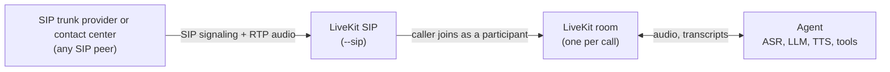

# Phone Calls (SIP) for the LiveKit Example

This guide connects the example to a phone number or a contact-center platform over standard SIP, with the open-source [LiveKit SIP](https://docs.livekit.io/sip/) service. The steps are provider-neutral: any SIP trunk provider, contact-center platform, or company PBX can deliver calls. A call becomes a LiveKit room, and the same agent answers it, with the same models and [sample use cases](README.md#sample-use-cases). Each number can map to a different use case.

SIP is optional. It adds two containers to the deployment (Redis and LiveKit SIP) and is off unless you start a profile with `--sip`. Like the TURN relay, it opens UDP ports on the host, so the same care applies: open them only to the networks that need them. The network setup is always manual: this example never changes your router or firewall. Check the steps against the current [LiveKit SIP documentation](https://docs.livekit.io/sip/) and your provider's documentation. Where a step needs provider screens, the guide shows [Twilio Elastic SIP Trunking](https://www.twilio.com/docs/sip-trunking) as one example.



| Piece | What you configure | Where |
| --- | --- | --- |
| SIP trunk provider | A trunk that points at your host | The provider's console ([step 3](#3-configure-your-sip-trunk-provider)) |
| LiveKit trunk and dispatch rule | Which number maps to which use case | `run.sh sip-setup` ([step 4](#4-map-a-number-to-a-use-case)) |
| Network | Reachability, and the provider's IP allowlist for SIP and RTP | By hand ([step 1](#1-prepare-the-network) and [IP allowlisting](#ip-allowlisting)) |

## Requirements

- **A Linux host.** LiveKit SIP and the Redis publish use host networking, which Docker supports only on Linux (a DGX Spark, a server, or a VM). On macOS and Windows `run.sh up --sip` stops with an error.
- **A host that the SIP provider can reach.** SIP and RTP are traffic that the provider opens to you from the internet. An SSH tunnel carries only connections that you open, so it cannot carry phone calls.
- **A SIP trunk provider account** with a number or extension, for example a Twilio trial number.

## 1. Prepare the network

These steps are manual. Replace the example addresses with yours.

1. **Public address.** You need a real public IPv4 address. Compare the WAN address in your router with `curl ifconfig.me`. If they differ, or the router's address starts with `100.64.` to `100.127.`, your ISP uses carrier-grade NAT (CGNAT) and inbound calls cannot reach you. Use a cloud VM instead. With a changing address, use a dynamic DNS name in the provider's origination URI.
2. **Router.** Give the host a fixed LAN address, turn off "SIP ALG" (it rewrites SIP packets and breaks calls) and UPnP, and forward only 5060 (UDP and TCP) and 10000-10100 (UDP) to the host. Never forward 22, the UI port, 7880 to 7882, 3478, or 6379.
3. **Host firewall.** A router forward cannot filter by source address, so allow only the provider on the host. Take the provider's current signaling and media ranges (see [IP allowlisting](#ip-allowlisting)) and print the commands:

   ```bash
   src/examples/generic_assistant_livekit/run.sh sip-network \
     --lan-ip 192.168.1.20 --lan 192.168.1.0/24 \
     --signaling <SIGNALING_CIDR> --media <MEDIA_CIDR>
   ```

   The command prints the checklist and the `ufw` commands for you to review and run. It changes nothing, repeats `--signaling` and `--media` as needed, and refuses an open range such as `0.0.0.0/0`.

On a cloud VM with a public IP, skip the router step and apply the same rules in the VM's security group or firewall.

Rules of thumb:

- **Allow-list the provider.** Open 5060 and the RTP range only to the provider's published ranges.
- **Keep the RTP range small.** The example uses 10000-10100, about 50 concurrent calls, so you open 100 ports, not 10,000.
- **Never expose Redis.** The example publishes it on `127.0.0.1` only and sets no password, so do not change that.
- **Phone audio is 8 kHz (G.711).** Recognition and voice quality are lower than in the browser. That is normal.

## IP allowlisting

A SIP port that accepts any source is scanned and abused within minutes. Restrict every SIP-related port to the addresses of your SIP trunk provider, in layers:

| Layer | What it restricts | How |
| --- | --- | --- |
| Host firewall (or cloud security group) | Ports 5060 (UDP and TCP) and the RTP range 10000-10100 (UDP) | The `ufw` commands from `run.sh sip-network`. This is the layer that matters most. |
| LiveKit inbound trunk | Which sources may start a call | `--allowed-address` on `run.sh sip-setup`. |
| Router | Nothing by source | A router forward cannot filter by source address, so keep the host firewall in place. |

What to allow:

- **Signaling** is the SIP traffic on port 5060 (5061 for TLS). Allow the provider's signaling addresses, which usually differ by region or by the trunk's origination setting.
- **Media** is the RTP audio on the RTP range. Allow the provider's media addresses. They are often a different, larger range than signaling.
- **Both UDP and TCP** on 5060, since a trunk can use either transport.
- **Where to find the ranges.** Ask the provider, or read its published list of SIP signaling and media IP addresses (for Twilio, the [IP addresses page](https://www.twilio.com/docs/sip-trunking/ip-addresses)). Contact-center platforms and PBXs give you their session border controller (SBC) addresses. Do not copy ranges from this guide or from an old blog post.
- **Keep them current.** Providers add and retire addresses. Review the allowlist when you change region or trunk, and when calls start failing from a new source.
- **A provider with no fixed addresses** cannot be allowlisted by IP. Use TLS with credentials or a mutual-TLS option from the provider, or put the host behind a VPN or a private link.
- **Private networks.** A platform on the same network (a PBX or SBC) needs only a private route, and the allowlist is that network's range.
- **IPv6.** The example opens IPv4 rules. Add equivalent IPv6 rules if the provider uses IPv6, and none if you do not use it.

`run.sh sip-network` takes the ranges as `--signaling` and `--media` (both can repeat; media defaults to the signaling ranges) and refuses an open range such as `0.0.0.0/0`. It prints the commands and never runs them. Verify the result from outside your network, as [step 5](#5-test-it) describes.

## 2. Start the deployment with SIP

```bash
src/examples/generic_assistant_livekit/run.sh up cloud --sip     # or server, single-gpu
```

This starts the profile plus Redis (published on `127.0.0.1:6379`) and `livekit/sip` (host network, ports 5060 and 10000-10100/udp). It writes the LiveKit and SIP configs into the state volume, with the SIP config advertising your public address (`use_external_ip: true`). Adding or removing `--sip` on a running profile restarts it; credentials and volumes are kept.

Then verify the services before you involve a provider:

```bash
src/examples/generic_assistant_livekit/run.sh check cloud sip
```

It checks that Redis is healthy and published on `127.0.0.1` only, that LiveKit SIP is running and listening on 5060, and that the recent SIP log has no errors. It prints PASS or FAIL for each check.

The plain Compose equivalent, from the repository root:

```bash
LIVEKIT_SIP=1 docker compose --env-file .env -f src/examples/generic_assistant_livekit/docker-compose.yaml \
  --profile generic-assistant-livekit --profile generic-assistant-livekit/sip up -d
```

## 3. Configure your SIP trunk provider

The exact screens depend on the provider, but every provider needs the same four things:

1. **A trunk** (or an external SIP connection) for inbound calls.
2. **A number or extension** attached to it. Trial accounts often call only verified numbers and may play a short message first.
3. **An origination target** (also called a SIP URI, destination, or peer) that points at your host: `sip:<public-ip-or-hostname>:5060`, with TCP or UDP to match what you opened. Use a dynamic DNS name if your address changes.
4. **For outbound calls (optional):** a termination address and credentials, protected by an IP access list, so that nobody else can place calls on your account.

Example with Twilio, under **Elastic SIP Trunking**: create a trunk, buy a number and attach it, add the origination URI `sip:<public-ip-or-hostname>:5060;transport=tcp`, and for outbound calls add a termination URI with a credential list and an IP access list.

## 4. Map a number to a use case

Provisioning tells LiveKit which called numbers to accept and which use case and voice each number gets. It creates records inside LiveKit and does not touch your provider, router, or firewall.

```bash
src/examples/generic_assistant_livekit/run.sh sip-setup cloud \
  --number +15551234567 --scenario bank --allowed-address <SIGNALING_CIDR>
```

This creates an inbound trunk for the number and a dispatch rule that opens a new room per call. It is safe to re-run. `--scenario` is `generic`, `insurance`, `clinic`, or `bank`, and `--voice` selects a TTS voice. Run it again with another number and use case for another line. `--allowed-address` restricts the trunk to the provider's signaling ranges and can repeat; without it the trunk accepts any source, and the command warns. The number must be in E.164 form.

The use case and voice become participant attributes, which the agent already reads for browser sessions. Unknown values fall back to the defaults.

## 5. Test it

1. Wait until the agent registers: `run.sh wait cloud`.
2. Call your number from a phone (a verified one on a trial account). You should hear the greeting of the use case you mapped.
3. Watch the logs while you call:

```bash
src/examples/generic_assistant_livekit/run.sh logs cloud sip      # INVITE received, trunk matched
src/examples/generic_assistant_livekit/run.sh logs cloud livekit  # room created, participant joined
src/examples/generic_assistant_livekit/run.sh logs cloud agent    # tool calls, errors
```

4. From a different network (a phone hotspot), check that 5060 is not reachable except from the provider.

## Troubleshooting

| Symptom | Likely cause |
| --- | --- |
| The provider says the call failed at once, and the SIP log is empty | The provider cannot reach port 5060: firewall, a wrong origination URI, or a host that is not public. Test from outside your network. If you allowlist, check that the provider's current signaling range is included. |
| The SIP log shows an INVITE, then 403, 404, or "no trunk found" | The called number is not in the trunk, or it is not in E.164 form. Run `sip-setup` again with the exact number. |
| The call connects but has no audio, or one-way audio | RTP is blocked, or the wrong address is advertised. Open the RTP range to the provider's media addresses (often a different range from signaling), and check the router's SIP ALG is off. |
| The call connects, then silence, then it hangs up | The agent is not registered, or it cannot reach the models. Check the agent log. |
| `up --sip` stops with "only on Linux" | SIP needs host networking. Run it on a Linux host. |
| It works in the browser but never by phone | The SSH tunnel does not carry phone calls. Follow step 1. |

## Security checklist

- Restrict 5060 and the RTP range to the provider's ranges ([IP allowlisting](#ip-allowlisting)). Keep Redis on `127.0.0.1`.
- SIP hosts are scanned within minutes of being exposed. Consider a non-standard SIP port in the origination URI, and watch the SIP log for repeated rejected INVITEs.
- Set geographic permissions and a spend limit with your provider, and protect outbound trunks with credentials and an IP access list, so that a leaked trunk cannot run up charges.
- Use TLS for LiveKit signaling (`wss://`) when it is reachable from the internet.
- Tell callers if you record or keep transcripts.
- The sample use cases use fictional data and a demo PIN. Do not connect them to real accounts.

## Other SIP peers

The steps above apply to any peer that can send calls to a SIP endpoint: trunk providers, contact-center platforms (for example Genesys Cloud, Five9, Amazon Connect), or a company PBX or session border controller (SBC). Points that vary:

- **Provider setup.** Create a trunk or external SIP connection on the platform and point it at your host's address and port (5060, or 5061 for TLS). The platform's administrator and documentation define how.
- **Allow the platform's addresses** in every layer of [IP allowlisting](#ip-allowlisting): the `ufw` rules, any cloud firewall, and `--allowed-address`.
- **Match the called number.** The platform sends a called number or extension. Pass it as `--number`, which need not be a real phone number.
- **Encryption.** Enterprise platforms often require TLS for signaling and SRTP for media. The LiveKit trunk has media-encryption settings and the SIP service needs a certificate for TLS. This example does not configure either.
- **Network.** A cloud platform needs a host reachable from the internet. An on-premises platform on the same network needs only a private connection, with nothing forwarded on a router.
- **Handing off to a person.** LiveKit supports SIP call transfer, but this example's agent has no handoff tool.

To test first, use a trial trunk or a SIP softphone on the same network, then switch the peer and change only the trunk address, the allowed addresses, and the number.
