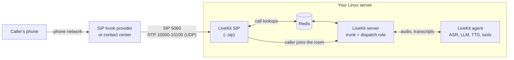
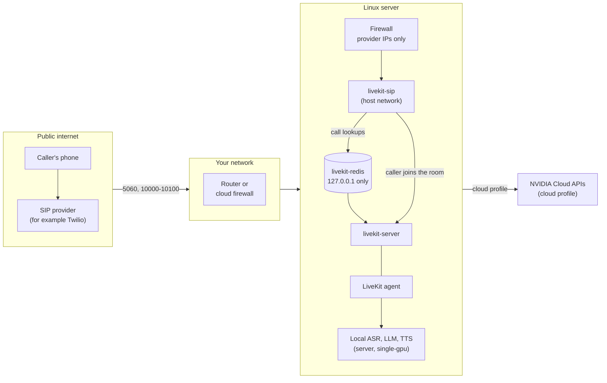

# Phone Calls (SIP) for the LiveKit Example

This guide connects the example to a phone number or contact-center platform over standard SIP, using the open-source [LiveKit SIP](https://docs.livekit.io/sip/) service. A call becomes a LiveKit room, and the same agent answers it with the same models and [sample use cases](README.md#sample-use-cases). Each number can map to a different use case.

SIP is optional and off unless you start a profile with `--sip`. It adds Redis and LiveKit SIP, and it opens port 5060 and a range of UDP ports on the server to the internet, so allow only your provider's addresses. The network setup is always manual: the example never changes your router or firewall. The steps use Twilio as the worked example, and any SIP provider works the same way. Check them against the current [LiveKit SIP](https://docs.livekit.io/sip/) and provider documentation.

## How It Works

SIP sets up and ends phone calls over IP. It carries only call control. The audio travels separately as RTP packets. A call reaches the agent through four pieces:



- **The provider** turns the phone call into a SIP call and sends it to your server.
- **LiveKit SIP** answers the call and joins a LiveKit room as the caller, turning phone audio into the same stream a browser sends.
- **The LiveKit server and Redis** decide what to do. LiveKit SIP asks the server, over Redis, whether the called number is allowed (an inbound **trunk**) and which room and use case to use (a **dispatch rule**). `run.sh sip-setup` creates both.
- **The LiveKit agent** is the same worker that serves the browser. It joins the room and the ASR, LLM, and TTS pipeline runs unchanged.

Where each component runs:



Only `livekit-sip` is reachable from the internet, and only from the provider's addresses. Everything else stays on the server. The models run where the profile puts them: the cloud profile calls the NVIDIA Cloud APIs, and the server and single-gpu profiles run them as local containers.

## Requirements

- **A Linux server.** LiveKit SIP uses host networking, which Docker supports only on Linux. On macOS and Windows `run.sh up --sip` stops with an error.
- **A server the provider can reach.** The provider opens SIP and RTP connections to you from the internet. An SSH tunnel cannot carry them.
- **A SIP provider account** with a number, for example a Twilio trial number (step 1).

## Setup Steps

Do the steps in order. Steps 1 and 2 are optional: skip one if you already have it.

| Step | What you do |
| --- | --- |
| [1. Set Up Twilio](#1-set-up-twilio-optional) | Create a trunk and a number, and get the provider's IP ranges |
| [2. Set Up the Network and Firewall](#2-set-up-the-network-and-firewall-optional) | Allow the SIP and RTP ports from the provider only |
| [3. Start the Deployment with SIP](#3-start-the-deployment-with-sip) | Start the profile with Redis and LiveKit SIP |
| [4. Map a Number to a Use Case](#4-map-a-number-to-a-use-case) | Tell LiveKit which number gets which use case |
| [5. Test It](#5-test-it) | Call the number |

## 1. Set Up Twilio (Optional)

Skip this step if you already have a trunk with a number that points at your server, and you know the provider's signaling and media ranges. This step uses [Twilio Elastic SIP Trunking](https://www.twilio.com/docs/sip-trunking). Twilio's screens and IP ranges change, so if something here does not work, check Twilio's documentation.

### 1.1 Find Your Public Address

On the server, from the repository folder:

```bash
src/examples/generic_assistant_livekit/run.sh sip-address
```

It prints the server's LAN address and network, the router's address, and the public address the internet sees. It fails if the public address is private or in the carrier-grade NAT range (`100.64.0.0/10`), because calls cannot reach you then. It changes nothing.

If you use a router, compare the printed public address with the **WAN** or **Internet** address on the router's status page. If they differ, another NAT sits in front of the router, and you need a cloud server or a public address from your ISP.

Home addresses often change. When yours does, calls stop arriving. Update the origination URI below and restart `livekit-sip`, which reads its public address only at startup. A dynamic DNS name in the URI keeps Twilio pointed at you, but you still restart `livekit-sip` after every change.

### 1.2 Create the Trunk and the Number

In the [Twilio Console](https://console.twilio.com):

1. **Create a trunk.** Go to **Elastic SIP Trunking**, then **Trunks**, then **Create new SIP Trunk**, for example named `livekit-test`.
2. **Add the origination URI.** On the trunk's **Origination** tab, add `sip:<public-ip>:5060;transport=udp`, with the address from step 1.1. Twilio sends inbound calls there.
3. **Attach a number.** On the **Numbers** tab, add a Twilio number. You call this number and pass it to `sip-setup` in E.164 form (for example `+15551234567`).
4. **Use Twilio's IP ranges.** These are the ranges that Twilio published when this guide was written (the [SIP trunking IP addresses](https://www.twilio.com/docs/sip-trunking/ip-addresses) page, last modified 2026-03-09). The firewall and the trunk accept calls only from them:

   | Use | Range |
   | --- | --- |
   | Signaling, North America (Virginia) | `54.172.60.0/30` |
   | Signaling, North America (Oregon) | `54.244.51.0/30` |
   | Signaling, Europe (Ireland) | `54.171.127.192/30` |
   | Signaling, Europe (Frankfurt) | `35.156.191.128/30` |
   | Signaling, Asia-Pacific (Tokyo) | `54.65.63.192/30` |
   | Signaling, Asia-Pacific (Singapore) | `54.169.127.128/30` |
   | Signaling, Asia-Pacific (Sydney) | `54.252.254.64/30` |
   | Signaling, South America (São Paulo) | `177.71.206.192/30` |
   | Media (RTP audio), all regions | `168.86.128.0/18` |

   Using all the signaling ranges works for any region. If calls are rejected or have no audio, compare this table with [Twilio's page](https://www.twilio.com/docs/sip-trunking/ip-addresses), because Twilio can change them.
5. **Skip termination.** Outbound calls are not needed for this test.

Trial accounts have limits: Twilio can play a notice, and you might need to verify the phone you call from. Check the trial limits first if a call is blocked.

Carry forward the public address and the phone number. The ranges are in the table above.

## 2. Set Up the Network and Firewall (Optional)

Skip this step if the SIP and RTP ports already reach the server, and only from the provider's ranges. Do it before step 3, so that port 5060 is never open to the whole internet.

Environments differ, so this is the strategy:

1. **Give the server a fixed address.** Use a DHCP reservation on the router or a static address.
2. **Run a firewall on the server that allows only the provider.** Deny incoming traffic by default, keep SSH reachable from your own network, and allow:

   | Traffic | Port | Allow from |
   | --- | --- | --- |
   | SIP signaling | 5060/UDP (add TCP only if the origination URI uses `transport=tcp`) | The provider's signaling ranges |
   | RTP audio | 10000-10100/UDP | The provider's media range |

   The UI, LiveKit, and Redis listen on `127.0.0.1`, so they need no rule. To open the web UI, use the SSH tunnel in the [README](README.md#remote-browser-access).
3. **Forward the same two ports from the internet to the server.** On a router, add port forwards to the server's LAN address, and turn off its SIP ALG and UPnP if it has them. In a cloud, open them in the security group. A forward cannot filter by source, which is why the server firewall does that. Forward nothing else.

On a server that uses `ufw` (Ubuntu-based systems, including DGX OS), print the commands for your addresses and run them one at a time. Check that an SSH rule covers where you connect from before you enable the firewall. A second SSH session helps only if it survives, so keep console access to the server as well:

```bash
src/examples/generic_assistant_livekit/run.sh sip-network \
  --lan-ip <SERVER_LAN_IP> --lan <LAN_CIDR> \
  --signaling 54.172.60.0/30 --signaling 54.244.51.0/30 \
  --signaling 54.171.127.192/30 --signaling 35.156.191.128/30 \
  --signaling 54.65.63.192/30 --signaling 54.169.127.128/30 \
  --signaling 54.252.254.64/30 --signaling 177.71.206.192/30 \
  --media 168.86.128.0/18
```

`sip-address` printed the LAN values. The firewall blocks SSH from every network it does not list, and enabling it can drop connections that are already open. If you connect from outside the LAN (a cloud server, or a VPN), add `--ssh-from <CIDR>` for that network, and add `--ssh-port <PORT>` if `sshd` does not use port 22. The command changes nothing, refuses open ranges such as `0.0.0.0/0`, and prints TCP 5060 rules that you can skip for a UDP-only trunk. Afterwards, `sudo ufw status numbered` must show a provider range, never `Anywhere`, for 5060 and 10000:10100. `livekit-sip` uses the host network, so the rules apply to it.

For production, or inside a company or cloud environment, ask your network or cloud administrator to apply the same rules with your environment's own tools. Also have them review TLS and SRTP, redundancy, and monitoring, which this guide does not cover.

## 3. Start the Deployment with SIP

```bash
src/examples/generic_assistant_livekit/run.sh up cloud --sip     # or server, single-gpu
src/examples/generic_assistant_livekit/run.sh check cloud
```

`up` starts the profile plus Redis (on `127.0.0.1:6379`) and `livekit/sip` (host network). The SIP service advertises your public address (`use_external_ip: true`, found with an outbound request at startup), so the server needs outbound internet access. `check` confirms that Redis and LiveKit SIP are healthy and listening, and that the SIP log has no errors.

The plain Compose equivalent, from the repository root:

```bash
LIVEKIT_SIP=1 docker compose --env-file .env -f src/examples/generic_assistant_livekit/docker-compose.yaml \
  --profile generic-assistant-livekit --profile generic-assistant-livekit/sip up -d
```

## 4. Map a Number to a Use Case

This creates records inside LiveKit and does not touch your provider, router, or firewall:

```bash
src/examples/generic_assistant_livekit/run.sh sip-setup cloud \
  --number +15551234567 --scenario generic \
  --allowed-address 54.172.60.0/30 --allowed-address 54.244.51.0/30 \
  --allowed-address 54.171.127.192/30 --allowed-address 35.156.191.128/30 \
  --allowed-address 54.65.63.192/30 --allowed-address 54.169.127.128/30 \
  --allowed-address 54.252.254.64/30 --allowed-address 177.71.206.192/30
```

Use your number and pass each signaling range from step 1.2 as `--allowed-address`. The command creates an inbound trunk for the number and a dispatch rule that opens a new room per call. Without `--allowed-address` the trunk accepts any source, and the command warns.

`--scenario` is `generic`, `insurance`, `clinic`, or `bank`, and `--voice` selects a TTS voice. Re-running updates the number in place, so use the same command with new values to change its use case or allowed addresses. Run it with another number for another line.

## 5. Test It

1. Wait for the agent: `run.sh wait cloud`.
2. Follow the logs in separate terminals:

   ```bash
   src/examples/generic_assistant_livekit/run.sh logs cloud sip      # INVITE received, trunk matched
   src/examples/generic_assistant_livekit/run.sh logs cloud livekit  # room created, participant joined
   src/examples/generic_assistant_livekit/run.sh logs cloud agent    # tool calls, errors
   ```

3. Call the number from your phone (a verified phone on a trial account).
   The web UI also lists the number under **Or call the agent** after a number is mapped, so people who open the UI know they can call in.
4. Expect an incoming call in the SIP log, a room named `call-...` in the LiveKit log, and then the greeting. Phone audio is 8 kHz, so recognition and voice quality are lower than in the browser. That is normal.

If a call fails, open the Twilio Console's **Monitor** logs for it. A SIP response code there shows whether the call reached your server.

To confirm the server does not answer everyone, run this from a different network, such as a phone hotspot, and not from the server:

```bash
nc -vz -w 5 <public-ip> 5060    # should time out
```

A timeout means TCP 5060 is closed. UDP cannot be tested this way, so check `ufw status` and confirm that the SIP log never shows calls from outside the provider's ranges.

### Clean Up After Testing

```bash
src/examples/generic_assistant_livekit/run.sh down cloud
```

To delete the trunk and dispatch rule records, which now survive restarts in a Docker volume, run `run.sh clean <profile>` instead (it also removes the stored credentials, so the next start generates new ones). Then remove the router's port forwards, delete the firewall rules you added, and detach or release the number and delete the trunk in Twilio, so the origination URI does not keep sending calls to an address that is no longer yours.

## IP Allowlisting

A SIP port that accepts any source is scanned and abused within minutes. Restrict it in layers:

| Layer | What it restricts | How |
| --- | --- | --- |
| Server firewall or cloud security group | 5060 and the RTP range 10000-10100 (UDP) | The commands from `run.sh sip-network` ([step 2](#2-set-up-the-network-and-firewall-optional)). This layer matters most. |
| LiveKit inbound trunk | Which sources may start a call | `--allowed-address` on `run.sh sip-setup` ([step 4](#4-map-a-number-to-a-use-case)) |
| Router | Nothing by source | A forward cannot filter by source, so keep the server firewall |

- **Signaling and media** have separate ranges, and the media range is often larger. Allow the provider's published addresses for each (for Twilio, the [IP addresses page](https://www.twilio.com/docs/sip-trunking/ip-addresses)). The Twilio ranges in step 1.2 may go out of date, so check Twilio's page if calls fail. For another provider, use its own list.
- **Transport.** A trunk with `transport=udp` needs only UDP on 5060. Add TCP if the provider uses it.
- **Keep them current.** Providers add and retire addresses, so review the list when you change region or trunk, or when calls start failing from a new source.
- **A provider with no fixed addresses** cannot be allowlisted. Use TLS with credentials or mutual TLS, or put the server behind a VPN or private link.
- **IPv6.** The example opens IPv4 rules. Add IPv6 rules if the provider uses IPv6.

## Troubleshooting

| Symptom | Likely cause |
| --- | --- |
| The provider reports a failed call and the SIP log is empty | The provider cannot reach 5060: the router forward, the origination URI or its `transport`, the server firewall (is the provider's current range allowed?), or CGNAT |
| Calls worked, then stopped arriving, and the SIP log is empty | Your public address probably changed. Run `run.sh sip-address`, update the origination URI, and restart the stack |
| The SIP log shows an incoming call, then `status 486` with `reason "no-dispatch"`, or a 403, a 404, or "no trunk found" | The call reached your server, but LiveKit has no trunk or rule for the called number. Run `sip-setup` with the exact number from the log's `toUser`, in E.164 form. If you set `--allowed-address`, check that the log's `fromIP` is in one of those ranges |
| The call connects but has no audio, or one-way audio | RTP is blocked, or the wrong address is advertised. Open the RTP range to the provider's media range, and turn off the router's SIP ALG |
| The call connects, then silence, then it hangs up | The agent is not registered, or it cannot reach the models. Check the agent log |
| `up --sip` stops with "only on Linux" | SIP needs host networking. Use a Linux server |
| It works in the browser but never by phone | The SSH tunnel does not carry phone calls. Follow [step 2](#2-set-up-the-network-and-firewall-optional) |

## Security Checklist

- Restrict 5060 and the RTP range to the provider's ranges, and keep Redis on `127.0.0.1`.
- SIP servers are scanned within minutes of being exposed. Consider a non-standard SIP port, and watch the SIP log for repeated rejected INVITEs.
- Set geographic permissions and a spend limit with your provider, and protect outbound trunks with credentials and an IP access list.
- Use TLS (`wss://`) for LiveKit signaling when it is reachable from the internet.
- Tell callers if you record or keep transcripts.
- The sample use cases use fictional data and a demo PIN. Do not connect them to real accounts.

## Serve the Web UI over the Internet (Optional, for Testing)

The same kind of network setup as [step 2](#2-set-up-the-network-and-firewall-optional) lets browsers on the internet use the web UI, which is handy for demos. It needs more ports than step 2 opens, and if you applied the step 2 firewall, it blocks them until you add the rules below. This is for testing, not for production.

1. **Point a domain at the server,** and run an HTTPS reverse proxy on it that sends `/rtc` to LiveKit and everything else to the UI. With [Caddy](https://caddyserver.com/):

   ```text
   <your-domain> {
       @livekit path /rtc /rtc/*
       reverse_proxy @livekit 127.0.0.1:7880
       reverse_proxy 127.0.0.1:3000
   }
   ```

2. **Forward these ports** from the router (or open them in the cloud security group) to the server: 443 and 80 for the proxy, and 7882/UDP and 7881/TCP for the browser's audio.

   If you applied the step 2 firewall, which denies incoming traffic by default, also allow these ports from any source. Browsers connect from anywhere, so this is the one place where the rules are not limited to a provider. Run these commands, and then `sudo ufw status numbered`:

   ```bash
   sudo ufw allow 80/tcp
   sudo ufw allow 443/tcp
   sudo ufw allow 7881/tcp
   sudo ufw allow 7882/udp
   ```

   Docker can publish container ports around `ufw`, so the last two rules might have no effect on your host. They are harmless, and they keep the setup working if your firewall does filter them.
3. **Set these in `.env`,** then restart with the same options you started with, for example `run.sh up <profile> --sip`. Without `--sip`, `up` removes the SIP service:

   ```bash
   LIVEKIT_UI_USERNAME=<username>                    # basic login, for testing
   LIVEKIT_UI_PASSWORD=<password>
   LIVEKIT_BIND=0.0.0.0                              # the audio ports must be reachable
   LIVEKIT_NODE_IP=<the server's public IP address>  # the address LiveKit gives browsers for audio
   LIVEKIT_PUBLIC_WS_URL=wss://<your-domain>         # where the page finds LiveKit signaling
   ```

If your public address changes, update `LIVEKIT_NODE_IP` and restart. The login is basic authentication for testing and is not intended as production authentication. For production, use your organization's authentication and network setup.

## Other SIP Peers

The steps apply to any peer that can send calls to a SIP endpoint: trunk providers, contact-center platforms (for example Genesys Cloud, Five9, Amazon Connect), or a company PBX or session border controller (SBC).

- **Provider setup.** Create a trunk or external SIP connection on the platform that points at your server's address and port (5060, or 5061 for TLS).
- **Allow the platform's addresses** in every layer of [IP allowlisting](#ip-allowlisting).
- **Match the called number.** Pass the number that the platform sends as `--number`, in E.164 form. `sip-setup` does not accept a bare PBX extension such as `1001`, so have the platform send a full number.
- **Encryption.** Enterprise platforms often require TLS for signaling and SRTP for media. This example configures neither.
- **Network.** A cloud platform needs a server reachable from the internet. An on-premises platform on the same network needs only a private route, with nothing forwarded on a router.
- **Handing off to a person.** LiveKit supports SIP call transfer, but this example's agent has no handoff tool.

To test first, use a trial trunk or a SIP softphone on the same network, then switch the peer and change only the trunk address, the allowed addresses, and the number.
