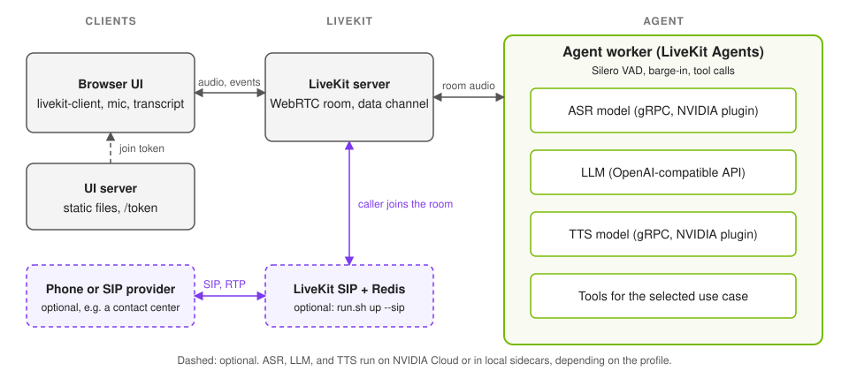

# Generic Assistant on LiveKit

The Generic Assistant on LiveKit is a Nemotron voice agent built on the [LiveKit Agents](https://docs.livekit.io/agents/) framework. By default, NVIDIA models run the three steps of the pipeline. Nemotron automatic speech recognition (ASR) turns your speech into text, a Nemotron large language model (LLM) writes the reply and calls tools, and Magpie text-to-speech (TTS) speaks it. You can choose other models, as [Configure Models](#configure-models) describes. LiveKit orchestrates the pipeline with voice activity detection, interruption (barge-in), and tool calls. Its WebRTC server carries the audio between the client and the agent in real time.

A small web UI shows live transcripts and tool calls, and lets you choose a [sample use case](#sample-use-cases) and a [voice](#voice-selection). The same agent can also answer phone calls. An optional [Session Initiation Protocol (SIP)](#phone-calls-sip) service connects a phone number, or a contact-center platform, to the agent, and each number can map to a different use case. Run the pipeline on NVIDIA Cloud (NVCF), or on your own GPU, with one of the [deployment profiles](#deployment-profiles).

## How It Works

The assistant is a cascade, in which each stage hands its output to the next. The ASR, LLM, and TTS services run on NVIDIA Cloud or in local sidecars, depending on the profile, as the following diagram shows.



Each stage has the following role:

1. **Client.** The browser sends your microphone audio to a LiveKit room over WebRTC, and plays the agent's audio. With the optional [SIP service](#phone-calls-sip), a phone caller joins the same kind of room, and the rest of the cascade is the same.
2. **VAD.** The Silero VAD model detects when you start and stop speaking.
3. **ASR.** The ASR model turns your speech into text while you talk.
4. **LLM.** The LLM writes the reply and calls the tools of the selected use case.
5. **TTS.** The TTS model speaks the reply as it streams in.
6. **Barge-in.** The VAD keeps listening while the agent speaks. If you talk over it, the agent stops, and your new speech becomes the next turn.

## Deployment Profiles

The profiles match the three modes of the repository's Pipecat examples. Choose one for your hardware. The `livekit` section of [`examples_registry.yaml`](../../../../../examples_registry.yaml) lists the services of this example. The first entry of each slot is the default, and the `LLM_SERVICE`, `ASR_SERVICE`, and `TTS_SERVICE` variables pick another catalog key from the root [`services.yaml`](../../../../../services.yaml). The following table lists the profiles and their default models.

| Profile | Compose profile | Hardware | Credentials | ASR | LLM | TTS |
| --- | --- | --- | --- | --- | --- | --- |
| Cloud | `generic-assistant-livekit` | No local GPU | `NVIDIA_API_KEY` | Nemotron ASR Streaming English | Nemotron 3.5 Lightning 30B A3B | Magpie TTS Multilingual |
| Server | `generic-assistant-livekit/server` | Workstation | `NVIDIA_API_KEY` and an NGC login | Nemotron ASR Streaming English NIM | Nemotron 3.5 Lightning 30B A3B NIM | Magpie TTS Multilingual NIM |
| Single GPU | `generic-assistant-livekit/single-gpu` | Workstation, DGX Spark, or Jetson Thor | `HF_TOKEN` | Nemotron Speech Streaming English 0.6B through NeMo-Speech.cpp | Nemotron 3.5 Lightning 30B A3B through vLLM | Magpie TTS Multilingual through NeMo-Speech.cpp |

The Server profile does not support DGX Spark or Jetson Thor. Use the Single GPU profile on those devices. The Single GPU profile is not validated on DGX Spark or Jetson Thor. The hardware support follows the [Getting Started guide](../../../../../docs/01-getting-started.md). To use other models, refer to [Configure Models](#configure-models).

The profiles get their model files as follows:

- **Cloud:** None. The models run on NVIDIA-hosted endpoints.
- **Server:** The official NVIDIA NIM containers download their models from NGC at first start. The first run can take 30 to 60 minutes.
- **Single GPU:** One NeMo-Speech.cpp sidecar loads small GGUF files for ASR and TTS. A script downloads the speech files (under 1 GB each) from Hugging Face. vLLM downloads the LLM (about 21.6 GB) at first start.

## Prerequisites

Complete the prerequisites in the [Getting Started guide](../../../../../docs/01-getting-started.md). This example needs the following software and credentials:

- **Docker with Docker Compose 2.24.4 or newer.** Check the version with `docker compose version`. The Cloud profile needs no GPU.
- **Git**, to clone the repository.
- **An NVIDIA GPU and Docker GPU support** for the Single GPU and Server profiles. Install the [NVIDIA Container Toolkit](https://docs.nvidia.com/datacenter/cloud-native/container-toolkit/latest/install-guide.html), and verify that `nvidia-smi` works inside a container. The Single GPU profile also needs NVIDIA driver 580.x or newer for NeMo-Speech.cpp.
- **[`uv`](https://docs.astral.sh/uv/) (or the Hugging Face `hf` CLI) and `curl` or `wget`** for the Single GPU profile, which uses them in its weights download script.

The credentials depend on the profile:

- **Cloud:** Set `NVIDIA_API_KEY`. Get a key from the [NVIDIA API Catalog](https://build.nvidia.com/).
- **Server:** Set `NVIDIA_API_KEY` to an NGC personal API key with the NGC Catalog service enabled, because the NIM images and models come from NGC. Refer to the [NGC Getting Started Guide](https://docs.nvidia.com/ngc/ngc-overview/index.html#registering-activating-ngc-account).
- **Single GPU:** Set `HF_TOKEN` only. Create a token with read access in your [Hugging Face settings](https://huggingface.co/settings/tokens).

For the Server and Single GPU profiles, use a machine that is not running other model servers, and check the following:

- **Memory:** On DGX Spark and Jetson Thor, the GPU shares memory with the system. Stop other model containers first.
- **Ports:** These host ports must be free: 7880 to 7882 (LiveKit), 3000 (UI), 9000, 9001, 50151, 50152, and 18000 (Server), or 50051 and 18000 (Single GPU).
- **Pipecat:** Do not run a Pipecat recipe on the same machine at the same time.

## Run the Example

Run every command from the repository root.

1. Preserve any existing `.env` file. Otherwise, copy the template, and then set the credentials that [Prerequisites](#prerequisites) lists for your profile in `.env`. If your `.env` comes from another example, add the LiveKit entries from [`.env.example`](../../../../../.env.example):

   ```bash
   test -f .env || cp .env.example .env
   ```

2. Log in to the NVIDIA NGC container registry. This step applies to the Server profile only. Skip it for Cloud and Single GPU:

   ```bash
   set -a; . ./.env; set +a
   printf '%s' "$NVIDIA_API_KEY" | docker login nvcr.io -u '$oauthtoken' --password-stdin
   ```

3. Deploy the profile that matches your hardware. Run only one profile at a time:

   ```bash
   docker compose --profile generic-assistant-livekit up -d          # Cloud
   docker compose --profile generic-assistant-livekit/server up -d   # Server

   # One GPU (incl. DGX Spark and Jetson Thor, not validated). Download speech weights once, as your user:
   bash scripts/download-nemo-speech-models.sh
   docker compose --profile generic-assistant-livekit/single-gpu up -d
   ```

   Each profile starts the following app service and sidecars. Every profile also starts `livekit-init`, which writes the LiveKit credentials and exits, and then `livekit-server` and `livekit-ui`:

   | Recipe profile | App service | Sidecars |
   | --- | --- | --- |
   | `generic-assistant-livekit` | `livekit-agent` | none (cloud NVCF) |
   | `generic-assistant-livekit/server` | `livekit-agent-server` | `livekit-nvidia-llm`, `livekit-nemotron-asr`, `livekit-magpie-tts` |
   | `generic-assistant-livekit/single-gpu` | `livekit-agent-single-gpu` | `livekit-nvidia-llm-vllm`, `livekit-nemo-speech` |

   > The sidecars extend the definitions in `docker/sidecars/`. The agent shares the network namespace of `livekit-server`. If you recreate `livekit-server`, run the same `up` command again.

   The helper script [`run.sh`](run.sh) runs the same profiles with extra checks. It checks your `.env` and the Docker Compose version, and stops a different running profile. It stops with an error if a host port is busy or, for Single GPU, if the speech weights are missing. For Single GPU, it also warns about low memory. Then it waits until the sidecars are healthy and the agent has registered with LiveKit:

   ```bash
   src/nemotron_voice_agent/livekit/examples/generic_assistant/run.sh up cloud        # Cloud
   src/nemotron_voice_agent/livekit/examples/generic_assistant/run.sh up server       # Server
   src/nemotron_voice_agent/livekit/examples/generic_assistant/run.sh up single-gpu   # Single GPU
   ```

   To also answer phone calls, add `--sip` to `run.sh up`, or add the `/sip` profile and set `LIVEKIT_SIP=1` with Compose. SIP needs a Linux host. The [SIP guide](SIP.md) covers the full setup, including the number mapping:

   ```bash
   src/nemotron_voice_agent/livekit/examples/generic_assistant/run.sh up cloud --sip   # or server, single-gpu
   # The Compose equivalent. LIVEKIT_SIP=1 is required, or `sip-setup` fails with "sip not connected (redis required)":
   LIVEKIT_SIP=1 docker compose --profile generic-assistant-livekit --profile generic-assistant-livekit/sip up -d
   ```

   The first start of the Server and Single GPU profiles downloads and loads models, which can take a long time. The script prints progress every 15 seconds. `not ready yet` is normal while a large model loads. Investigate only if a container restarts or its last log line stops changing. Connect after the script prints `Ready to connect`. To stop waiting without stopping the containers, press Ctrl+C. Use these commands to resume the wait, or to skip it:

   ```bash
   src/nemotron_voice_agent/livekit/examples/generic_assistant/run.sh wait single-gpu             # resume the wait
   src/nemotron_voice_agent/livekit/examples/generic_assistant/run.sh up single-gpu --no-wait     # start without waiting
   ```

4. Open the UI at `http://localhost:3000/` on the machine that runs Docker. For a browser on another computer, refer to [Remote Browser Access](#remote-browser-access). The header shows the deployment mode and the models in use. Choose a use case and a voice, select **Connect**, and speak.

5. Clean up when you are done by tearing down with the same profile you started with:

   ```bash
   docker compose --profile generic-assistant-livekit down              # Cloud
   docker compose --profile generic-assistant-livekit/server down       # Server
   docker compose --profile generic-assistant-livekit/single-gpu down   # Single GPU
   ```

   To stop the profile with the helper script, or to also delete the LiveKit volumes, refer to [Cleanup](#cleanup).

## Configuration

The following table lists the main files in this example.

| Path | Role |
| --- | --- |
| `agent.py` | LiveKit agent worker: ASR, LLM, and TTS, with the use case chosen in the UI |
| `config.py` | Resolves the ASR, LLM, and TTS endpoints from the shared service catalog |
| `prompts.yaml` | Prompt catalog. Each use case in `scenarios.py` reads one entry |
| `scenarios.py` | Use cases, each of which pairs a prompt from `prompts.yaml` with its own tools |
| `tools.py` | Plain helpers (date, time, and weather) behind the generic assistant's tools |
| `tool_wrapper.py` | Turns plain functions into LiveKit tools that report their calls to the web UI |
| `voices.py` | Discovers the TTS voices that a speech server offers, for the voice selector |
| `session.py` | Validates the session choices that the UI sends with the join token |
| `ui_server.py` | Serves the web UI and mints a LiveKit join token at `/token` |
| `run.sh` | Starts, checks, and cleans up the profiles, and sets up SIP |
| `sip_setup.py` | Provisions the optional phone (SIP) integration through `run.sh sip-setup` and `run.sh sip-network` |

To change the prompts or add a use case, refer to [Sample Use Cases](#sample-use-cases).

### Configure Models

The agent reads the repository's [`services.yaml`](../../../../../services.yaml) catalog, which the Pipecat examples also use. To use a different model, set one or more of these variables in `.env`:

```bash
LLM_SERVICE=nemotron-bolt-4b
ASR_SERVICE=nemotron-asr-streaming-english
TTS_SERVICE=magpie-multilingual-tts
```

Then recreate the agent of your profile (`livekit-agent`, `livekit-agent-server`, or `livekit-agent-single-gpu`). For example, this command recreates the Cloud agent:

```bash
docker compose \
  --profile generic-assistant-livekit up -d --force-recreate livekit-agent
```

To list the keys that each profile accepts, with the defaults marked, run this command from the repository root:

```bash
uv run python -m nemotron_voice_agent.livekit.examples.generic_assistant.config single-gpu   # or: cloud, server. Omit to list all
```

The profiles accept these entries:

- **Cloud:** Any listed entry works without other setup.
- **Server and Single GPU:** The entry's sidecar must be running, and [`docker/livekit/docker-compose.yaml`](../../../../../docker/livekit/docker-compose.yaml) starts only the defaults. To run another model locally, add its sidecar from `docker/sidecars/` with `extends`, and give it a network alias that matches the hostname in `services.yaml`.
- **New models:** Add an entry to `services.yaml`, and then select it.
- **Not supported:** ASR entries that use the Transcribe HTTP API, such as `nemotron-transcribe`, do not work. The LiveKit NVIDIA plugin speaks Riva gRPC.

Unlike the Pipecat examples, this example has no **Services** tab and no `settings.yaml` controls. You choose models at deploy time, and one profile serves all three slots. Only the entry's `extra_params.extra_body` applies, and reasoning is off unless the entry turns it on.

## Sample Use Cases

The **Use case** list selects the agent's prompt and tools. Choose one before you connect. It stays fixed for the session, and the generic assistant is the default. The following table lists the use cases.

| Use case | What it does | Try saying |
| --- | --- | --- |
| Generic assistant | Date, time, and live weather | "What is the weather in Paris?" |
| Insurance claims | Summit Auto Insurance: look up a policy, file a claim, and check a claim | "I was in a fender bender yesterday, my policy is AUT-1001." |
| Clinic booking | Riverside Family Clinic: find open slots, and book and cancel appointments | "I would like to see a dermatologist this week." |
| Bank assistant | Harbor Bank: verify a PIN (demo PIN 1234), then balances, transactions, transfers, and a lost card | "What is my checking balance?" |

The insurance, clinic, and bank data is fictional and held in memory for one session. Only the weather lookup calls an outside service (Open-Meteo, which needs no key). Each tool call shows in the transcript panel. To add a use case, add an entry to `prompts.yaml`, write its tool functions in `scenarios.py`, and register it in `USE_CASES`. LiveKit builds each tool schema from the type hints and the docstring `Args:` section.

## Voice Selection

The **Voice** list shows the voices that the TTS server offers. Choose a voice before you connect, or change it during the session. The agent uses the new voice from its next reply and says a short sample. The list works as follows:

- **Discovery:** The agent worker asks the TTS server for its voices when it starts, and retries until the server answers. The UI shows `Loading voices…` until then.
- **Language and default:** The list shows voices for the catalog entry's language (`en-US` by default). The default voice is Sofia when the TTS server lists her. Otherwise, it is the `voice_id` in `services.yaml`. For more information, refer to [Configure TTS](../../../../../docs/how-to/configure-tts.md#voices--emotions). The Pipecat examples keep using `voice_id`.
- **Validation:** The UI server and the agent ignore any voice that the server did not list.

## Remote Browser Access

WebRTC is always on. The LiveKit server carries the audio, with UDP on port 7882 and TCP on port 7881 as the fallback. By default, the UI and the LiveKit ports listen on `127.0.0.1`, and LiveKit advertises `LIVEKIT_NODE_IP` (default `127.0.0.1`). The browser must therefore run on the Docker machine or reach it through a tunnel. Browsers also allow the microphone only on `localhost` or HTTPS.

Run `run.sh tunnel` on the laptop and keep it open. It forwards the UI, signaling, and LiveKit TCP media ports, and it stops with an error if a local port is busy. Then open `http://localhost:3000/`. If the laptop does not have this folder, run the plain `ssh` command in the comment instead:

```bash
src/nemotron_voice_agent/livekit/examples/generic_assistant/run.sh tunnel <user>@<host>
# or: ssh -N -L 3000:127.0.0.1:3000 -L 7880:127.0.0.1:7880 -L 7881:127.0.0.1:7881 <user>@<host>
```

To start the tunnel with a plain `ssh -N <host>`, add the forwards to your SSH config on the laptop:

```text
Host spark
  HostName <host>
  User <user>
  LocalForward 3000 127.0.0.1:3000
  LocalForward 7880 127.0.0.1:7880
  LocalForward 7881 127.0.0.1:7881
```

SSH cannot forward UDP, so media falls back to TCP port 7881. To use the example from another machine without a tunnel, set `LIVEKIT_NODE_IP` (the host's LAN address), `LIVEKIT_BIND=0.0.0.0`, and `LIVEKIT_UI_BIND=0.0.0.0` in `.env`, and open the UI at the host's address. Media then flows directly over UDP port 7882. Open the host firewall for 3000/tcp, 7880/tcp, 7881/tcp, and 7882/udp, to your network only. This path uses plain HTTP, so join tokens, and any login you add, cross the network unencrypted. Use the SSH tunnel, or put Transport Layer Security (TLS) in front, on any network that you do not fully trust. A browser exposes the microphone only on HTTPS or `localhost`. A plain-HTTP address therefore needs your browser's insecure-origin setting for that address (in Chrome, `chrome://flags/#unsafely-treat-insecure-origin-as-secure`). On macOS, the browser also needs access under **System Settings** > **Privacy & Security** > **Local Network**. To find which media path a call used, open `chrome://webrtc-internals` before you connect.

For a demo over the internet, point a domain at the server and run an HTTPS reverse proxy that sends `/rtc` to LiveKit and everything else to the UI. The following example uses [Caddy](https://caddyserver.com/):

```text
<your-domain> {
    @livekit path /rtc /rtc/*
    reverse_proxy @livekit 127.0.0.1:7880
    reverse_proxy 127.0.0.1:3000
}
```

Open 80/tcp and 443/tcp for the proxy, and 7881/tcp and 7882/udp for audio, from any source. Then set the following variables in `.env`, and restart with the same `run.sh up` options that you started with:

```bash
LIVEKIT_UI_USERNAME=<username>                    # basic login, for testing
LIVEKIT_UI_PASSWORD=<password>
LIVEKIT_BIND=0.0.0.0                              # the audio ports must be reachable
LIVEKIT_NODE_IP=<the server's public IP address>  # the address LiveKit gives browsers for audio
LIVEKIT_PUBLIC_WS_URL=wss://<your-domain>         # where the page finds LiveKit signaling
```

This setup is for testing only. The login is basic authentication, and it is not production authentication. If the public address changes, update `LIVEKIT_NODE_IP` and restart.

This example does not include a Traversal Using Relays around NAT (TURN) relay. A client-server voice session has no peer-to-peer path to relay, and LiveKit falls back to TCP on port 7881 when UDP is blocked. A network that also blocks that port needs a relay over TLS on port 443. LiveKit's built-in TURN server provides one, but this example does not enable it. For more information, refer to the [LiveKit ports and firewall documentation](https://docs.livekit.io/home/self-hosting/ports-firewall/). The Pipecat examples have a separate relay, defined in [`docker/sidecars/docker-compose.coturn.yaml`](../../../../../docker/sidecars/docker-compose.coturn.yaml). For details, refer to [Enable the TURN Server](../../../../../docs/how-to/enable-turn-server.md).

The defaults keep the example private to the machine that runs it:

- **The UI server mints join tokens without authentication** unless you set `LIVEKIT_UI_USERNAME` and `LIVEKIT_UI_PASSWORD`. Each session starts an agent that uses your model quota. Keep the UI on `127.0.0.1` (`LIVEKIT_UI_BIND`) unless the network is trusted.
- **LiveKit ports 7880 to 7882 also bind to `127.0.0.1`.** `LIVEKIT_BIND=0.0.0.0` opens them. Join tokens still require the LiveKit secret.
- **SIP is off by default.** It uses host networking and opens ports to your network. Follow the [SIP guide](SIP.md) before you expose it.
- **Credentials reach only the containers that use them.** Only the cloud agent receives `NVIDIA_API_KEY`, and no application container receives `HF_TOKEN`.

## Phone Calls (SIP)

The example can also answer phone calls. `run.sh up <profile> --sip` adds Redis and the open source [LiveKit SIP](https://docs.livekit.io/sip/) service. Redis is published on `127.0.0.1` only, and it keeps the number mappings in a volume that survives restarts. `run.sh sip-setup` maps a phone number to a use case, so each number can be a different line. The web UI then shows the number under **Or call the agent**. SIP needs a Linux host that your SIP provider can reach. It listens on port 5060 and on UDP ports 10000 to 10100 of that host, so the network setup is manual and restricted to the provider's addresses. The provider-neutral [SIP guide](SIP.md) covers the network setup, IP allowlisting for your SIP trunk provider, testing, and troubleshooting, with a Twilio example.

## Cleanup

Use these commands to inspect, stop, and clean up the example:

```bash
src/nemotron_voice_agent/livekit/examples/generic_assistant/run.sh ps                 # show containers
src/nemotron_voice_agent/livekit/examples/generic_assistant/run.sh down single-gpu    # stop a profile
src/nemotron_voice_agent/livekit/examples/generic_assistant/run.sh clean single-gpu   # stop and delete the LiveKit volumes, after a confirmation
src/nemotron_voice_agent/livekit/examples/generic_assistant/run.sh clean --image -y   # all profiles, also remove the image, no prompt
```

`down` removes the containers and the network, including the optional SIP and Redis containers. It then confirms that no container of the example remains. `clean` stops the given profile, or all profiles when you omit it. It then removes the LiveKit volumes (`livekit_state` and `livekit_redis`), which all three profiles share. The next start forgets the phone numbers that `sip-setup` mapped. It also generates new LiveKit credentials, unless you set `LIVEKIT_API_KEY` and `LIVEKIT_API_SECRET` in `.env`. `--image` also removes the example image, which the next start rebuilds. The plain commands are `docker compose --profile <profile> --profile generic-assistant-livekit/sip down`, `docker volume rm nemotron-voice-agent_livekit_state nemotron-voice-agent_livekit_redis`, and `docker image rm generic-assistant-livekit:latest`. Do not run `down -v`. The Compose project is shared with the Pipecat examples, so `-v` also deletes their model caches.

Cleanup never removes the NIM model caches, the downloaded weights (`~/.cache/huggingface` and `models/nemo-speech`), or the pulled sidecar images, because the Pipecat examples and other applications share them. `run.sh up` stops a different running profile for you. With plain Compose, run `down` for the old profile first, or its containers keep their ports.

## Tips and Best Practices

Follow these practices:

- **Run one deployment at a time.** `run.sh up` stops a different running LiveKit profile. Do not run a Pipecat recipe on the same machine at the same time.
- **Keep the example private.** Keep the UI and the LiveKit ports on `127.0.0.1`, and use the SSH tunnel from another computer. Refer to [Remote Browser Access](#remote-browser-access).
- **Keep the shared volumes.** Use `run.sh clean` instead of `docker compose down -v`, which also deletes the model caches of the Pipecat examples. Refer to [Cleanup](#cleanup).

## Troubleshooting

Check the agent log first with `src/nemotron_voice_agent/livekit/examples/generic_assistant/run.sh logs <profile> agent`. The following list covers common symptoms:

- **Transcripts appear but the agent does not answer (Cloud):** The hosted LLM is probably rate limited. The log shows `429 Too Many Requests`, and the UI shows a warning. Wait a minute, or choose another model, for example `LLM_SERVICE=nemotron-bolt-4b`.
- **`LLM was busy. Retrying.` in the transcript panel:** A call failed briefly, and LiveKit retried it. The conversation continues. A rate-limited call shows `(rate limited, HTTP 429)` in the note, and an ASR or TTS failure shows `STT` or `TTS` instead of `LLM`.
- **The Voice list is empty or shows `Default voice (list unavailable)`:** The TTS server has not answered yet. A hosted endpoint can take up to 30 seconds when cold, and a local sidecar answers after it loads its models.
- **`port is already allocated`:** Another container holds a host port. Refer to [Prerequisites](#prerequisites) and [Cleanup](#cleanup).

For phone calls, refer to [Troubleshooting](SIP.md#troubleshooting) in the SIP guide. For general failure modes, refer to the [Troubleshooting guide](../../../../../docs/06-troubleshooting.md).
