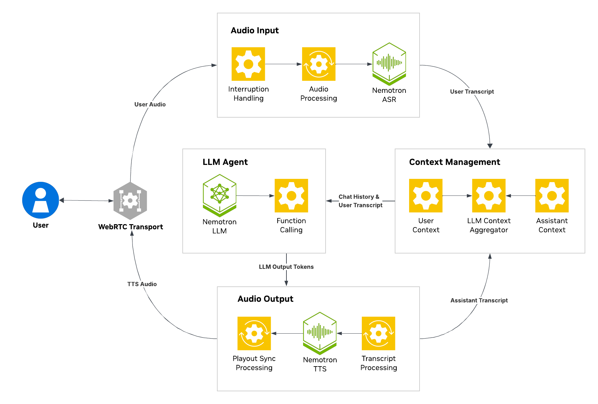

# Generic Assistant Cascaded Pipeline Example

Generic cascaded voice pipeline using Pipecat's built-in NVIDIA services (`NvidiaSTTService` -> `NvidiaLLMService` with function calling -> `NvidiaTTSService`). It keeps ASR, LLM, tools, and TTS as separate services. Word-level input streaming and timestamp-based LLM context commits require `NvidiaWordTTSService` with Magpie TTS Multilingual NIM 1.10.0 or newer. Refer to [Configure TTS](../../../../../docs/how-to/configure-tts.md#word-level-input-streaming-and-timestamps).



## Default Models

The `services` lists under `pipecat.examples` in [`examples_registry.yaml`](../../../../../examples_registry.yaml) resolve to the following default models for each profile. Service entries live in the root [`services.yaml`](../../../../../services.yaml):

| Profile | ASR | LLM | TTS |
| --- | --- | --- | --- |
| Cloud | Nemotron ASR Streaming English | Nemotron 3.5 Lightning 30B A3B | Magpie TTS Multilingual |
| Server | Nemotron ASR Streaming English NIM | Nemotron 3.5 Lightning 30B A3B NIM | Magpie TTS Multilingual NIM |
| Server Performance | Nemotron ASR Streaming English NIM | Nemotron 3.5 Lightning 30B A3B NIM with a pinned NVFP4 TP2 profile | Magpie TTS Multilingual NIM with `batch_size=64` |
| Single GPU | Nemotron Speech Streaming English 0.6B through NeMo-Speech.cpp | Nemotron 3.5 Lightning 30B A3B through vLLM, with chat completions or streaming input | Magpie TTS Multilingual through NeMo-Speech.cpp |
| Dynamo | Nemotron ASR Streaming English NIM | Nemotron 3.5 Lightning 30B A3B through NVIDIA Dynamo, with chat completions or streaming input | Magpie TTS Multilingual NIM |

## Running the Example

This example runs with **Cloud**, **Server** (NIM), benchmark-only **Server Performance** (NIM), universal **Single GPU**, and **Dynamo** profiles. Server and Dynamo are workstation-only (not DGX Spark or Jetson Thor). The performance profile uses the dedicated four-GPU Blackwell layout and pinned NVFP4 TP2 LLM profile documented in the [scaling benchmark](../../../../../benchmarking_tools/scaling-perf/README.md#reproducing-the-recommended-scaling-setup). Older hardware requires a compatible TP2 profile. It runs 200 Uvicorn workers for load testing and is not intended for normal browser UI sessions. The single-gpu profile covers workstations, DGX Spark, and Jetson Thor. Refer to the [Getting Started guide](../../../../../docs/01-getting-started.md) for prerequisites and hardware detail. Run commands from the repository root.

1. Create `.env` only if it does not exist:

   ```bash
   test -f .env || cp .env.example .env
   ```

2. Set the credentials for your browser recipe. Cloud and Server use `NVIDIA_API_KEY`.

   > **Single-GPU profile:** set `HF_TOKEN` in `.env` only. Do not set `NVIDIA_API_KEY` or log in to `nvcr.io`. This profile serves the LLM with vLLM, which downloads model weights from Hugging Face. The Server and Performance Server profiles use NIMs from NGC (`NVIDIA_API_KEY`) and do not use `HF_TOKEN`.

   > **Dynamo profile:** set both `NVIDIA_API_KEY` and `HF_TOKEN` in `.env`. The ASR and TTS NIMs come from NGC, and the Dynamo worker downloads the Lightning weights from Hugging Face. Refer to [Run Nemotron 3.5 Lightning on NVIDIA Dynamo](../../../../../docs/how-to/configure-llm.md#run-nemotron-35-lightning-on-nvidia-dynamo).

3. [Log in to the NGC registry](../../../../../docs/01-getting-started.md#log-in-to-the-ngc-registry) for Server or Dynamo only.

4. Download the speech assets for Single-GPU only. Run the script as your user, not with `sudo`. Resolve any VAD build warnings before starting.

   ```bash
   bash scripts/download-nemo-speech-models.sh
   ```

5. Start one browser recipe. Substitute a profile from the table for `<recipe>`. For `server-perf`, use the benchmark procedure linked above instead.

   ```bash
   docker compose --profile <recipe> up -d
   ```

   Each recipe starts the following services:

   | Recipe profile | App service | Sidecars |
   | --- | --- | --- |
   | `generic-assistant` | `generic-assistant` | none (cloud NVCF) |
   | `generic-assistant/server` | `generic-assistant-server` | `nvidia-llm`, `nemotron-asr-streaming-english`, `magpie-multilingual-tts-service` |
   | `generic-assistant/server-perf` | `generic-assistant-server-perf` | `nvidia-llm-perf`, `nemotron-asr-streaming-english-perf`, `magpie-multilingual-tts-service-perf` |
   | `generic-assistant/single-gpu` | `generic-assistant-single-gpu` | `nvidia-llm-vllm-lightning`, `nemo-speech-asr`, `nemo-speech-tts` |
   | `generic-assistant/dynamo` | `generic-assistant-dynamo` | `dynamo-frontend`, `dynamo-lightning-worker`, `nemotron-asr-streaming-english`, `magpie-multilingual-tts-service` |
   > The standard Lightning `server` deployment uses NIM's automatic compatible-profile selection. The `single-gpu` deployment uses its hardware-aware vLLM configuration. The four-GPU `server-perf` benchmark pins NVFP4 TP2 for Blackwell. On older hardware, change it to a compatible TP2 profile as described in [Configure LLM](../../../../../docs/how-to/configure-llm.md).

6. Open the UI at `https://localhost:7860/`. Keep TLS enabled for the browser and the scaling benchmark. For plain-HTTP browser testing, refer to [Browser Access](../../../../../docs/06-troubleshooting.md#browser-access).

7. For Dynamo, [verify the self-hosted Dynamo model](../../../../../docs/01-getting-started.md#deployment-steps) first. Select **Connect**.
8. Allow microphone access if prompted.
9. Ask an English question after the greeting. The assistant should answer aloud.
10. Select **Disconnect** to end the session.
11. Stop the deployment with the profile you started:

   ```bash
   docker compose --profile <recipe> down
   ```

For a host-native run, follow [Local Development Without Docker](../../../../../docs/01-getting-started.md#optional-local-development-without-docker).

## Transcribe ASR

For whole-turn transcription instead of streaming ASR, follow [Run Transcribe With a Server Recipe](../../../../../docs/how-to/configure-asr.md#run-transcribe-with-a-server-recipe) or [Run Transcribe With a Single-GPU Recipe](../../../../../docs/how-to/configure-asr.md#run-transcribe-with-a-single-gpu-recipe). Transcribe does not supply speaker labels.

## Customization

| Path | Role |
| --- | --- |
| `pipeline.py` | Pipecat entry point for the generic example |
| `prompts.yaml` | example-local prompt catalog. Each entry may list `tools_available` to gate function calling per prompt |
| `tools.yaml` | OpenAI function-calling schemas, keyed by tool name |
| `tool_handlers.py` | async handlers for each schema in `tools.yaml`, exposed through the `TOOL_HANDLERS` registry |
| `tools.py` | builds a filtered `ToolsSchema` from `tools.yaml` for the tool names a prompt requests, skipping entries without a matching handler |

To change models, voices, prompts, or tool wiring, see [Configure Services](../../../../../docs/how-to/configure-services.md), [Configure LLM](../../../../../docs/how-to/configure-llm.md), [Configure ASR](../../../../../docs/how-to/configure-asr.md), [Configure TTS](../../../../../docs/how-to/configure-tts.md), and [Configure Prompts](../../../../../docs/how-to/configure-prompts.md).

## Speaker Labels

Optional. Select **Generic Assistant** with an ASR entry that sets `speaker_diarization_supported: true`, then turn on **Diarization** in **Speaker Labels** before you connect. Default prompts follow the first speaker. `multi_speaker_assistant` labels every speaker and answers only when called by name. Refer to [Enable Speaker Labels](../../../../../docs/how-to/enable-speaker-labels.md).

## Tips and Best Practices

- **Start from this baseline.** The generic example is intentionally minimal. Add domain logic, custom tools, and deployment-specific service choices on top of it rather than starting from scratch.
- **Pick the model for the deployment.** Nemotron 3.5 Lightning is the default across profiles. Nemotron 3.5 Super VL is a higher-capability alternative that runs on NVIDIA Cloud, or self-hosted with the `nemotron-35-super-vl` (server) or `nemotron-35-super-vl-single-gpu` profile. Refer to [Run Nemotron 3.5 Super VL](../../../../../docs/how-to/configure-llm.md#run-nemotron-35-super-vl) for commands, sizing, and precision. After you start Super VL, select it in the Services tab, then disconnect and connect again if a session is already running. Nemotron 3.5 Bolt 74B is another self-hosted alternative for Blackwell workstation GPUs and DGX Spark that you start with the `nemotron-35-bolt-single-gpu` profile. Nemotron 3.5 Bolt E4B is a compact option that runs on NVIDIA Cloud, or self-hosted with the `nemotron-35-bolt-e4b` (server) or `nemotron-35-bolt-e4b-single-gpu` profile. Select `nemotron-bolt-74b` or `nemotron-bolt-4b` in the Services tab. Refer to [Run Nemotron 3.5 Bolt 74B](../../../../../docs/how-to/configure-llm.md#run-nemotron-35-bolt-74b) and [Run Nemotron 3.5 Bolt E4B](../../../../../docs/how-to/configure-llm.md#run-nemotron-35-bolt-e4b).
- **Tune turn-taking and latency** with the shared pipeline knobs in [Tune Pipeline Performance](../../../../../docs/how-to/tune-pipeline-performance.md).
- For deployment, ASR/LLM/TTS, and general failure modes, see the [Troubleshooting guide](../../../../../docs/06-troubleshooting.md).
