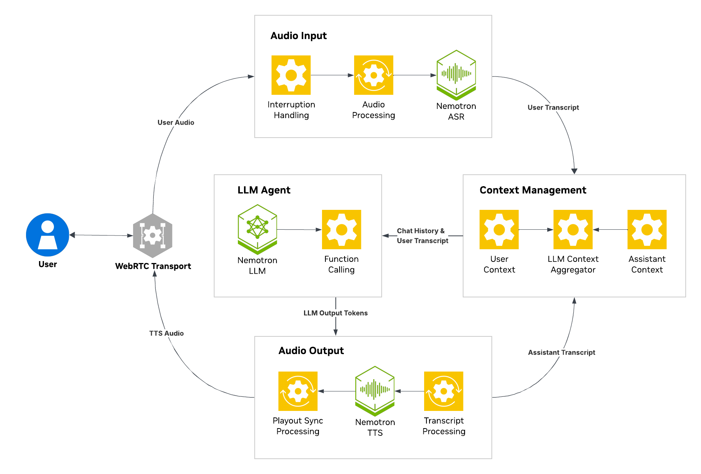

# Multilingual Assistant Cascaded Pipeline Example

Multilingual cascaded voice pipeline using Pipecat's built-in NVIDIA services (`NvidiaSTTService` -> `NvidiaLLMService` -> `NvidiaTTSService`). The session is locked to a single language for the whole connection (selected in the UI, default `de-DE`): the ASR, the TTS voice, and the LLM all operate in that one language. The LLM replies with plain spoken text, kept on-language by the fixed-session prompt addon and a per-turn reminder.

The pattern uses dedicated ASR, LLM, and TTS services with a plain-text response, a per-turn language reminder injected at request time only, and a clean chat history that stores just the spoken reply.



## Default Models

The `services` lists under `pipecat.examples` in [`examples_registry.yaml`](../../../../../examples_registry.yaml) resolve to the following default models for each profile. Service entries live in the root [`services.yaml`](../../../../../services.yaml):

| Profile | ASR | LLM | TTS |
| --- | --- | --- | --- |
| Cloud | Parakeet 1.1B RNNT Multilingual ASR | Nemotron 3.5 Lightning 30B A3B | Magpie TTS Multilingual |
| Server | Nemotron ASR Streaming Multilingual NIM | Nemotron 3.5 Lightning 30B A3B NIM | Magpie TTS Multilingual NIM |
| Single GPU | Nemotron 3.5 ASR Streaming Multilingual 0.6B through NeMo-Speech.cpp | Nemotron 3.5 Lightning 30B A3B through vLLM | Magpie TTS Multilingual through NeMo-Speech.cpp |
| Dynamo | Nemotron ASR Streaming Multilingual NIM | Nemotron 3.5 Lightning 30B A3B through NVIDIA Dynamo, with chat completions | Magpie TTS Multilingual NIM |

The registry lists `nemotron-asr-streaming-multilingual` first for ASR, so it is the default on Server and Single GPU. It has no NVIDIA Cloud endpoint, so the Cloud recipe uses the next key, `parakeet-rnnt`.

## Running the Example

This example runs with **Cloud**, **Server** (NIM, recommended for scaling), universal **Single GPU**, and **Dynamo** profiles. Server and Dynamo are workstation-only (not DGX Spark or Jetson Thor). The single-gpu profile covers workstations, DGX Spark, and Jetson Thor. Refer to the [Jetson Thor guide](../../../../../docs/03-jetson-thor.md) when applicable. Refer to the [Getting Started guide](../../../../../docs/01-getting-started.md) for prerequisites and hardware detail. Run every command from the repository root.

1. Create `.env` only if it does not exist:

   ```bash
   test -f .env || cp .env.example .env
   ```

2. Set the credentials for your recipe. Cloud and Server use `NVIDIA_API_KEY`.

   > **Single GPU:** set `HF_TOKEN` in `.env` only. Do not set `NVIDIA_API_KEY` or log in to `nvcr.io`. This recipe serves the LLM with vLLM, which downloads model weights from Hugging Face.

   > **Dynamo:** set both `NVIDIA_API_KEY` and `HF_TOKEN` in `.env`. The ASR and TTS NIMs come from NGC, and the Dynamo worker downloads the Lightning weights from Hugging Face. Refer to [Run Nemotron 3.5 Lightning on NVIDIA Dynamo](../../../../../docs/how-to/configure-llm.md#run-nemotron-35-lightning-on-nvidia-dynamo).

3. [Log in to the NGC registry](../../../../../docs/01-getting-started.md#log-in-to-the-ngc-registry) for Server or Dynamo only.

4. Download the speech assets for Single-GPU only. Run the script as your user, not with `sudo`.

   ```bash
   bash scripts/download-nemo-speech-models.sh
   ```

5. Start one recipe. Substitute a profile from the table for `<recipe>`.

   ```bash
   docker compose --profile <recipe> up -d
   ```

   Each recipe starts the following services:

   | Recipe profile | App service | Sidecars |
   | --- | --- | --- |
   | `multilingual-assistant` | `multilingual-assistant` | none (cloud NVCF) |
   | `multilingual-assistant/server` | `multilingual-assistant-server` | `nvidia-llm`, `nemotron-asr-streaming-multilingual`, `magpie-multilingual-tts-service` |
   | `multilingual-assistant/single-gpu` | `multilingual-assistant-single-gpu` | `nvidia-llm-vllm-lightning`, `nemo-speech-asr-multilingual`, `nemo-speech-tts` |
   | `multilingual-assistant/dynamo` | `multilingual-assistant-dynamo` | `dynamo-frontend`, `dynamo-lightning-worker`, `nemotron-asr-streaming-multilingual`, `magpie-multilingual-tts-service` |

6. Open the UI at `https://localhost:7860/`. Keep TLS enabled for the browser and the scaling benchmark. For plain-HTTP API testing, refer to [Browser Access](../../../../../docs/06-troubleshooting.md#browser-access).

7. For Dynamo, [verify the self-hosted Dynamo model](../../../../../docs/01-getting-started.md#deployment-steps) before connecting. Then follow [Testing](#testing) to check the session language.
8. Select **Disconnect** to end the session.
9. Stop the deployment with `docker compose --profile <recipe> down` using the same recipe.

For a [host-native run](../../../../../docs/01-getting-started.md#optional-local-development-without-docker), use `multilingual-assistant` as `pipecat.selection`.

## Transcribe ASR

For whole-turn transcription, follow [Run Transcribe With a Server Recipe](../../../../../docs/how-to/configure-asr.md#run-transcribe-with-a-server-recipe) or [Run Transcribe With a Single-GPU Recipe](../../../../../docs/how-to/configure-asr.md#run-transcribe-with-a-single-gpu-recipe). Choose the language you plan to speak in **Voice Settings** before connecting. The assistant sends that language with each Transcribe request.

## Customization

TTS voices and supported language codes are discovered at runtime by prewarming the configured TTS service. The UI language selector contains only locales supported by the selected ASR, TTS, and built-in LLM. Changing the LLM refreshes that compatible set. The selected session language is injected into the prompt and passed to the ASR and the TTS voice for the whole connection. If you omit the session language in an API request, the registry default (`de-DE`) applies. An explicit session language overrides it. For Magpie and Chatterbox TTS language coverage, see [Configure TTS](../../../../../docs/how-to/configure-tts.md#supported-languages).

| Path | Role |
| --- | --- |
| `pipeline.py` | pipecat entry point, multilingual mode always on |
| `prompts.yaml` | multilingual prompt catalog (`multilingual_voice_assistant`) |

### How It Works

1. The user selects a locale compatible with the active ASR, TTS, and LLM in the UI (default `de-DE`) before connecting.
2. The session language is passed to the ASR and pins the TTS voice when the connection starts. It does not change mid-session.
3. The fixed-session prompt addon instructs the LLM to reply only in that language, and the LLM returns plain spoken text (no JSON, labels, or metadata) that flows straight to TTS, the client transcript, and chat history.
4. `PerTurnReminderProcessor` re-states the "reply only in <language>" reminder on each user turn at request time only, so the reminder never pollutes stored history.

### Switching the Multilingual ASR Model

**Parakeet 1.1B RNNT Multilingual** offers stronger multilingual recognition quality at higher latency (see [Model Selection Notes](#model-selection-notes)). To run it instead of the default Nemotron ASR Streaming Multilingual on-prem:

1. In [`examples_registry.yaml`](../../../../../examples_registry.yaml), under `pipecat.examples.multilingual-assistant`, set `services.asr: [parakeet-rnnt, nemotron-asr-streaming-multilingual]`.
2. Redeploy with the recipe profile plus the Parakeet profile. Each ASR sidecar publishes its own host port, so both can run when the GPU has room. Scale the Nemotron sidecar off to free its GPU:

   ```bash
   # Server
   docker compose --profile multilingual-assistant/server \
     --profile parakeet-rnnt-asr up -d --scale nemotron-asr-streaming-multilingual=0
   ```

3. Switch back to Nemotron by reversing the registry edit and redeploying the stock on-prem recipe.

## Tips and Best Practices

### Model Selection Notes

Multilingual behavior depends on the ASR model, the LLM, and the selected TTS voice. Use the notes below when choosing a deployment profile or setting expectations for demo and validation runs.

| Component | Recommendation and trade-offs |
| --- | --- |
| Nemotron ASR Streaming Multilingual | Prefer this model when latency and throughput are the main constraints. It is faster in this pipeline, but recognition quality is currently weaker for a few languages. Since the session language is fixed, its pinned-language recognition is a good fit here. In noisy environments, it can occasionally emit an empty transcript for turns, so the user may need to repeat themselves. A good microphone and reduced background noise help. |
| Parakeet 1.1B RNNT Multilingual | Prefer this model when multilingual recognition quality matters more than raw latency. Chinese recognition is generally better than Nemotron ASR in this setup. The trade-off is slower latency and throughput. It can also miss the first word of an utterance in some cases and may produce occasional false transcripts when the microphone is muted or no user speech is intended, so validate turn-start and silence handling for production. |
| Nemotron 3.5 Super VL LLM | **Recommended for multilingual.** Use it on NVIDIA Cloud, or start it with the `nemotron-35-super-vl` (server) or `nemotron-35-super-vl-single-gpu` profile. Then select it in the Services tab. Supports English, German, Spanish, French, Italian, Japanese, and Chinese. Stays more reliably in the fixed session language and delivers stronger conversation quality across that set, especially where Nemotron 3.5 Lightning is weaker. |
| Nemotron 3.5 Bolt 74B LLM | Self-hosted alternative for Blackwell workstation GPUs and DGX Spark. Start it with the `nemotron-35-bolt-single-gpu` profile, then select `nemotron-bolt-74b` in the Services tab. It supports English, German, Spanish, French, Italian, and Japanese. Refer to [Run Nemotron 3.5 Bolt 74B](../../../../../docs/how-to/configure-llm.md#run-nemotron-35-bolt-74b). |
| Nemotron 3.5 Bolt E4B LLM | Compact conversational option with a low time to first token (TTFT). Use it on NVIDIA Cloud, or start it with the `nemotron-35-bolt-e4b` (server) or `nemotron-35-bolt-e4b-single-gpu` profile. Then select `nemotron-bolt-4b` in the Services tab. It supports English, German, Spanish, French, Italian, and Japanese. Refer to [Run Nemotron 3.5 Bolt E4B](../../../../../docs/how-to/configure-llm.md#run-nemotron-35-bolt-e4b). |
| Nemotron 3.5 Lightning LLM | Useful for lower latency, lower resource usage, and faster local experiments. It supports English, German, Spanish, French, Italian, and Japanese. Conversation quality is weaker in some languages, and with reasoning disabled it can occasionally slip in foreign words on quantized builds, so the fixed-session prompt addon and the per-turn reminder both enforce a single language. Prefer Nemotron 3.5 Super VL when multilingual quality matters. |

### Testing

1. In the running app, open **Voice Settings**, choose a session language, and select **Connect**.
2. Speak in the selected language. Verify that the transcript shows what you said and the assistant replies in that language.
3. To test the reply language, speak in another language and check whether the assistant continues replying in the selected session language.
4. To change the session language, select **Disconnect**, choose another language in **Voice Settings**, and reconnect.

### Troubleshooting

| Issue | Cause | What to check |
|-------|-------|---------------|
| Bot responds in the wrong language | LLM ignored the fixed session language | Confirm the fixed-session prompt addon and per-turn reminder name the selected language. Try the larger Nemotron 3.5 Super VL LLM |
| Bot slips in foreign words | Quantized small-model sampling artifacts | Lower the LLM Temperature in the Services tab (or set a `temperature` default under `settings` in `examples_registry.yaml`), or use a larger LLM |
| Session language is unavailable or startup is rejected | The selected locale is not supported by the active ASR, TTS, or built-in LLM | Select a locale shown in Voice Settings. For built-in LLM support, see [Configure LLM](../../../../../docs/how-to/configure-llm.md#multilingual-session-languages). |
| Japanese or Chinese is missing from Voice Settings on single-GPU | Magpie TTS on NeMo-Speech.cpp does not advertise `ja-JP` or `zh-CN` | Expected on `multilingual-assistant/single-gpu` with any built-in LLM. Use the cloud or `multilingual-assistant/server` recipe for these languages. See [Configure LLM](../../../../../docs/how-to/configure-llm.md#multilingual-session-languages). |
| TTS uses the wrong voice or language | Selected session language is not supported by the active TTS service | Check the configured TTS service exposes that language code, or pick a supported language |
| No voices discovered at startup | TTS prewarm failed | For Cloud, confirm `NVIDIA_API_KEY` in `.env`. For Server, also confirm NGC login and TTS sidecar health with `docker compose ps`. For Single-GPU, confirm that the `nemo-speech-tts` sidecar is running and `models/nemo-speech` contains the downloaded weights. |
| Bot does not respond to a turn (no transcript) | Nemotron ASR Multilingual can drop a turn in noisy environments | Speak again, reduce background noise, and use a good microphone. See [Configure ASR](../../../../../docs/how-to/configure-asr.md#choosing-a-multilingual-asr-model) |
| Weak or awkward replies in some languages | Nemotron 3.5 Lightning has weaker conversation quality in a few languages | Use Nemotron 3.5 Super VL for better multilingual quality. See [Configure LLM](../../../../../docs/how-to/configure-llm.md) |
| Random ASR text while silent | Parakeet RNNT noise sensitivity | Expected with the Parakeet opt-in. The default Nemotron ASR is less prone to this. Otherwise reduce room noise and use a good mic |

For ASR, LLM, and TTS model details and general failure modes, see [Configure ASR](../../../../../docs/how-to/configure-asr.md), [Configure TTS](../../../../../docs/how-to/configure-tts.md), [Configure LLM](../../../../../docs/how-to/configure-llm.md), and the [Troubleshooting guide](../../../../../docs/06-troubleshooting.md).
