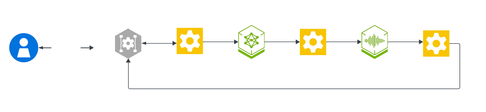

# Nemotron Omni Assistant - cascaded pipeline example

Cascaded voice pipeline that uses Nemotron 3 Nano Omni as a single model for ASR and the LLM, then hands the text reply to Magpie TTS. Nemotron Omni consumes user audio directly and produces the assistant text that Magpie TTS speaks. This example enables only text and audio inputs. Uploaded media and webcam vision are covered by [`omni-assistant-subagents`](../omni_assistant_subagents/README.md).

The pattern replaces the separate ASR and text LLM stages with one audio-input LLM service while preserving the familiar Pipecat transport, TTS, prompt, and service-catalog flow. It showcases Pipecat's `NvidiaOmniLLMService`, audio-only turn finalization with Pipecat's turn analyzer strategy, and a user transcript taken from the Omni response rather than a separate ASR pipeline.



## Default Models

The `services` lists under `pipecat.examples` in [`examples_registry.yaml`](../../../../../examples_registry.yaml) resolve to the following default models for each profile. Service entries live in the root [`services.yaml`](../../../../../services.yaml):

| Profile | Audio-input LLM | TTS |
| --- | --- | --- |
| Cloud | Nemotron 3 Nano Omni 30B A3B Reasoning | Magpie TTS Multilingual |
| Server | Nemotron 3 Nano Omni 30B A3B Reasoning NIM | Magpie TTS Multilingual NIM |
| Single GPU | Nemotron 3 Nano Omni 30B A3B Reasoning through vLLM | Magpie TTS Multilingual through NeMo-Speech.cpp |

Nemotron Omni handles both speech recognition and response generation, so this example does not configure a separate ASR model.

## Running the Example

This example runs with **Cloud**, **Server** (Omni NIM + NIM TTS, recommended for scaling), and universal **Single GPU** profiles. Server is workstation-only (not DGX Spark or Jetson Thor). The single-gpu profile covers workstations, DGX Spark, and Jetson Thor. See the [Getting Started guide](../../../../../docs/01-getting-started.md) for prerequisites and hardware detail. Run every command from the repository root.

1. Create `.env` only if it does not exist:

   ```bash
   test -f .env || cp .env.example .env
   ```

2. Set `NVIDIA_API_KEY` in `.env` for Cloud or Server, or `HF_TOKEN` for Single-GPU. The Single-GPU vLLM service downloads Omni weights from Hugging Face.
3. Log in to the NVIDIA NGC container registry (Server only. Skip for Cloud and Single GPU):

   ```bash
   set -a; . ./.env; set +a
   printf '%s' "$NVIDIA_API_KEY" | docker login nvcr.io -u '$oauthtoken' --password-stdin
   ```

4. Download the speech assets for Single-GPU only. Run the script as your user, not with `sudo`.

   ```bash
   bash scripts/download-nemo-speech-models.sh
   ```

5. Start one recipe from the table. Substitute its profile for `<recipe>`.

   ```bash
   docker compose --profile <recipe> up -d
   ```

   Each recipe starts the following services:

   | Recipe profile | App service | Shared sidecars pulled from `docker/sidecars/` |
   | --- | --- | --- |
   | `omni-assistant` | `omni-assistant` | none (cloud NVCF) |
   | `omni-assistant/server` | `omni-assistant-server` | `nvidia-llm-omni`, `magpie-multilingual-tts-service` |
   | `omni-assistant/single-gpu` | `omni-assistant-single-gpu` | `nvidia-llm-vllm-omni`, `nemo-speech-tts` |

   > The single-GPU recipe uses the Omni vLLM sidecar and takes TTS from the on-device NeMo-Speech.cpp `nemo-speech-tts` service instead of the NIM sidecars. Jetson Thor (128 GB unified memory) fits the 30B Omni NVFP4 model. Follow the [Jetson Thor guide](../../../../../docs/03-jetson-thor.md). Orin-class Jetson hardware is not supported because the models do not fit.

6. Open the UI at `https://localhost:7860/`. Keep TLS enabled for browser UI testing. `PIPELINE_TLS=false` serves plain HTTP for headless performance and API testing. For plain-HTTP browser testing, see [browser access](../../../../../docs/06-troubleshooting.md#browser-access).

7. Select **Connect**.
8. Allow microphone access if prompted.
9. Ask a question after the greeting. Expect a spoken reply from Magpie TTS without a separate ASR service.
10. Select **Disconnect** to end the session.
11. Stop the deployment with `docker compose --profile <recipe> down` using the same recipe.

For a [host-native run](../../../../../docs/01-getting-started.md#optional-local-development-without-docker), use `omni-assistant` as `pipecat.selection`.

## Customization

| Path | Role |
| --- | --- |
| `pipeline.py` | pipecat entry point for the Omni Assistant example, built on `pipecat.services.nvidia.omni.llm.NvidiaOmniLLMService` |
| `prompts.yaml` | example-local prompt catalog |

Environment variables read by [`pipeline.py`](pipeline.py):

| Env var | Default | Purpose |
| --- | --- | --- |
| `OMNI_MAX_TOKENS` | `8192` | Max tokens for the Omni response |
| `OMNI_TEMPERATURE` | `0.6` | Sampling temperature |
| `OMNI_TOP_P` | `0.95` | Nucleus sampling top-p |
| `OMNI_MIN_USER_AUDIO_SECS` | `0.3` | Drop turns shorter than this |
| `TTS_STOP_FRAME_TIMEOUT_S` | `30` | TTS audio-context idle timeout |
| `AUDIO_OUT_10MS_CHUNKS` | `5` (WebRTC) / `10` (WebSocket) | Outbound audio framing |

For model selection, voices, and shared service-catalog mechanics, see [Configure LLM](../../../../../docs/how-to/configure-llm.md), [Configure TTS](../../../../../docs/how-to/configure-tts.md), and [Configure Services](../../../../../docs/how-to/configure-services.md).

## Tips & best practices

- **Omni model and hardware.** The Server recipe uses the `nvidia-llm-omni` NIM sidecar with automatic model-profile selection. The Single-GPU recipe uses `nvidia-llm-vllm-omni` and selects the model precision from the GPU at startup. Blackwell workstations, DGX Spark, and Jetson Thor use NVFP4. Hopper and Ada use FP8. See [Configure LLM](../../../../../docs/how-to/configure-llm.md#vram--hardware-support).
- **Tune Omni behavior** with the environment variables in the table above: raise the minimum-audio threshold if noise triggers spurious turns, and adjust max-tokens and sampling for your latency and verbosity targets.
- For deployment and general failure modes, see the [Troubleshooting guide](../../../../../docs/06-troubleshooting.md). VRAM sizing for the Omni vLLM sidecar is covered in [Configure LLM](../../../../../docs/how-to/configure-llm.md#vram--hardware-support), and edge deployment in the [Jetson Thor guide](../../../../../docs/03-jetson-thor.md).
