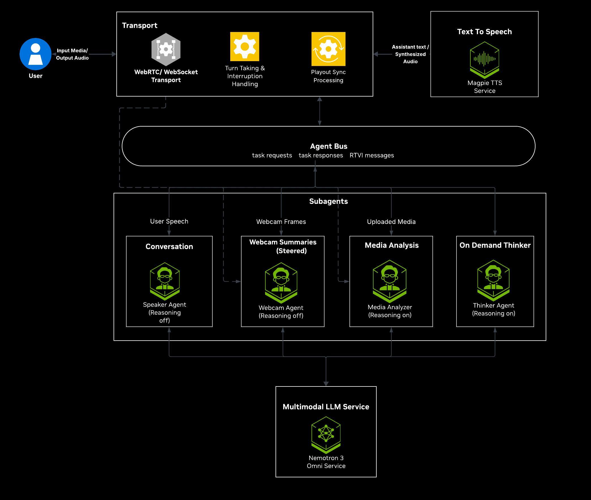

# Nemotron 3 Omni Assistant Subagents - cascaded pipeline example

Multi-agent variant of [`omni-assistant`](../omni_assistant/README.md) built on Pipecat's built-in multi-agent framework (`pipecat.workers`). A transport agent owns I/O and TTS, a speaker agent owns spoken output, and worker agents handle uploaded media, live webcam vision, and deliberate reasoning. It keeps the voice conversation responsive while specialized agents analyze uploaded media and live webcam frames and escalate difficult turns to a reasoning pass.

The pattern splits responsibility across a transport agent, speaker agent, media analyzer, webcam agent, and thinker using `pipecat.workers`, with explicit dispatch and acknowledgement points. It showcases agent boundaries and prompt separation, visual barge-in, deferred media dispatch, rolling webcam scene summaries, on-demand high-resolution capture, proactive hand-gesture behavior, and UI capability declarations for attachments and webcam support.



## Default Models

The `services` lists under `pipecat.examples` in [`examples_registry.yaml`](../../../../../examples_registry.yaml) resolve to the following default models for each profile. Service entries live in the root [`services.yaml`](../../../../../services.yaml):

| Profile | Audio-input LLM | TTS |
| --- | --- | --- |
| Cloud | Nemotron 3 Nano Omni 30B A3B Reasoning | Magpie TTS Multilingual |
| Server | Nemotron 3 Nano Omni 30B A3B Reasoning NIM | Magpie TTS Multilingual NIM |
| Single GPU | Nemotron 3 Nano Omni 30B A3B Reasoning through vLLM | Magpie TTS Multilingual through NeMo-Speech.cpp |

Nemotron Omni handles both speech recognition and response generation, so this example does not configure a separate ASR model. The agents share this model and apply role-specific prompts and reasoning settings.

## Running the Example

This example runs with **Cloud**, **Server** (Omni NIM + NIM TTS, recommended for scaling), and **Single GPU** profiles. Server is workstation-only (not DGX Spark or Jetson Thor). The single-gpu profile covers workstations and DGX Spark. It is **not supported on Jetson Thor**. See the [Getting Started guide](../../../../../docs/01-getting-started.md) for prerequisites and hardware detail. Run every command from the repository root.

1. Create `.env` only if it does not exist:

   ```bash
   test -f .env || cp .env.example .env
   ```

2. Set `NVIDIA_API_KEY` in `.env` for Cloud or Server, or `HF_TOKEN` for Single-GPU. The Single-GPU vLLM service downloads Omni weights from Hugging Face.
3. Log in to the NVIDIA NGC container registry (Server only. Skip for Cloud and Single GPU):

   ```bash
   set -a; . ./.env; set +a
   printf '%s' "$NVIDIA_API_KEY" | docker login nvcr.io -u '$oauthtoken' --password-stdin
   ```

4. Download the speech assets for Single-GPU only. Run the script as your user, not with `sudo`.

   ```bash
   bash scripts/download-nemo-speech-models.sh
   ```

5. Start one recipe from the table. On Jetson Thor, choose the Cloud profile.

   ```bash
   docker compose --profile <recipe> up -d
   ```

   Substitute a profile from the following table for `<recipe>`:

   | Recipe profile | App service | Shared sidecars pulled from `docker/sidecars/` |
   | --- | --- | --- |
   | `omni-assistant-subagents` | `omni-assistant-subagents` | none (cloud NVCF) |
   | `omni-assistant-subagents/server` | `omni-assistant-subagents-server` | `nvidia-llm-omni`, `magpie-multilingual-tts-service` |
   | `omni-assistant-subagents/single-gpu` | `omni-assistant-subagents-single-gpu` | `nvidia-llm-vllm-omni`, `nemo-speech-tts` |

6. Open the UI at `https://localhost:7860/`. Keep TLS enabled for browser UI testing. `PIPELINE_TLS=false` serves plain HTTP for headless performance and API testing. For plain-HTTP browser testing, see [browser access](../../../../../docs/06-troubleshooting.md#browser-access).

7. Select **Connect**.
8. Allow microphone access if prompted.
9. Ask a question. Expect a spoken reply from the speaker agent.
10. Select **Disconnect** to end the session.
11. Stop the deployment with `docker compose --profile <recipe> down` using the same recipe.

For a [host-native run](../../../../../docs/01-getting-started.md#optional-local-development-without-docker), use `omni-assistant-subagents` as `pipecat.selection`.

## Customization

| Path | Role |
| --- | --- |
| `pipeline.py` | entry point that wires the five workers into a `WorkerRunner` over a shared `WorkerBus` |
| `subagents/speaker/agent.py` | `SpeakerOmniAgent` plus a structured-JSON wrapper around Pipecat's `NvidiaOmniLLMService` |
| `subagents/transport/agent.py` | `OmniTransportAgent` for transport I/O, TTS, visual barge-in, analyzer dispatch, and the pinned subagent state board |
| `subagents/media_analyzer/agent.py` | `MediaAnalyzerWorker` for uploaded image, audio, and video attachments |
| `subagents/webcam/agent.py` | `WebcamAgent` rolling scene summaries for live webcam context |
| `subagents/thinker/agent.py` | `ThinkerWorker` reruns difficult or low-confidence turns with reasoning enabled |
| `media_dispatch_processor.py` | frame-processor that defers analyzer dispatch until the speaker ack closes |
| `subagents.yaml` | source of truth for worker capabilities, routing rules, reasoning modes and budgets, and UI labels |
| `prompts.yaml` | example-local prompt catalog (top-level prompt plus `agent_prompts:` per agent) |

The example declares `capabilities: [attachments, webcam]` under `pipecat.examples.omni-assistant-subagents` in `examples_registry.yaml`, which gates these UI surfaces and backend endpoints:

| Endpoint | Purpose |
| --- | --- |
| `POST /api/sessions/{session_id}/attachments?kind={image,audio,video}` | Upload a media attachment for the media analyzer |
| `POST /api/sessions/{session_id}/webcam/frames` | Upload one webcam JPEG frame |
| `GET /api/webcam-config` | Browser webcam capture defaults |

## Tips & best practices

- **Keep the voice loop responsive.** Media, webcam, and reasoning analysis run as separate worker agents so the transport and speaker agents never block on vision or reasoning work. Preserve that split when adding new capabilities.
- **Reuse the deferred-dispatch pattern.** `media_dispatch_processor.py` holds analyzer dispatch until the current spoken turn finishes, which avoids cutting the user off. Reuse it for any new asynchronous worker.
- **Model selection and VRAM** follow the Omni sizing in [Configure LLM](../../../../../docs/how-to/configure-llm.md). For deployment and general failure modes, see the [Troubleshooting guide](../../../../../docs/06-troubleshooting.md).
